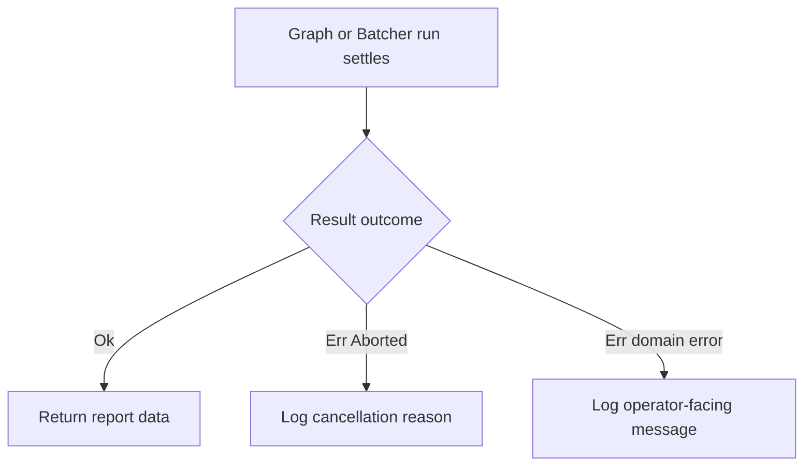

<!-- BUNDLE_SIZE:START -->

> 62 B minified + gzipped

<!-- BUNDLE_SIZE:END -->

An operator closes a dashboard while an export is running. The network request stops, the graph
stops scheduling, and the caller receives... something. Without a shared shape, every engine reports
that stop differently, and the handler that logs it grows a branch per engine.

## Core Behavior

`Aborted` describes work that stopped because its caller cancelled it:

```ts
type Aborted = { readonly kind: "Aborted"; readonly reason: unknown };
```

Cancellable engines settle with this shape instead of inventing their own cancelled variant.

- `Aborted.make(reason)` creates the outcome; engines pass `signal.reason`.
- `Aborted.is(value)` narrows any discriminated `{ kind }` value to `Aborted`.
- `reason` is `unknown`: it is whatever was passed to `AbortSignal.abort(reason)`.

Cancellation is reported by every cancellable engine, so one check covers the source. Reach for
`Aborted` when work can be stopped from outside; reach for [`Result`](/guides/result/) when the work
itself fails. The [choosing guide](/basics/choosing/) covers the async engines that produce it.

## Example: Nightly Report Export

A report exporter runs a dependency graph, then batches customer lookups for each section. Either
stage can stop early when the operator closes the dashboard. Both stages report the stop the same
way, so the outer handler does not need to know which engine cancelled.

`Result.mapError` rewrites domain errors into a single operator-facing message; `Aborted` passes
through unchanged because it is not an application error:



### Handling Both Stages

The graph and the batcher share the same cancellation contract. A single `Aborted.is` check covers
either source:

```ts
import { Aborted, Deferred, Graph, pipe, Result } from "@pplnd/core";

interface ReportInput {
  readonly month: string;
}

type ExportError =
  | { readonly kind: "MissingSource"; readonly source: string; }
  | { readonly kind: "LookupFailed"; readonly message: string; };

declare const reportGraph: Graph<ExportError, string, ReportInput>;

const describe = (error: ExportError | Aborted): string => {
  if (Aborted.is(error)) {
    return `Export cancelled: ${String(error.reason)}`;
  }
  return error.kind === "MissingSource"
    ? `Source ${error.source} did not publish last month`
    : error.message;
};

const exportReport = async (controller: AbortController): Promise<string> => {
  const summary = pipe(
    Graph.run({ month: "2026-10" }, { signal: controller.signal })(reportGraph),
    Deferred.map((result: Result<ExportError | Aborted, string>) =>
      Result.match({
        ok: (file) => `Report written to ${file}`,
        err: describe,
      })(result)
    ),
  );

  return summary;
};

controller.abort("operator closed the dashboard");
console.log(await exportReport(controller));
// Export cancelled: operator closed the dashboard
```

The run settles with a value either way. Cancellation is not a thrown exception, so no `try`/`catch`
is involved.

### When one task cancels a batch

`Task.Result.all` settles the whole batch with `Aborted` as soon as the caller's signal fires, even
though the individual tasks report their own outcome. The batch result keeps the shared contract, so
the same `describe` handler works without a second branch:

```ts
import { Result, Task } from "@pplnd/core";

const sections = await Task.Result.all([
  loadRevenue("2026-10"),
  loadChurn("2026-10"),
  loadPipeline("2026-10"),
])(controller.signal);

if (Result.is.err(sections)) {
  return describe(sections.error); // Export cancelled: ...
}
```

The [`Task.Result` guide](/guides/task/) covers `all` and how the caller's signal reaches each task.

## Core Operations

| Signature              | What it does                                           | Return type |
| :--------------------- | :----------------------------------------------------- | :---------- |
| `Aborted.make(reason)` | Builds a cancellation outcome from an optional reason. | `Aborted`   |
| `Aborted.is(value)`    | Narrows a discriminated `{ kind }` value to `Aborted`. | boolean     |

## Failure Behavior and Edge Cases

`Aborted` is a settled value, not an exception. `is` returns `false` for every other `kind`,
including cancelled-looking variants from older code such as `"GraphAborted"`.

The `reason` is passed through unchanged. It can be `undefined` when the signal was aborted without
an argument, so format it defensively rather than assuming a message.

Cancellation is only reported when the engine observes the signal. Work that ignores its
`AbortSignal` keeps running until it finishes; the engine settles with `Aborted` immediately and
discards the eventual result.
