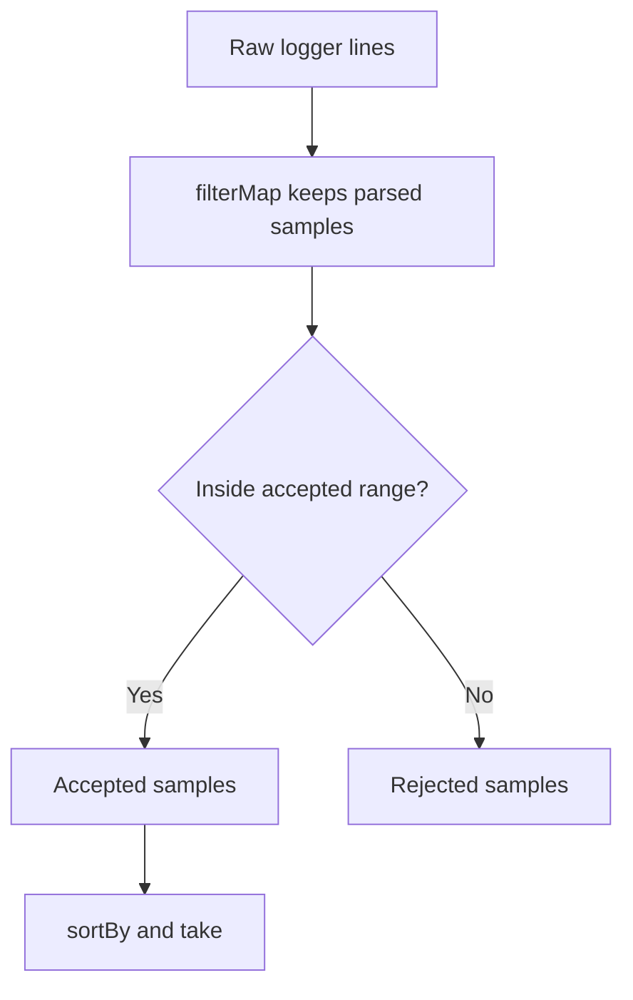

<!-- BUNDLE_SIZE:START -->

> 6.45 kB minified + gzipped

<!-- BUNDLE_SIZE:END -->

A cold-chain logger writes one temperature sample per line. A failed probe appears in the export as
the text `FAULT`, so a parser that converts every line produces `NaN` and a later report shows a
temperature that was never measured. Separating the broken lines from the good ones by hand also
changes the order of the containers.

## Core Behavior

`Arr` provides data-last operations for readonly arrays. Functions that can miss return `Maybe`; no
operation modifies the input array.

- `partition` returns matching items first, then the rest; `partitionMap` and `partitionMaybe`
  return failures first.
- `groupBy` returns a record whose values are non-empty arrays; `indexBy` returns a map and keeps
  the last item per key.
- `at`, `head`, and `findFirst` return `None` instead of throwing or returning `undefined`.
- `traverse.Result` stops at the first error, while `traverse.Validation` collects every error.

Reach for `Arr` when order matters and indices must stay safe. When items are keyed by a string,
[`Rec`](/guides/rec/) holds the groups in a plain object. The [choosing guide](/basics/choosing/)
places the collection modules side by side.

## Example: Cold-Chain Temperature Samples

A logger reports samples from two refrigerated containers. The export mixes numeric readings with
probe-fault lines, and the quality report needs the accepted readings, the rejected ones, and the
coldest accepted samples.

`filterMap` parses lines and drops the faults in one pass; `partition` then splits the parsed
samples without reordering them:



### Reading the Temperature Log

```ts
import { Arr, Maybe, pipe, Str } from "@pplnd/core";

type Line = { container: string; raw: string };
type Sample = { container: string; celsius: number };

const lines: readonly Line[] = [
  { container: "RC-104", raw: "4.5" },
  { container: "RC-104", raw: "FAULT" },
  { container: "RC-219", raw: "9.5" },
  { container: "RC-219", raw: "5.0" },
];

const toSample = (line: Line): Maybe<Sample> =>
  pipe(
    Str.parse.float(line.raw),
    Maybe.map((celsius) => ({ container: line.container, celsius })),
  );

const samples = pipe(lines, Arr.filterMap(toSample));
const [accepted, rejected] = pipe(
  samples,
  Arr.partition((sample: Sample) => sample.celsius >= -2 && sample.celsius <= 8),
);
const coldest = pipe(
  accepted,
  Arr.sortBy((first: Sample, second: Sample) => first.celsius - second.celsius),
  Arr.take(2),
);

accepted;
// [{ container: "RC-104", celsius: 4.5 }, { container: "RC-219", celsius: 5 }]
rejected;
// [{ container: "RC-219", celsius: 9.5 }]
coldest;
// [{ container: "RC-104", celsius: 4.5 }, { container: "RC-219", celsius: 5 }]
```

The fault line never reaches `partition`; `filterMap` returned `None` for it. `accepted` and
`rejected` both keep the order of the export, and `take` returns the whole array when the count
exceeds its length.

### Handoff: Grouping Samples by Container

`Arr.groupBy` returns a record whose values are typed as non-empty arrays, so the first sample of
each container can be read without unwrapping a `Maybe`:

```ts
import { Arr, Rec, pipe } from "@pplnd/core";

const byContainer = pipe(accepted, Arr.groupBy((sample: Sample) => sample.container));
const leads = pipe(
  byContainer,
  Rec.map((group: Arr.NonEmpty<Sample>) => Arr.NonEmpty.head(group)),
);
// { "RC-104": { container: "RC-104", celsius: 4.5 }, "RC-219": { container: "RC-219", celsius: 5 } }
```

Each group came from at least one sample, and the type records that fact.
[Non-Empty Collections](/guides/nonempty/) shows the guards that produce the same guarantee from
untyped data.

## Core Operations

### Creating and Slicing

| Signature                                             | What it does                                          | Result                            |
| :---------------------------------------------------- | :---------------------------------------------------- | :-------------------------------- |
| `Arr.prepend(item)` / `Arr.append(item)`              | Adds an item at the start or end.                     | `NonEmptyArr<A>`                  |
| `Arr.intersperse(item)` / `Arr.concat(other)`         | Inserts a separator between items / joins two arrays. | An array                          |
| `Arr.chunksOf(size)` / `Arr.windowed(size, { step })` | Splits into fixed chunks / sliding windows.           | Arrays; empty for an invalid size |
| `Arr.chunkBy(keySelector)`                            | Groups consecutive items that share a key.            | Arrays of arrays                  |
| `Arr.unfold(seed, step)`                              | Builds items until the callback returns `None`.       | An array                          |

### Reading and Searching

| Signature                                                                           | What it does                                         | Result                                                  |
| :---------------------------------------------------------------------------------- | :--------------------------------------------------- | :------------------------------------------------------ |
| `Arr.head` / `Arr.last` / `Arr.tail` / `Arr.init`                                   | Reads an end or the remaining items.                 | `Maybe`; `None` for an empty array                      |
| `Arr.at(index)`                                                                     | Reads an index; negative indices count from the end. | `Maybe`; `None` for a non-integer or out-of-range index |
| `Arr.findFirst(predicate)` / `Arr.findLast(predicate)` / `Arr.findIndex(predicate)` | Finds an item or its index.                          | `Maybe`                                                 |
| `Arr.findMap(transform)`                                                            | Finds the first `Some` produced by the callback.     | `Maybe`                                                 |
| `Arr.is.empty` / `Arr.is.nonEmpty` / `Arr.size`                                     | Checks emptiness or reads the length.                | Boolean or count; `is.nonEmpty` narrows                 |
| `Arr.some(predicate)` / `Arr.every(predicate)`                                      | Tests items; stops at the first decisive item.       | Boolean                                                 |

### Transforming

| Signature                                                                                                              | What it does                                                 | Result                                                               |
| :--------------------------------------------------------------------------------------------------------------------- | :----------------------------------------------------------- | :------------------------------------------------------------------- |
| `Arr.map(transform)` / `Arr.mapWithIndex(transform)`                                                                   | Transforms items; the indexed form receives `(index, item)`. | A new array                                                          |
| `Arr.filter(predicate)` / `Arr.filterMap(transform)`                                                                   | Keeps matching items / `Some` results.                       | A new array                                                          |
| `Arr.compact(items)`                                                                                                   | Unwraps a `Maybe` array and drops `None`.                    | Array of values                                                      |
| `Arr.partition(predicate)` / `Arr.partitionMap(transform)` / `Arr.partitionMaybe(transform)` / `Arr.separate(items)`   | Splits into two arrays.                                      | `partition` puts matches first; the others put failures first        |
| `Arr.uniq` / `Arr.uniqBy(keySelector)` / `Arr.uniqWith(areEqual)` / `Arr.dedupeAdjacent()`                             | Removes duplicates.                                          | `uniq` uses same-value equality; `dedupeAdjacent` compares neighbors |
| `Arr.sortBy(compare)` / `Arr.sortWith(ordering)` / `Arr.reverse`                                                       | Reorders items.                                              | A new sorted array                                                   |
| `Arr.take(count)` / `Arr.drop(count)` / `Arr.takeWhile(predicate)` / `Arr.dropWhile(predicate)` / `Arr.splitAt(index)` | Selects a portion.                                           | An array or a pair of arrays                                         |
| `Arr.insertAt(index, item)` / `Arr.removeAt(index)`                                                                    | Inserts or removes one item.                                 | A new array, or the input for an invalid index                       |
| `Arr.scan(initial, reducer)`                                                                                           | Records every intermediate accumulator.                      | One entry per item                                                   |

### Combining, Grouping, and Running

| Signature                                                                                    | What it does                                   | Result                                                 |
| :------------------------------------------------------------------------------------------- | :--------------------------------------------- | :----------------------------------------------------- |
| `Arr.zip(other)` / `Arr.zipWith(combine)(other)`                                             | Pairs items from two arrays.                   | Stops at the shorter array                             |
| `Arr.flatten(items)` / `Arr.flatMap(transform)`                                              | Flattens one level / maps then flattens.       | A new array                                            |
| `Arr.groupBy(keySelector)`                                                                   | Groups items under string keys.                | `Record<string, NonEmptyArr<A>>`                       |
| `Arr.indexBy(keySelector)` / `Arr.frequencies(items)`                                        | Builds a map from items / counts each value.   | `ReadonlyMap`; `indexBy` keeps the last item per key   |
| `Arr.reduce(initial, reducer)`                                                               | Accumulates from an initial value.             | The final accumulator                                  |
| `Arr.traverse.Maybe/Result/Validation(transform)` / `Arr.traverse.Task(transform, options?)` | Maps items into a container and combines them. | `Maybe`, `Result`, `Validation`, or `Task` of an array |
| `Arr.sequence.Maybe/Result/Validation(items)` / `Arr.sequence.Task(items, options?)`         | Combines already-created containers.           | The same container around an array                     |

### Working with Non-Empty Arrays

| Signature                                                                             | What it does                                         | Result                                |
| :------------------------------------------------------------------------------------ | :--------------------------------------------------- | :------------------------------------ |
| `Arr.is.nonEmpty(items)` / `Arr.NonEmpty.from.array(items)`                           | Refines an array with at least one item.             | Type guard / `Maybe<Arr.NonEmpty<A>>` |
| `Arr.NonEmpty.singleton(item)`                                                        | Creates a one-item array.                            | `Arr.NonEmpty<A>`                     |
| `Arr.NonEmpty.head(items)` / `Arr.NonEmpty.last(items)` / `Arr.NonEmpty.tail(items)`  | Reads an end or the remaining items without `Maybe`. | Item or array; `tail` may be empty    |
| `Arr.NonEmpty.map(transform)` / `mapWithIndex` / `intersperse` / `concat` / `reverse` | Transforms a non-empty array.                        | `Arr.NonEmpty`                        |
| `Arr.NonEmpty.reduce(reducer)`                                                        | Folds from the first item.                           | The final accumulator                 |

## Failure Behavior and Edge Cases

`Arr.at` returns `None` for a non-integer index and for an index outside the array, including a
negative index that counts past the start. `take`, `drop`, and `splitAt` normalize their count:
`NaN` and negative values become 0, `Infinity` becomes the array length, and a fraction is floored
before clamping. `insertAt` ignores a non-integer index and clamps an integer one; `removeAt`
returns the input array for any index it cannot use.

```ts
import { Arr } from "@pplnd/core";

Arr.at(1.5)(["a", "b"]); // None
Arr.take(-2)(["a", "b"]); // []
Arr.splitAt(Number.POSITIVE_INFINITY)(["a", "b"]); // [["a", "b"], []]
Arr.insertAt(1.5, "c")(["a", "b"]); // ["a", "b"]
Arr.removeAt(4)(["a", "b"]); // ["a", "b"]
```

`chunksOf` returns an empty array unless its size is a positive integer. `windowed` returns an empty
array when the size or step is not a positive integer, or when the size exceeds the input length;
overlapping windows are allowed when the step is smaller than the size.

`partition` keeps the input order in both outputs; `partitionMaybe` puts the original failures first
and the unwrapped successes second. `groupBy` takes string keys and preserves item order inside each
group. `uniq` compares with same-value equality and `dedupeAdjacent` with `Object.is` unless a
custom equality is supplied. `indexBy` keeps the last item for a repeated key.

`traverse.Result` stops at the first `Err` and `traverse.Maybe` at the first `None`;
`traverse.Validation` collects errors from every item before it fails, as
[`Validation`](/guides/validation/) does for fields. `sequence` receives containers that were
already created, so the callbacks that produced them have already run; use `traverse` when the
callback itself must be skipped after a failure. `traverse.Task` returns a task that runs every
callback and forwards the abort signal to each one; `concurrency` limits how many tasks run at once.
