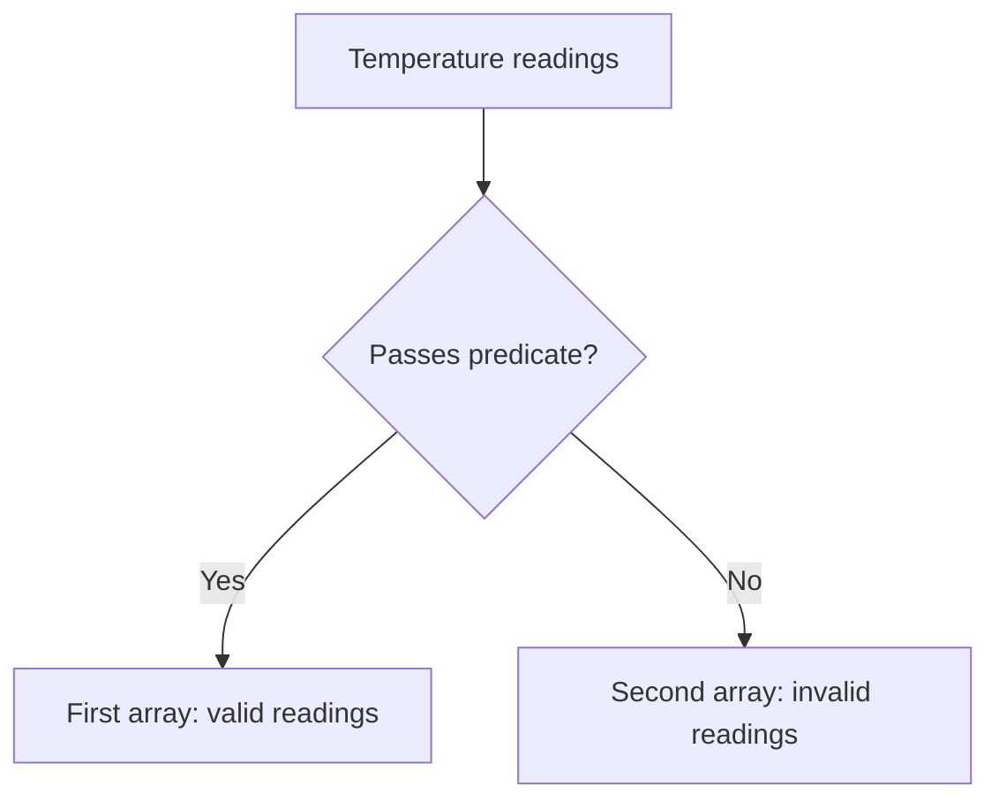

<!-- BUNDLE_SIZE:START -->

> 6.25 kB minified + gzipped

<!-- BUNDLE_SIZE:END -->

## Core Behavior

`Arr` provides data-last operations for readonly arrays. Search and indexed access return `Maybe`
when an item may be absent; transformations return arrays without changing the input.

- `partition` returns matching items first, followed by nonmatching items.
- `groupBy` puts each item in a group selected by a string key.
- `traverse` and `sequence` combine results in `Maybe`, `Result`, `Validation`, or `Task`.

## Example: Processing Temperature Readings

A monitoring service receives readings from several rooms. It needs to separate valid measurements
from invalid ones and group the valid measurements by room.

`partition` examines each reading and keeps its original order within the selected output:



### Separating and Grouping Readings

```ts
import { Arr, pipe } from "@pplnd/core";

type Reading = { room: string; celsius: number };
const readings: readonly Reading[] = [
  { room: "lab", celsius: 21 },
  { room: "storage", celsius: NaN },
  { room: "lab", celsius: 22 },
];

const [valid, invalid] = pipe(readings, Arr.partition((reading) => Number.isFinite(reading.celsius)));
const byRoom = pipe(valid, Arr.groupBy((reading) => reading.room));
// invalid: [{ room: "storage", celsius: NaN }]
// byRoom.lab: [{ room: "lab", celsius: 21 }, { room: "lab", celsius: 22 }]
```

## Core Operations

### Reading and Searching

| Signature                                                          | What it does                                         | Result                     |
| :----------------------------------------------------------------- | :--------------------------------------------------- | :------------------------- |
| `Arr.head` / `last` / `tail` / `init`                              | Reads an end or the remaining items.                 | `None` for an empty array. |
| `Arr.at(index)`                                                    | Reads an index; negative indices count from the end. | `Maybe<A>`.                |
| `Arr.findFirst(fn)` / `findLast(fn)` / `findIndex(fn)`             | Finds an item or its index.                          | `Maybe`.                   |
| `Arr.findMap(fn)`                                                  | Finds the first `Some` produced by a callback.       | `Maybe`.                   |
| `Arr.is.empty` / `is.nonEmpty` / `size` / `some(fn)` / `every(fn)` | Inspects the collection.                             | A boolean or count.        |

### Transforming and Combining

| Signature                                                                    | What it does                                    | Behavior                                                              |
| :--------------------------------------------------------------------------- | :---------------------------------------------- | :-------------------------------------------------------------------- |
| `Arr.map(fn)` / `mapWithIndex(fn)`                                           | Transforms items.                               | Index callback receives `(index, item)`.                              |
| `Arr.filter(fn)` / `filterMap(fn)` / `compact`                               | Keeps matching items / `Some` results.          | Preserves input order.                                                |
| `Arr.partition(fn)` / `partitionMap(fn)` / `partitionMaybe(fn)` / `separate` | Splits items into two arrays.                   | `partition` puts matches first; `partitionMaybe` puts failures first. |
| `Arr.groupBy(fn)` / `indexBy(fn)` / `frequencies`                            | Groups, indexes, or counts items.               | `groupBy` returns a record; the others return maps.                   |
| `Arr.uniq` / `uniqBy(fn)` / `uniqWith(equal)` / `dedupeAdjacent()`           | Removes duplicates.                             | `dedupeAdjacent` compares neighbors only.                             |
| `Arr.sortBy(fn)` / `sortWith(compare)` / `reverse`                           | Reorders items.                                 | Returns an array without modifying the input.                         |
| `Arr.zip(other)` / `zipWith(fn)(other)`                                      | Combines corresponding items.                   | Stops at the shorter array.                                           |
| `Arr.concat(other)` / `prepend(item)` / `append(item)` / `intersperse(item)` | Combines or adds items.                         | Returns an array.                                                     |
| `Arr.flatten` / `flatMap(fn)`                                                | Flattens one level / maps and flattens.         | Returns an array.                                                     |
| `Arr.reduce(initial, fn)` / `scan(initial, fn)`                              | Accumulates items / intermediate accumulations. | `reduce` returns the final value.                                     |

### Slicing and Combining Results

| Signature                                                                    | What it does                                          | Behavior                                                   |
| :--------------------------------------------------------------------------- | :---------------------------------------------------- | :--------------------------------------------------------- |
| `Arr.take(n)` / `drop(n)` / `takeWhile(fn)` / `dropWhile(fn)` / `splitAt(n)` | Selects a portion of the input.                       | Returns arrays.                                            |
| `Arr.insertAt(index, item)` / `removeAt(index)`                              | Inserts or removes an item.                           | Invalid non-integer indices leave the input unchanged.     |
| `Arr.chunksOf(size)` / `windowed(size, options)` / `chunkBy(fn)`             | Divides into batches, windows, or consecutive groups. | Windows can overlap.                                       |
| `Arr.unfold(seed, fn)`                                                       | Builds items until the callback returns `None`.       | The callback supplies the next seed.                       |
| `Arr.traverse.Maybe/Result/Validation/Task(fn)`                              | Maps items and combines their wrapped results.        | The chosen wrapper determines failure behavior.            |
| `Arr.sequence.Maybe/Result/Validation/Task(items)`                           | Combines already-wrapped items.                       | Returns a wrapper around an array.                         |
| `Arr.NonEmpty.from.array(items)` / `Arr.is.nonEmpty(items)`                  | Checks that an array has an item.                     | Provides the non-empty type for `Arr.NonEmpty` operations. |

## Failure Behavior and Edge Cases

`Arr.at` returns `None` for a non-integer or out-of-range index. `Arr.insertAt` clamps an integer
index to the array boundaries; `removeAt` leaves an out-of-range index unchanged. `chunksOf` returns
an empty array when its size is zero or negative.

Unlike `partition`, `partitionMaybe` puts failures first and unwrapped successes second:

```ts
import { Arr, Str, pipe } from "@pplnd/core";

pipe(["21", "missing"], Arr.partitionMaybe(Str.parse.float));
// [["missing"], [21]]
```

`Arr.traverse.Result` stops at the first error, while `Arr.traverse.Validation` collects errors.
`Arr.sequence` receives values that were already created; use `traverse` when the callback itself
must be skipped after a failure.

`Arr.traverse.Task` and `Arr.sequence.Task` return `Task<readonly B[]>`. Infallible task composition
forwards the abort signal to every task, collecting a complete array.
