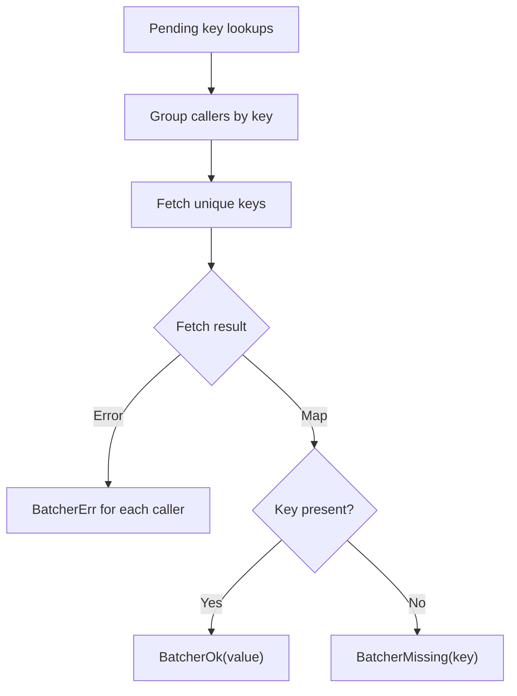

<!-- BUNDLE_SIZE:START -->

> 2.90 kB minified + gzipped

<!-- BUNDLE_SIZE:END -->

## Core Behavior

`Batcher` collects key lookups and calls a supplied bulk fetch function. Each caller receives an
outcome for its own key.

- Calls queued before dispatch share a batch; duplicate keys are fetched once within that batch.
- A returned map entry produces `BatcherOk`, an absent key produces `BatcherMissing`, and a failed
  bulk fetch produces `BatcherErr` for the affected callers.
- Results are not cached after a batch finishes. A later lookup can fetch the key again.

## Example: Looking Up Catalog Items

A page needs catalog information for several item IDs. Some IDs may repeat and some may no longer
exist. The batcher can fetch the unique IDs together and report an outcome for each requested ID.

The bulk fetch returns a map. The batcher uses its entries to settle every caller that requested a
key, including callers that requested the same key:



### Loading Items Together

This example uses an in-memory catalog so it can run without a database. The `fetch` callback can
instead return a `Task.Result` that performs a bulk query.

```ts
import { Batcher, Task, pipe } from "@pplnd/core";

type Item = { id: string; name: string };
const catalog = new Map<string, Item>([
  ["pencil", { id: "pencil", name: "Pencil" }],
  ["notebook", { id: "notebook", name: "Notebook" }],
]);

const items = Batcher.make({
  fetch: (ids: readonly string[]) =>
    Task.Result.tryCatch(
      async () => {
        const found = new Map<string, Item>();
        for (const id of ids) {
          const item = catalog.get(id);
          if (item !== undefined) found.set(id, item);
        }
        return found;
      },
      { onError: (error) => String(error) },
    ),
});

const outcomes = await items.loadMany(["pencil", "pencil", "missing"]);
const descriptions = outcomes.map((outcome) =>
  pipe(
    outcome,
    Batcher.Outcome.match({
      ok: (item) => item.name,
      missing: (id) => `No item for ${id}`,
      err: (error) => `Catalog lookup failed: ${error}`,
    }),
  )
);
// ["Pencil", "Pencil", "No item for missing"]
```

## Core Operations

### Creating and Running

| Signature                         | What it does                                         | Result                                          |
| :-------------------------------- | :--------------------------------------------------- | :---------------------------------------------- |
| `Batcher.make(options)`           | Creates a batcher around a bulk `fetch`.             | A batcher with `load`, `loadMany`, and `flush`. |
| `batcher.load(key, signal?)`      | Queues a single key.                                 | `Deferred` of that key's outcome.               |
| `batcher.loadMany(keys, signal?)` | Queues multiple keys.                                | Outcomes in the input order.                    |
| `batcher.flush()`                 | Dispatches queued keys and waits for pending chunks. | `Deferred<void>`.                               |

The options `maxBatchSize` and `concurrency` limit chunk size and simultaneous fetches. `window`
sets a collection delay; without it, dispatch is scheduled as a microtask. Reaching `maxBatchSize`
flushes the current queue immediately. `serializeKey` can group structurally equivalent object keys;
the bulk fetch receives the first key in each group.

### Reading Outcomes

| Signature                                     | What it does                             | Result                                         |
| :-------------------------------------------- | :--------------------------------------- | :--------------------------------------------- |
| `Batcher.Outcome.match({ ok, missing, err })` | Handles all three outcomes.              | The selected handler's result.                 |
| `Batcher.Outcome.is.ok/err/missing(value)`    | Checks the outcome kind.                 | Type guard.                                    |
| `Batcher.Outcome.make.ok/err/missing(value)`  | Creates an outcome.                      | The selected variant.                          |
| `Batcher.Outcome.map(fn)` / `mapError(fn)`    | Transforms a found value / fetch error.  | Other variants pass through.                   |
| `Batcher.Outcome.getOrElse(fn)`               | Reads a found value or calls a fallback. | Value or fallback.                             |
| `Batcher.Outcome.to.Result(onMissing)`        | Converts a missing key to an error.      | `Result` preserving fetch errors.              |
| `Batcher.Outcome.to.Maybe` / `to.nullable`    | Keeps only a found value.                | Both missing and error outcomes are discarded. |

## Failure Behavior and Edge Cases

A missing key and a failed fetch are separate outcomes. When a batch completes, `loadMany` preserves
input order, including positions that requested the same key.

A synchronous exception while creating or starting the fetch is returned as `BatcherErr` with a
`BatcherUnexpected` error. Aborting a caller returns a `BatcherAborted` error containing the
signal's reason; it does not cancel the shared bulk fetch.

`serializeKey` controls grouping, but the returned map is looked up using the first original key for
each group. For object keys, the fetch must return map entries keyed by those original objects.
