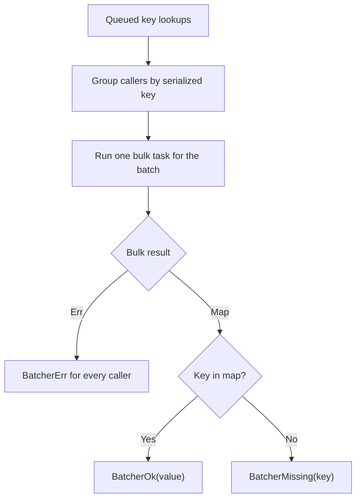

<!-- BUNDLE_SIZE:START -->

> 3.06 kB minified + gzipped

<!-- BUNDLE_SIZE:END -->

A product page renders its parts one component at a time, and each component looks up its catalog
item by id. Sent separately, forty lookups become forty database round trips, and two components
asking for the same item send the same query twice.

## Core Behavior

`Batcher<K, E, V>` groups key lookups issued close together into one bulk request and settles each
caller with its own outcome.

- Lookups queued before dispatch share a batch. Duplicate keys are fetched once per batch, and every
  caller for that key receives the same outcome.
- A returned map entry produces `BatcherOk` with the value, an absent key produces `BatcherMissing`
  with the key, and a failed bulk task produces `BatcherErr` for every caller in that batch.
- Outcomes are not cached. A lookup made after dispatch can fetch the same key again, even while the
  earlier request is still running.

`Batcher` answers many single-key lookups with one query per tick. When calls to one dependency must
be replaced, queued, or retried, [`Op`](/guides/op/) owns the run instead.
[Reading the Types](/basics/types/) notes that a batcher is an instance as soon as it is created,
and the [choosing guide](/basics/choosing/) places it beside the other execution modules.

## Example: Looking Up Catalog Items

A page needs catalog information for several item ids. Some ids repeat and some no longer exist. The
batcher collects the unique ids for one batch and reports an outcome for every requested id.

The bulk task returns a map of the keys it found. The batcher looks up each queued key in that map
and settles every caller, including callers that requested the same key:



### Loading Items Together

This example uses an in-memory catalog so it runs without a database. A database version replaces
the body of `readCatalog` with one query for the ids it receives:

```ts
import { Batcher, pipe, Task } from "@pplnd/core";

interface Item {
  readonly id: string;
  readonly name: string;
}

const catalog = new Map<string, Item>([
  ["pencil", { id: "pencil", name: "Pencil" }],
  ["notebook", { id: "notebook", name: "Notebook" }],
]);

const readCatalog = (ids: readonly string[]): Task.Result<string, ReadonlyMap<string, Item>> =>
  Task.Result.tryCatch(
    async () => {
      const found = new Map<string, Item>();
      for (const id of ids) {
        const item = catalog.get(id);
        if (item !== undefined) found.set(id, item);
      }
      return found;
    },
    { onError: (error) => String(error) },
  );

const items = Batcher.make(readCatalog);

const outcomes = await items.loadMany(["pencil", "pencil", "missing"]);
const descriptions = outcomes.map((outcome) =>
  pipe(
    outcome,
    Batcher.Outcome.match({
      ok: (item) => item.name,
      missing: (id) => `No item for ${id}`,
      err: (error) => `Catalog lookup failed: ${error}`,
    }),
  )
);
// ["Pencil", "Pencil", "No item for missing"]
```

Both `pencil` entries share one queued key and one map lookup. The second `pencil` resolves from the
same batch as the first, and the missing id is reported without failing the batch.

### Keeping a Failing Source Away

A catalog database that starts failing should not be queried by every rendered page. The breaker
wraps the same bulk task, so a failing batch counts against the source and a blocked batch settles
without querying it:

```ts
import { CircuitBreaker, Duration, Task } from "@pplnd/core";

const catalogBreaker = CircuitBreaker.make<string>({
  failureThreshold: 3,
  resetTimeout: Duration.seconds(15),
});

const guardedCatalog = (
  ids: readonly string[],
): Task.Result<string | CircuitBreaker.OpenError<string>, ReadonlyMap<string, Item>> =>
  (signal) => catalogBreaker.run(readCatalog(ids), { signal });

const guardedItems = Batcher.make(guardedCatalog);
```

Each dispatched batch becomes one breaker call, so a failed batch counts as one failure and a
blocked batch settles every caller with `BatcherErr` carrying `CircuitBreaker.OpenError`. The
[CircuitBreaker guide](/guides/circuit-breaker/) covers thresholds and recovery probes.

## Core Operations

### Creating and Running

| Signature                           | What it does                                         | Result                                         |
| :---------------------------------- | :--------------------------------------------------- | :--------------------------------------------- |
| `Batcher.make(loadBatch, options?)` | Creates a batcher around a bulk load task.           | A batcher with `load`, `loadMany`, and `flush` |
| `batcher.load(key, signal?)`        | Queues a single key.                                 | `Deferred` of that key's outcome               |
| `batcher.loadMany(keys, signal?)`   | Queues multiple keys.                                | `Deferred` of outcomes in input order          |
| `batcher.flush()`                   | Dispatches queued keys and waits for pending chunks. | `Deferred` that resolves when the work is done |

`maxBatchSize` limits the keys in one query and defaults to unbounded; a nonpositive or non-integer
value clamps to 1. `concurrency` limits simultaneous chunk queries and clamps the same way. `window`
adds a collection delay; without it, dispatch is scheduled as a microtask, and an explicit zero uses
a timer. `keyBy` groups structurally equal object keys.

### Reading Outcomes

| Signature                                     | What it does                               | Result                               |
| :-------------------------------------------- | :----------------------------------------- | :----------------------------------- |
| `Batcher.Outcome.match({ ok, missing, err })` | Handles all three outcomes.                | The selected handler's result        |
| `Batcher.Outcome.is.ok` / `err` / `missing`   | Checks the outcome kind.                   | Type guard                           |
| `Batcher.Outcome.make.ok` / `err` / `missing` | Creates an outcome.                        | The selected variant                 |
| `Batcher.Outcome.map(fn)` / `mapError(fn)`    | Transforms a found value or a fetch error. | Other variants pass through          |
| `Batcher.Outcome.getOrElse(fn)`               | Reads a found value or calls a fallback.   | Value or fallback                    |
| `Batcher.Outcome.to.Result(onMissing)`        | Turns a missing key into an error.         | `Result` that preserves fetch errors |
| `Batcher.Outcome.to.Maybe(outcome)`           | Keeps only a found value.                  | Missing and error become `None`      |
| `Batcher.Outcome.to.nullable(outcome)`        | Keeps only a found value.                  | Missing and error become `null`      |

## Failure Behavior and Edge Cases

A missing key and a failed fetch are separate outcomes. Use `BatcherMissing` to fall back to a
placeholder and `BatcherErr` to report a failed source; `loadMany` preserves input order, including
positions that requested the same key.

The bulk load factory and its task must not throw or reject. Represent expected failures with
`Task.Result`, because a rejection leaves every caller in that batch without a settled outcome.

Aborting a caller settles that caller with `BatcherErr` carrying an [`Aborted`](/guides/aborted/)
value whose `reason` is the signal's reason. Other callers keep sharing the batch. If every caller
in a dispatched batch cancels, the batcher aborts the bulk task's signal. A caller that cancels
before dispatch leaves its queued key when no other caller shares it, and an empty queue cancels the
pending timer. Cancellation is cooperative, and `flush()` still waits for an in-flight task that
ignores the signal.

Reaching `maxBatchSize` flushes immediately, so a lookup made right after that point can start a new
batch for the same key even while the previous fetch runs. The limit counts unique keys, not
callers.

`keyBy` decides which keys share a slot, but the returned map is queried with the first original key
in each group. For object keys, return map entries keyed by those original objects. A missing
outcome also carries the first key in its group, which can be a different object from the one a
later caller supplied.
