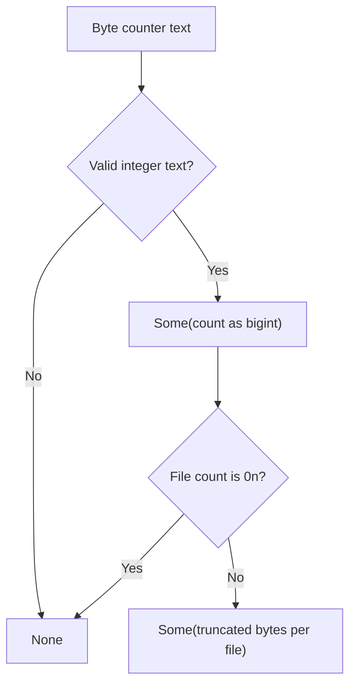

<!-- BUNDLE_SIZE:START -->

> 1.85 kB minified + gzipped

<!-- BUNDLE_SIZE:END -->

A storage dashboard adds byte counters from many buckets. Individual counters fit in a JavaScript
number, but their total exceeds `2^53`, where doubles round to the nearest representable value. The
dashboard reports a fleet size that differs from the true sum, and no error marks the drift.

## Core Behavior

`BigNum` provides data-last arithmetic and safe conversions for JavaScript `bigint` values.

- `from.string` parses integer text and returns `None` for blank or invalid input; `from.number`
  accepts only safe integers.
- `to.number` returns `None` outside the safe integer range instead of rounding.
- `divide` and `remainder` return `None` for a zero divisor; division truncates toward zero.
- `sum([])` is `0n`; `min` and `max` return `None` for an empty array.

Use `BigNum` when the values are whole numbers and the result must stay exact beyond `2^53`. When
the measurement fits in a double and needs clamping, rounding, or locale formatting,
[`Num`](/guides/num/) works on plain numbers. The [choosing guide](/basics/choosing/) lists the
primitives side by side.

## Example: Storage Byte Counters

A storage service receives a byte counter as text and divides it by the number of files in the
bucket. The counter can exceed the safe number range, so the calculation stays in `bigint`.

`from.string` returns an integer when parsing succeeds and an absent value when it fails; `divide`
then guards the zero divisor:



### Calculating Bytes per File

```ts
import { BigNum, Maybe, pipe } from "@pplnd/core";

interface BucketUsage {
  readonly bucket: string;
  readonly byteCount: string;
}

const bytesPerFile = (usage: BucketUsage, fileCount: bigint): string =>
  fileCount === 0n
    ? `${usage.bucket}: no files`
    : pipe(
        BigNum.from.string(usage.byteCount),
        Maybe.chain(BigNum.divide(fileCount)),
        Maybe.match({
          some: (bytes) => `${usage.bucket}: ${bytes} bytes per file`,
          none: () => `${usage.bucket}: counter is not an integer`,
        }),
      );

bytesPerFile({ bucket: "exports", byteCount: "90071992547409930" }, 10n);
// "exports: 9007199254740993 bytes per file"
bytesPerFile({ bucket: "exports", byteCount: "12.5" }, 10n);
// "exports: counter is not an integer"
```

The zero check runs before parsing, so a missing file count is reported separately from unreadable
counter text.

### Handing a Fitting Count to Num

Once a count fits the safe integer range, the display layer can leave exact arithmetic. `to.number`
returns `None` rather than rounding when it does not fit, and `Num.format` then produces the
locale-aware text:

```ts
import { BigNum, Maybe, Num, pipe } from "@pplnd/core";

const formattedCount = (count: bigint): Maybe<string> =>
  pipe(
    count,
    BigNum.to.number,
    Maybe.chain(Num.format({ maximumFractionDigits: 0 }, "en-US")),
  );

formattedCount(9007199254740991n); // Some("9,007,199,254,740,991")
formattedCount(9007199254740993n); // None
```

[`Num`](/guides/num/) covers the formatting options and the rest of the number surface.

## Core Operations

### Creating and Converting

| Signature                   | What it does                                 | Result           |
| :-------------------------- | :------------------------------------------- | :--------------- |
| `BigNum.from.string(text)`  | Parses integer text.                         | `Maybe<bigint>`. |
| `BigNum.from.number(value)` | Converts a safe integer.                     | `Maybe<bigint>`. |
| `BigNum.to.number(value)`   | Converts when the value fits the safe range. | `Maybe<number>`. |

### Calculating and Comparing

| Signature                                                      | What it does                                    | Result           |
| :------------------------------------------------------------- | :---------------------------------------------- | :--------------- |
| `BigNum.add(amount)` / `subtract(amount)` / `multiply(factor)` | Applies arithmetic to the piped value.          | `bigint`.        |
| `BigNum.divide(divisor)` / `remainder(divisor)`                | Divides or calculates a remainder.              | `Maybe<bigint>`. |
| `BigNum.abs` / `clamp(min, max)`                               | Computes an absolute value or restricts bounds. | `bigint`.        |
| `BigNum.is.zero` / `even` / `odd` / `positive` / `negative`    | Checks an integer property.                     | Boolean.         |
| `BigNum.between(min, max)` / `inRange(start, end)`             | Checks inclusive or half-open bounds.           | Boolean.         |

### Aggregating

| Signature                            | What it does                         | Result                             |
| :----------------------------------- | :----------------------------------- | :--------------------------------- |
| `BigNum.sum(values)`                 | Adds all values.                     | `bigint`; `0n` for an empty array. |
| `BigNum.min(values)` / `max(values)` | Finds the smallest or largest value. | `Maybe<bigint>`.                   |

## Failure Behavior and Edge Cases

Division truncates toward zero, so `BigNum.divide(3n)(10n)` returns `Some(3n)` and
`BigNum.divide(3n)(-10n)` returns `Some(-3n)`. The remainder keeps the dividend's sign:
`BigNum.remainder(3n)(-10n)` returns `Some(-1n)`. Both operations return `None` for `0n`.

`from.string` follows `BigInt` syntax. `"0x10"` becomes `Some(16n)`, a leading sign and surrounding
whitespace are accepted, but `"1.5"` and blank text return `None`. Digit separators such as
`"1_000"` also return `None`. Apply a decimal-format check before parsing when the input must be
base ten.

`from.number` rejects floats, `NaN`, and integers outside the safe range. `to.number` applies the
same limit in reverse, returning `None` instead of losing precision. `clamp` assumes `min` is less
than or equal to `max`; it compares against the bounds as given and does not reorder them.
