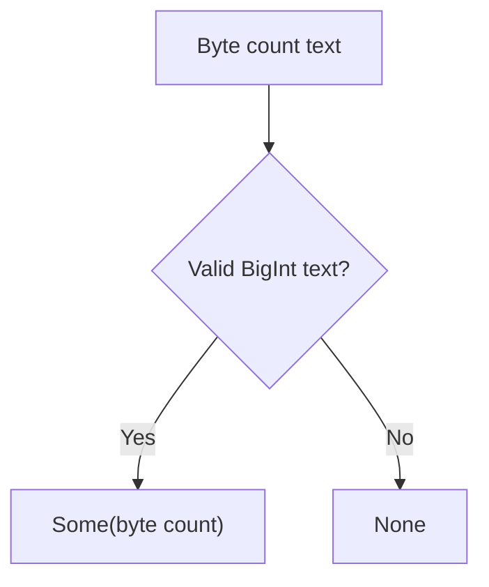

<!-- BUNDLE_SIZE:START -->

> 1.90 kB minified + gzipped

<!-- BUNDLE_SIZE:END -->

## Core Behavior

`BigNum` provides arithmetic and safe conversions for JavaScript `bigint` values.

- `from.string` returns `None` for blank or invalid integer text.
- Conversion between `number` and `bigint` succeeds only within the safe integer range.
- `divide` and `remainder` return `None` for a zero divisor.

## Example: Storage Byte Counters

A storage service receives a byte counter as text. The count can exceed the safe range for a
JavaScript `number`, so the service parses and calculates with `bigint`.

`from.string` returns an integer when parsing succeeds and an absent value when it fails:



### Calculating Average Bytes

```ts
import { BigNum, Maybe, pipe } from "@pplnd/core";

const averageBytes = (total: string, files: bigint): string =>
  pipe(
    BigNum.from.string(total),
    Maybe.chain(BigNum.divide(files)),
    Maybe.match({
      some: (bytes) => `${bytes} bytes per file`,
      none: () => "Invalid count or zero files",
    }),
  );

averageBytes("90071992547409930", 10n); // "9007199254740993 bytes per file"
averageBytes("invalid", 10n);            // "Invalid count or zero files"
```

## Core Operations

### Parsing and Inspecting

| Signature                                          | What it does                                        | Result           |
| :------------------------------------------------- | :-------------------------------------------------- | :--------------- |
| `BigNum.from.string(text)` / `from.number(value)`  | Parses text / converts a safe integer.              | `Maybe<bigint>`. |
| `BigNum.to.number(value)`                          | Converts within the safe integer range.             | `Maybe<number>`. |
| `BigNum.is.zero/even/odd/positive/negative`        | Checks an integer property.                         | Boolean.         |
| `BigNum.between(min, max)` / `inRange(start, end)` | Checks inclusive bounds / an exclusive upper bound. | Boolean.         |

### Calculating and Aggregating

| Signature                                                      | What it does                                   | Result                                              |
| :------------------------------------------------------------- | :--------------------------------------------- | :-------------------------------------------------- |
| `BigNum.add(amount)` / `subtract(amount)` / `multiply(factor)` | Applies arithmetic to the piped value.         | `bigint`.                                           |
| `BigNum.divide(divisor)` / `remainder(divisor)`                | Divides or calculates a remainder.             | `Maybe<bigint>`.                                    |
| `BigNum.abs` / `clamp(min, max)`                               | Computes an absolute value / restricts bounds. | `bigint`.                                           |
| `BigNum.sum` / `min` / `max`                                   | Aggregates integers.                           | `bigint` for `sum`; `Maybe<bigint>` for the others. |

## Failure Behavior and Edge Cases

BigInt division truncates toward zero, so `BigNum.divide(3n)(10n)` returns `Some(3n)`. Both division
and remainder return `None` for `0n`.

`BigNum.from.string` follows JavaScript's `BigInt` syntax, including supported base prefixes. Use a
separate format check if input must contain decimal digits only. Converting an integer outside the
safe `number` range returns `None` rather than losing precision.
