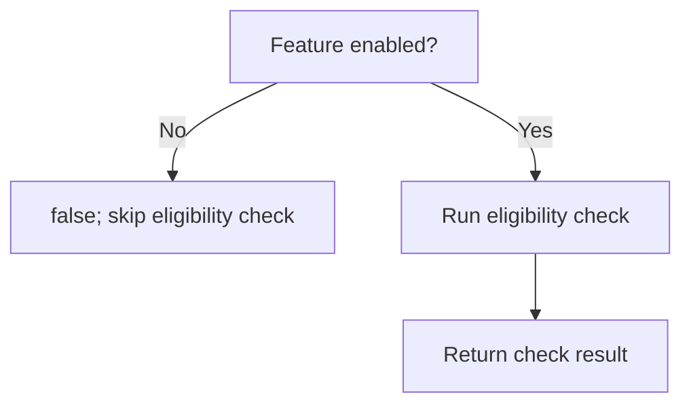

<!-- BUNDLE_SIZE:START -->

> 1.83 kB minified + gzipped

<!-- BUNDLE_SIZE:END -->

## Core Behavior

`Bool` provides data-last boolean operations, branching, parsing, and conversions.

- `from.string` accepts trimmed, case-insensitive `true` or `false`; other text returns `None`.
- `andLazy` skips its callback when the input is false; `orLazy` skips it when the input is true.
- `match` selects a named `true` or `false` handler.

## Example: Feature Availability

A service reads a feature flag and checks whether a workspace is eligible. If the feature is
disabled, the eligibility check is unnecessary.

`andLazy` evaluates the second condition only when the first condition is true:



### Checking a Feature Flag

```ts
import { Bool, Maybe, pipe } from "@pplnd/core";

const featureAvailable = (rawFlag: string, workspacePlan: string): string =>
  pipe(
    Bool.from.string(rawFlag),
    Maybe.getOrElse(() => false),
    Bool.andLazy(() => workspacePlan === "team"),
    Bool.match({ true: () => "Available", false: () => "Unavailable" }),
  );

featureAvailable("true", "team");  // "Available"
featureAvailable("false", "team"); // "Unavailable"
featureAvailable("unknown", "team"); // "Unavailable"
```

## Core Operations

### Parsing and Converting

| Signature                                          | What it does                                  | Result                              |
| :------------------------------------------------- | :-------------------------------------------- | :---------------------------------- |
| `Bool.from.string(text)` / `from.number(value)`    | Parses true/false text or numeric 1/0.        | `Maybe<boolean>`.                   |
| `Bool.from.truthy(value)`                          | Applies JavaScript truthiness.                | Boolean.                            |
| `Bool.to.string` / `to.number`                     | Converts a boolean.                           | `"true"` / `"false"`, or `1` / `0`. |
| `Bool.to.Maybe(onTrue)` / `to.Result(onErr, onOk)` | Produces a value using the selected callback. | `Maybe` / `Result`.                 |

### Combining and Inspecting

| Signature                                                     | What it does                            | Result                                               |
| :------------------------------------------------------------ | :-------------------------------------- | :--------------------------------------------------- |
| `Bool.not(value)` / `and(other)` / `or(other)` / `xor(other)` | Negates or combines boolean values.     | Boolean.                                             |
| `Bool.andLazy(fn)` / `orLazy(fn)`                             | Combines a value with a deferred check. | Short-circuits when the input determines the result. |
| `Bool.all(values)` / `any(values)`                            | Checks all / any conditions.            | Boolean.                                             |
| `Bool.match({ true, false })`                                 | Runs the handler for the input.         | Selected handler's result.                           |
| `Bool.is.boolean/true/false/truthy/falsy`                     | Checks and narrows a value.             | Type guard.                                          |

## Failure Behavior and Edge Cases

`Bool.from.string("false")` returns `Some(false)`. `Bool.from.truthy("false")` returns `true`,
because a non-empty string is truthy. Use the parser for text that represents a boolean.

`Bool.all([])` returns `true`; `Bool.any([])` returns `false`. The non-lazy `and` and `or` receive
already-evaluated boolean arguments; use their lazy variants when the second check should be
skipped.
