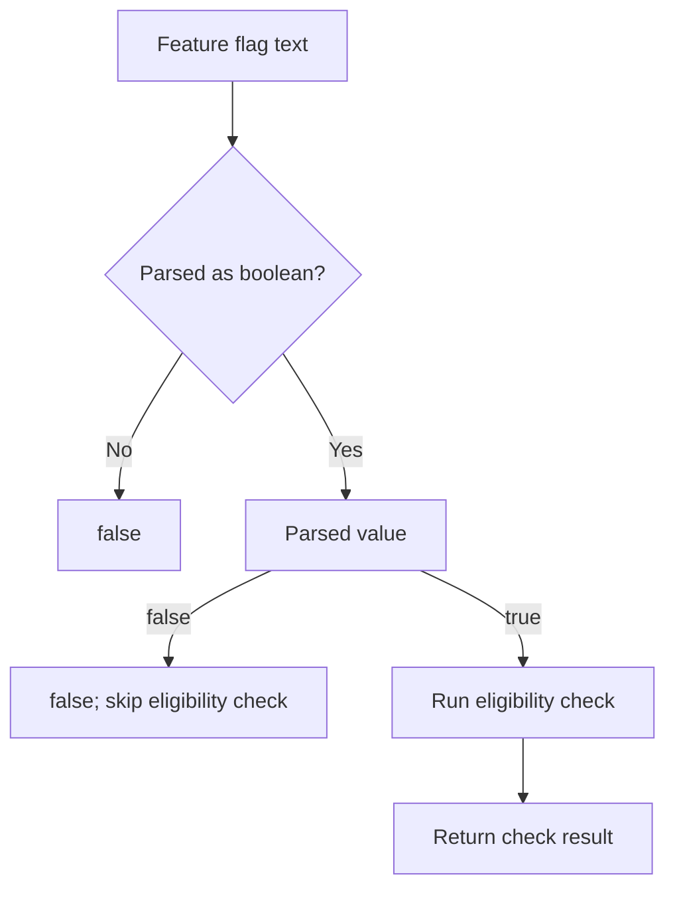

<!-- BUNDLE_SIZE:START -->

> 1.83 kB minified + gzipped

<!-- BUNDLE_SIZE:END -->

The environment provides a feature flag as text, and the service combines it with a workspace
eligibility check. When the flag is false, the eligibility check still runs, and a workspace with an
unusual plan can flip a feature that was never enabled. An empty or misspelled variable must also
fall back to disabled rather than throwing.

## Core Behavior

`Bool` provides data-last boolean parsing, combination, branching, and conversion.

- `from.string` trims and lowercases its input, accepting only `"true"` and `"false"`; `from.number`
  accepts only `1` and `0`.
- `and` and `or` receive evaluated booleans; `andLazy` and `orLazy` call their callback only when
  the first value cannot decide the result.
- `all` and `any` scan arrays in order and stop at the first decisive element.
- `match` runs only the selected `true` or `false` handler.

Use `Bool` when the decision is one value or one deferred check. When the checks themselves must be
named, reused, and combined across call sites, [`Predicate`](/guides/predicate/) stores them as
functions. The [choosing guide](/basics/choosing/) lists the primitives side by side.

## Example: Feature Availability

A service reads a feature flag and checks whether a workspace may use the audit log. The plan and
seat checks only matter when the flag is enabled.

`andLazy` evaluates the eligibility check only when the parsed flag is true:



### Checking a Feature Flag

```ts
import { Bool, Maybe, pipe } from "@pplnd/core";

type Plan = "free" | "team" | "enterprise";

interface Workspace {
  readonly plan: Plan;
  readonly seatCount: number;
}

const eligibleWorkspace = (workspace: Workspace): boolean =>
  workspace.plan !== "free" && workspace.seatCount <= 50;

const auditLogState = (rawFlag: string, workspace: Workspace): string =>
  pipe(
    Bool.from.string(rawFlag),
    Maybe.getOrElse(() => false),
    Bool.andLazy(() => eligibleWorkspace(workspace)),
    Bool.match({
      true: () => "Audit log enabled",
      false: () => "Audit log disabled",
    }),
  );

auditLogState("TRUE", { plan: "team", seatCount: 12 }); // "Audit log enabled"
auditLogState("false", { plan: "team", seatCount: 12 }); // "Audit log disabled"
auditLogState("yes", { plan: "team", seatCount: 12 }); // "Audit log disabled"
```

A flag that does not parse becomes `false` before the lazy check, so the workspace check is skipped.

### Handing the Eligibility Rules to Predicate

The plan and seat rules can become named functions, so another feature can apply the same
combination without repeating the conjunction:

```ts
import { Predicate } from "@pplnd/core";

const paidPlan: Predicate<Plan> = (plan) => plan !== "free";
const smallWorkspace: Predicate<Workspace> = (workspace) => workspace.seatCount <= 50;

const isEligibleWorkspace = Predicate.all([
  Predicate.using((workspace: Workspace) => workspace.plan)(paidPlan),
  smallWorkspace,
]);

isEligibleWorkspace({ plan: "team", seatCount: 12 }); // true
```

[`Predicate`](/guides/predicate/) covers composition, negation, and branching over named rules.

## Core Operations

### Parsing and Converting

| Signature                                          | What it does                                  | Result                       |
| :------------------------------------------------- | :-------------------------------------------- | :--------------------------- |
| `Bool.from.string(text)` / `from.number(value)`    | Parses true/false text or numeric 1/0.        | `Maybe<boolean>`.            |
| `Bool.from.truthy(value)`                          | Applies JavaScript truthiness.                | Boolean.                     |
| `Bool.to.string` / `to.number`                     | Converts to `"true"`/`"false"` or `1`/`0`.    | String or number literal.    |
| `Bool.to.Maybe(onTrue)` / `to.Result(onErr, onOk)` | Produces a value using the selected callback. | `Maybe<A>` / `Result<E, A>`. |

### Combining and Branching

| Signature                                                     | What it does                            | Result                                           |
| :------------------------------------------------------------ | :-------------------------------------- | :----------------------------------------------- |
| `Bool.not(value)` / `and(other)` / `or(other)` / `xor(other)` | Negates or combines evaluated values.   | Boolean.                                         |
| `Bool.andLazy(check)` / `orLazy(check)`                       | Combines a value with a deferred check. | Boolean; skips the check when the input decides. |
| `Bool.all(values)` / `any(values)`                            | Checks all or any conditions.           | Boolean; short-circuits in array order.          |
| `Bool.match({ true, false })`                                 | Runs the handler for the input.         | Selected handler's result.                       |
| `Bool.is.boolean` / `true` / `false` / `truthy` / `falsy`     | Checks and narrows a value.             | Type guard.                                      |

## Failure Behavior and Edge Cases

`from.string` accepts only `true` or `false` after trimming and lowercasing; `"1"`, `"yes"`, and
`"on"` return `None`. `from.number` accepts exactly `1` and `0`, so `2` returns `None`.

`from.truthy` follows JavaScript truthiness: `from.truthy("false")` and `from.truthy("0")` both
return `true`, while `from.truthy(0)`, `from.truthy("")`, and `from.truthy(null)` return `false`.
Use `from.string` for text that represents a boolean.

`all([])` returns `true` and `any([])` returns `false`. The strict `and` and `or` receive booleans
that were already evaluated; use the lazy variants when the second check has a cost or a side
effect. A callback passed to `andLazy`, `orLazy`, or `match` is not wrapped in a catch, so an
exception escapes the pipeline.

Only the selected `match` handler runs. Both handlers must return a type that the caller can use as
one result type.
