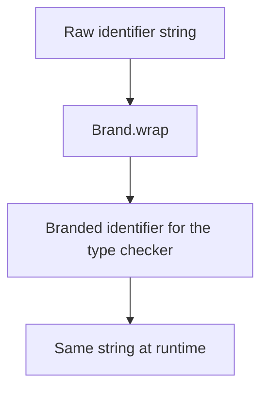

<!-- BUNDLE_SIZE:START -->

> 27 B minified + gzipped

<!-- BUNDLE_SIZE:END -->

A transfer desk accepts a warehouse identifier and a shipment identifier, both strings. A reversed
argument compiles cleanly, the shipment is filed against the wrong warehouse, and the audit report
still shows a successful transfer.

## Core Behavior

`Brand<K, T>` intersects `T` with a phantom label `K`, so two values with the same representation
become distinct TypeScript types.

- `Brand.wrap<K, T>()` returns a function that applies the label; the runtime value is unchanged and
  unchecked.
- A branded value is assignable to its underlying type `T`, but `T` is not assignable back to the
  brand.
- `Brand.unwrap` returns the underlying `T`; the brand exists only in the type system.
- The label carries no runtime marker, so data read from JSON or a database needs parsing before it
  is branded.

Reach for `Brand` when two values share a representation but must never be exchanged. When the same
boundary must also reject malformed input, [`Result`](/guides/result/) carries the parsed value or a
typed error before the brand is applied. The [choosing guide](/basics/choosing/) covers the
containers that carry validation outcomes; a brand records the outcome once validation has passed.

## Example: Warehouse Identifiers

A warehouse transfer needs a warehouse ID and a shipment ID. Both arrive as strings, but a function
that expects one should not accidentally receive the other.

The brand changes the type accepted by TypeScript without changing the value passed at runtime:



### Validating and Using Identifiers

The parsing functions check each prefix before applying its brand. The transfer function then
accepts the two distinct types:

```ts
import { Brand, Result, pipe } from "@pplnd/core";

type WarehouseId = Brand<"WarehouseId", string>;
type ShipmentId = Brand<"ShipmentId", string>;

const toWarehouseId = Brand.wrap<"WarehouseId", string>();
const toShipmentId = Brand.wrap<"ShipmentId", string>();

type TransferError = "INVALID_WAREHOUSE" | "INVALID_SHIPMENT";

const parseWarehouse = (raw: string): Result<TransferError, WarehouseId> =>
  raw.startsWith("wh_") && raw.length > 3
    ? Result.make.ok(toWarehouseId(raw))
    : Result.make.err("INVALID_WAREHOUSE");

const parseShipment = (raw: string): Result<TransferError, ShipmentId> =>
  raw.startsWith("sh_") && raw.length > 3
    ? Result.make.ok(toShipmentId(raw))
    : Result.make.err("INVALID_SHIPMENT");

const transferLabel = (warehouse: WarehouseId, shipment: ShipmentId): string =>
  `Transfer ${shipment} to ${warehouse}`;

const label = pipe(
  parseWarehouse("wh_north"),
  Result.chain((warehouse) =>
    pipe(
      parseShipment("sh_42"),
      Result.map((shipment) => transferLabel(warehouse, shipment)),
    )
  ),
  Result.getOrElse(() => "Invalid transfer"),
);
// "Transfer sh_42 to wh_north"
```

The transfer function accepts a `WarehouseId` and a `ShipmentId`. Swapping the arguments is a type
error even though both values are strings.

### Parsing at the boundary

The parsers above open-code the prefix check. At an HTTP or queue boundary, the same check composes
as a [`Result`](/guides/result/) pipeline that rejects the raw string before any brand reaches the
domain:

```ts
import { Brand, Result, pipe } from "@pplnd/core";

const toWarehouseId = Brand.wrap<"WarehouseId", string>();

const parseWarehouseId = (raw: string): Result<"INVALID_WAREHOUSE", WarehouseId> =>
  pipe(
    raw,
    Result.from.Predicate(
      (value: string) => value.startsWith("wh_") && value.length > 3,
      () => "INVALID_WAREHOUSE" as const,
    ),
    Result.map(toWarehouseId),
  );
```

## Core Operations

### Creating Brands

| Signature            | What it does                            | Result                            |
| :------------------- | :-------------------------------------- | :-------------------------------- |
| `Brand<K, T>`        | Adds a type label to `T`.               | A branded type assignable to `T`. |
| `Brand.wrap<K, T>()` | Creates an unchecked branding function. | `(value: T) => Brand<K, T>`.      |

### Reading Branded Values

| Signature               | What it does                                | Result |
| :---------------------- | :------------------------------------------ | :----- |
| `Brand.unwrap(branded)` | Returns the value with its underlying type. | `T`.   |

A branded value also passes directly where `T` is expected; `unwrap` states that intent in code.

## Failure Behavior and Edge Cases

`Brand.wrap` accepts any value of the underlying type, including an invalid identifier. The brand
records a type distinction; it does not enforce a format. Validate at the input boundary, as in the
example, when the format matters to the application.

The distinction is one-directional. A `WarehouseId` satisfies a parameter typed `string`, so a
function that does not ask for the brand still accepts it. Protection holds only where signatures
name the branded type.

The label is erased at runtime. A value that crosses JSON, a database, or a message queue arrives as
its plain representation and must be parsed and branded again on the way back in. A type assertion
restores the label without checking the value; use [`Result`](/guides/result/) at that boundary when
the format is not guaranteed.

`Brand.unwrap` is an unchecked conversion in the opposite direction. It performs no validation and
returns the original value.
