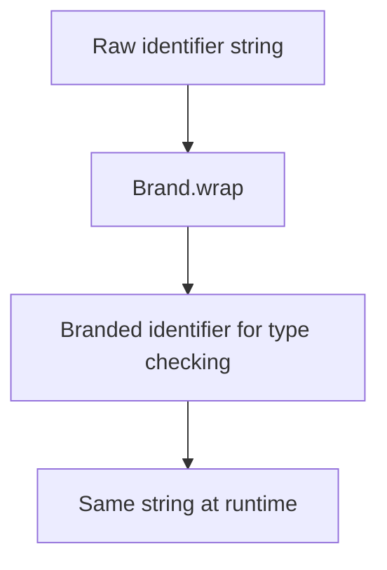

<!-- BUNDLE_SIZE:START -->

> 27 B minified + gzipped

<!-- BUNDLE_SIZE:END -->

## Core Behavior

`Brand<K, T>` gives a value of type `T` an additional type label `K`. Two strings with different
brands are distinct to TypeScript, even though both remain strings at runtime.

- `Brand.wrap` returns a function that assigns a brand to a value.
- A branded value can be used where its underlying type is expected.
- Wrapping does not validate the value; check any required format before wrapping it.

## Example: Warehouse Identifiers

A warehouse transfer needs a warehouse ID and a shipment ID. Both arrive as strings, but a function
that expects one should not accidentally receive the other.

The brand changes the type accepted by TypeScript without changing the value passed at runtime:



### Validating and Using Identifiers

The parsing functions check each prefix before applying its brand. The transfer function then
accepts the two distinct types:

```ts
import { Brand, Result, pipe } from "@pplnd/core";

type WarehouseId = Brand<"WarehouseId", string>;
type ShipmentId = Brand<"ShipmentId", string>;

const wrapWarehouse = Brand.wrap<"WarehouseId", string>();
const wrapShipment = Brand.wrap<"ShipmentId", string>();

const parseWarehouse = (raw: string): Result<string, WarehouseId> =>
  raw.startsWith("wh_") && raw.length > 3
    ? Result.make.ok(wrapWarehouse(raw))
    : Result.make.err("Invalid warehouse ID");

const parseShipment = (raw: string): Result<string, ShipmentId> =>
  raw.startsWith("sh_") && raw.length > 3
    ? Result.make.ok(wrapShipment(raw))
    : Result.make.err("Invalid shipment ID");

const transferLabel = (warehouse: WarehouseId, shipment: ShipmentId): string =>
  `Transfer ${shipment} to ${warehouse}`;

const label = pipe(
  parseWarehouse("wh_north"),
  Result.chain((warehouse) =>
    pipe(
      parseShipment("sh_42"),
      Result.map((shipment) => transferLabel(warehouse, shipment)),
    )
  ),
  Result.getOrElse(() => "Invalid transfer"),
);
// "Transfer sh_42 to wh_north"
```

## Core Operations

| Signature             | What it does                                | Result                            |
| :-------------------- | :------------------------------------------ | :-------------------------------- |
| `Brand<K, T>`         | Adds a type label to `T`.                   | A branded type assignable to `T`. |
| `Brand.wrap<K, T>()`  | Creates an unchecked branding function.     | `(value: T) => Brand<K, T>`.      |
| `Brand.unwrap(value)` | Returns the value with its underlying type. | `T`.                              |

## Failure Behavior and Edge Cases

`Brand.wrap` accepts any value of the underlying type, including an invalid identifier. The brand
records a type distinction; it does not enforce a format. Keep validation at the input boundary, as
in the example, when the format matters to the application.
