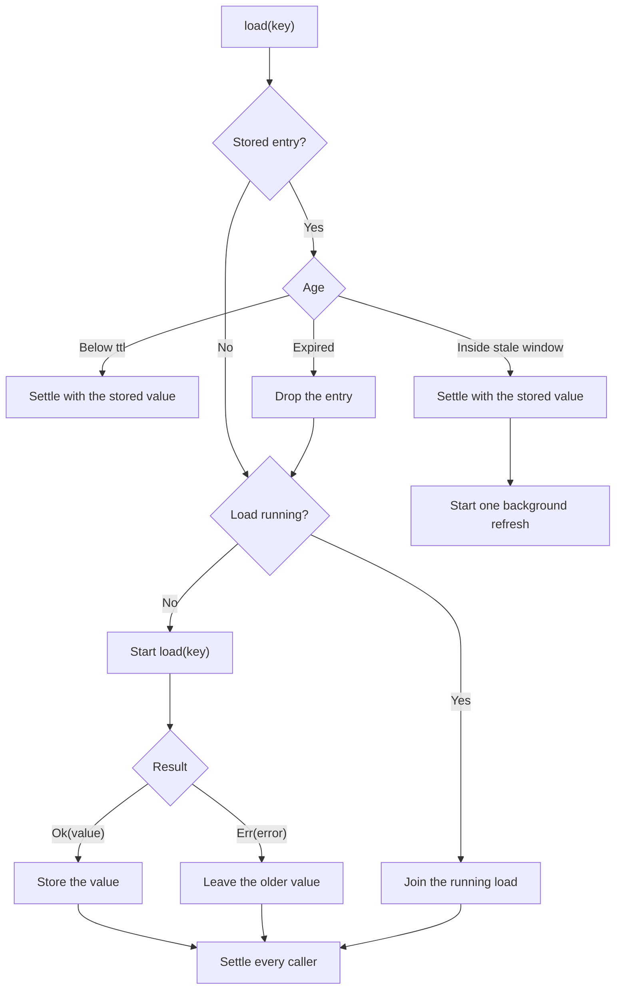

<!-- BUNDLE_SIZE:START -->

> 2.40 kB minified + gzipped

<!-- BUNDLE_SIZE:END -->

A pricing page renders forty components for three SKUs. Each component calls the pricing service on
mount, so the service answers forty requests for three answers. A per-call promise map removes the
duplicates but never refreshes them, and a failed first call stays failed for every component that
arrives later.

## Core Behavior

`Cache<K, E, V>` stores successful lookups by key and decides, per lookup, whether to answer from
storage, share a running load, or call the loader.

- A stored value younger than `ttl` is returned without calling `load`.
- Concurrent lookups for one key share a single load, so fifty components produce one request.
- With `staleWhileRevalidate`, a value past `ttl` is returned immediately while one background
  refresh runs.
- Only `Ok` is stored. An `Err` removes the running load and leaves an older stored value in place.
- `maxSize` evicts the least recently used entries, and `peek` reports what is stored without
  loading.

[`Batcher`](/guides/batcher/) groups nearby key lookups into one bulk request but stores nothing
between batches. `Cache` answers the next lookup without a request at all.
[Reading the Types](/basics/types/) lists caches with the engines that are instances as soon as they
are created, and the [choosing guide](/basics/choosing/) places them by question.

## Example: Pricing a Product Page

The page needs a price for several SKUs and shows the last known price while a refresh runs. A
catalog lookup is fast but not free, and the same SKU appears in several components.

The cache checks storage first. A fresh value settles immediately, a stale value settles while one
refresh starts, and a missing value joins a running load or starts one:



### Serving Prices From Storage

The example uses an in-memory catalog so it runs without a database. A real version replaces the
body of `loadPrice` with the service call:

```ts
import { Cache, Duration, Task } from "@pplnd/core";

interface Price {
  readonly sku: string;
  readonly cents: number;
}

type PriceError = { readonly kind: "Unavailable"; };

const catalog = new Map<string, Price>([
  ["SKU-1042", { sku: "SKU-1042", cents: 2900 }],
  ["SKU-2087", { sku: "SKU-2087", cents: 1450 }],
]);

const loadPrice = (sku: string): Task.Result<PriceError, Price> => {
  const price = catalog.get(sku);
  return price === undefined
    ? Task.Result.make.err({ kind: "Unavailable" })
    : Task.Result.make.ok(price);
};

const prices = Cache.make({
  load: (sku: string) => loadPrice(sku)(),
  ttl: Duration.minutes(5),
  staleWhileRevalidate: Duration.minutes(1),
  maxSize: 500,
});

const [first, second] = await Promise.all([
  prices.load("SKU-1042"),
  prices.load("SKU-1042"),
]);
// Both settle with Ok(price); loadPrice ran once
```

`load` starts the lookup when called; the second call arrives while the first load is still running,
so it waits on the same deferred instead of starting another request.

When a price changes, drop the entry instead of waiting for the ttl:

```ts
catalog.set("SKU-1042", { sku: "SKU-1042", cents: 2600 });
prices.invalidate("SKU-1042");

const updated = await prices.load("SKU-1042");
// Ok(2600)
```

`peek` reads the last stored value without starting work, which is what a renderer uses for the
first paint:

```ts
const known = prices.peek("SKU-1042");
// Some(price) after a successful lookup, None before one
```

### Batching the Loader

A service that answers one SKU per call becomes chatty on a page with many SKUs. `Batcher` coalesces
nearby keys into one request; the cache sits in front of it, so a hit never reaches the batcher and
a miss joins the batch for the current tick.

`Batcher.load` settles with a batch outcome, and the cache stores a `Result`. The converter below
names the missing-key policy once, because the cache cannot guess whether an absent key is an error
or a legitimate absence:

```ts
import { Batcher, Cache, Deferred, Duration, pipe, Task } from "@pplnd/core";

const batched = Batcher.make(
  (skus: readonly string[]): Task.Result<PriceError, ReadonlyMap<string, Price>> => {
    const found = new Map<string, Price>();
    for (const sku of skus) {
      const price = catalog.get(sku);
      if (price !== undefined) found.set(sku, price);
    }
    return Task.Result.make.ok(found);
  },
);

const toPriceResult = Batcher.Outcome.to.Result(
  (_missing): PriceError => ({ kind: "Unavailable" }),
);

const batchedPrices = Cache.make({
  load: (sku: string) => pipe(batched.load(sku), Deferred.map(toPriceResult)),
  ttl: Duration.minutes(5),
});
```

A cache hit answers without touching the batcher, and a miss is queued with the other keys loaded in
the same tick. The [Batcher guide](/guides/batcher/) covers batch size, concurrency, and key
grouping.

### Keeping a Failing Source Away

The pricing service can fail during an incident. The breaker wraps the load, so a failing source
counts against it and a tripped circuit settles the lookup without touching the catalog:

```ts
import { Cache, CircuitBreaker, Duration } from "@pplnd/core";

const priceBreaker = CircuitBreaker.make<PriceError>({
  failureThreshold: 3,
  resetTimeout: Duration.seconds(20),
});

const guardedPrices = Cache.make({
  load: (sku: string) => priceBreaker.run(loadPrice(sku)),
  ttl: Duration.minutes(5),
});
```

A tripped breaker settles the load with `CircuitBreaker.OpenError`. The cache stores only `Ok`, so
the open error is not remembered, and prices stored before the incident keep serving the page. The
[CircuitBreaker guide](/guides/circuit-breaker/) covers thresholds and recovery probes.

## Core Operations

### Creating a Cache

| Signature                                                            | What it does                                               | Result           |
| :------------------------------------------------------------------- | :--------------------------------------------------------- | :--------------- |
| `Cache.make({ load, ttl, staleWhileRevalidate?, maxSize?, keyBy? })` | Wraps a keyed loader with freshness and eviction policies. | `Cache<K, E, V>` |

`load` is required and must return a `Deferred` of a `Result`; call your task there
(`loadPrice(sku)()`), or return a batcher lookup. A lazy `Task` is rejected because a lookup starts
the load immediately. `keyBy` maps a key to the value used for storage and flight identity, and
defaults to the key itself.

### Reading Values

| Signature         | What it does                                                | Result                   |
| :---------------- | :---------------------------------------------------------- | :----------------------- |
| `cache.load(key)` | Starts a lookup that reuses a stored value or joins a load. | `Deferred<Result<E, V>>` |
| `cache.peek(key)` | Reads the last stored value without loading or refreshing.  | `Maybe<V>`               |
| `cache.flush()`   | Waits until no load is running.                             | `Deferred<void>`         |
| `cache.size()`    | Counts stored entries, excluding running loads.             | `number`                 |

`load` starts the lookup when called and returns a `Deferred` that settles with the result. It takes
no signal; a lookup is not cancellable.

### Maintaining Entries

| Signature               | What it does                  | Behavior                                                        |
| :---------------------- | :---------------------------- | :-------------------------------------------------------------- |
| `cache.invalidate(key)` | Drops one entry and its load. | Callers already waiting still settle; the result is not stored. |
| `cache.clear()`         | Drops every entry and load.   | The same rule applies to every key.                             |

## Failure Behavior and Edge Cases

A failed load is never stored. The next lookup calls `load` again, which keeps a transient outage
from becoming the cached answer. A failed background refresh is swallowed because the caller already
received the stored value, and that value stays available.

`load` takes no cancellation input. The load is shared and its value is retained, so a per-caller
cancellation would cancel work other callers need, and reporting a per-caller error would fabricate
an application error. To abandon a lookup, stop awaiting its deferred; the load continues for
everyone else. [Aborted](/guides/aborted/) covers the engines that do propagate cancellation.

The load must not throw and its deferred must not reject. A synchronous throw from `load(key)` is a
contract violation; it propagates to the caller and leaves no half-registered load behind.

`invalidate` and `clear` detach running loads. A load that settles afterwards still settles the
callers already attached to it, but it does not write to the store.

`flush` returns a deferred that settles once no load is running. A background refresh is included,
and so is a load started while the flush is waiting, including one started by a loader. It stays
pending while requests keep arriving, so use it before shutdown and in tests that need the refresh
to finish.

`ttl` non-positive or `NaN` disables storage while single flight still applies; `Infinity` never
expires. A `staleWhileRevalidate` that is absent, non-positive, or `NaN` disables the stale window.
A `maxSize` of zero or less disables storage, a non-finite value is unbounded, a fraction is
floored, and the default is unbounded. `size()` counts stored entries only.

`keyBy` decides which keys share an entry. Without it, `Map` identity applies, so two structurally
equal objects are two entries. Passing a stable field is the caller's contract, not a special case
the cache detects.

`peek` returns a stale value when one is still stored, never refreshes it, and does not move it in
the eviction order. `get` and a successful store do move the entry to the most recently used
position.

For one unkeyed, infallible thunk, [`Task.memoize`](/guides/task/) remains the smaller tool: it has
no expiry, eviction, or failure policy because it cannot fail.
