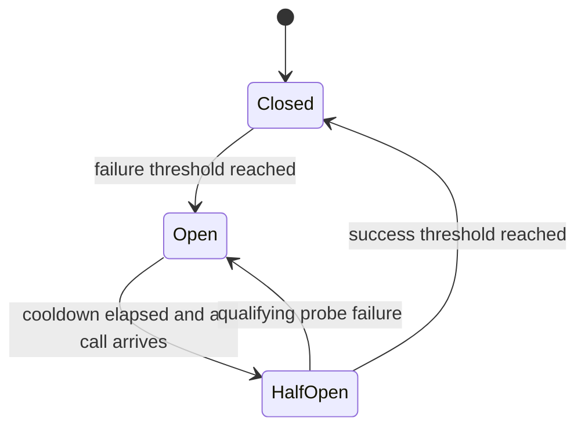

<!-- BUNDLE_SIZE:START -->

> 2.81 kB minified + gzipped

<!-- BUNDLE_SIZE:END -->

A package registry starts returning timeouts, and every build that needs metadata waits the full
timeout before failing. The retries keep arriving while the registry is trying to recover, so the
outage lasts longer than it would have under no load.

## Core Behavior

`CircuitBreaker<E>` runs fallible tasks and blocks calls after enough qualifying failures, until a
cooldown ends and a probe can test recovery.

- In `Closed`, protected tasks run and qualifying failures count toward `failureThreshold`. Without
  a `failureWindow`, a success resets that count.
- In `Open`, calls settle immediately with `CircuitBreaker.OpenError` and never start their task.
  Once `resetTimeout` elapses, the next call becomes a probe.
- In `HalfOpen`, one probe runs at a time. `successThreshold` successful probes close the circuit,
  and a qualifying failure opens it again.

Use the breaker when a dependency is known to fail and callers should stop paying the timeout. When
overlapping calls need a policy for how they replace or queue, [`Op`](/guides/op/) manages them and
holds the breaker at the task boundary. [Reading the Types](/basics/types/) notes that a breaker is
an instance as soon as it is created, and the [choosing guide](/basics/choosing/) places it next to
the other execution modules.

## Example: Package Registry Requests

A build service retrieves package metadata from a registry. If the registry repeatedly fails, the
service pauses requests briefly and then admits one request to check whether the registry has
recovered.

The breaker opens after the configured number of failures. Once the cooldown has elapsed, the next
protected call becomes the probe:



### Protecting a Registry Request

`Task.Result.tryCatch` turns request failures into strings. `breaker.run` adds
`CircuitBreaker.OpenError` to the error channel of the result it returns:

```ts
import { CircuitBreaker, Duration, Result, Task, pipe } from "@pplnd/core";

const registry = CircuitBreaker.make<string>({
  failureThreshold: 2,
  resetTimeout: Duration.seconds(30),
});

const readPackage = (name: string): Task.Result<string, string> =>
  Task.Result.tryCatch(
    async (signal) => {
      const response = await fetch(`/registry/${encodeURIComponent(name)}`, { signal });
      if (!response.ok) throw new Error(`Registry HTTP ${response.status}`);
      return response.text();
    },
    { onError: (error) => String(error) },
  );

const packageDescription = async (name: string): Promise<string> => {
  const outcome = await registry.run(readPackage(name));
  return pipe(
    outcome,
    Result.match({
      ok: (description) => description,
      err: (error) =>
        CircuitBreaker.is.openError(error)
          ? `Registry cooling down; retry after ${error.retryAfterMs}ms`
          : `Registry request failed: ${error}`,
    }),
  );
};

console.log(await packageDescription("parser"));
```

A blocked call never reaches `readPackage`, so it resolves without a request. The `OpenError`
carries the last failure and the remaining cooldown in `retryAfterMs`.

### Retrying Under a Manager

A build that needs metadata can retry a transient registry failure without retrying a blocked call,
because the breaker has already decided that the registry is unavailable:

```ts
import { CircuitBreaker, Duration, Op, RetryPolicy } from "@pplnd/core";

const registryChecks = Op.interpret(
  Op.make((name: string) => (signal?: AbortSignal) => registry.run(readPackage(name), { signal })),
  {
    strategy: "exclusive",
    retry: RetryPolicy.constant({
      attempts: 2,
      delay: Duration.milliseconds(200),
      when: (error) => !CircuitBreaker.is.openError(error),
    }),
  },
);

const outcome = await registryChecks.run("parser");
// OpOk(description), OpErr(last registry error), or OpNil("dropped") while another check runs
```

The manager retries a failed registry read once, then reports `Retrying` to subscribers. A blocked
call is not retried, because the retry predicate filters `OpenError`. The [Op guide](/guides/op/)
covers strategies and retry state.

## Core Operations

### Creating and Protecting

| Signature                       | What it does                                               | Result                                                     |
| :------------------------------ | :--------------------------------------------------------- | :--------------------------------------------------------- |
| `CircuitBreaker.make(config)`   | Creates a breaker with a failure threshold and a cooldown. | A breaker instance                                         |
| `breaker.run(task, { signal })` | Runs a protected `Task.Result`.                            | `Deferred` result whose error channel includes `OpenError` |
| `breaker.reset()`               | Clears recorded failures and closes the circuit.           | `void`                                                     |
| `breaker.subscribe(listener)`   | Observes state transitions.                                | An unsubscribe function                                    |

`failureThreshold` sets the number of failures that opens the circuit. `resetTimeout` sets the
cooldown. `successThreshold` sets the successful probes needed to close and defaults to one.
`shouldTrip` selects which errors count, and it defaults to every error. With `failureWindow`,
qualifying failures are counted over that duration; without it, consecutive failures are counted and
a success resets the count.

### Reading State and Errors

| Signature                            | What it does                   | Result                          |
| :----------------------------------- | :----------------------------- | :------------------------------ |
| `breaker.state()`                    | Reads the current state.       | `Closed`, `Open`, or `HalfOpen` |
| `CircuitBreaker.is.closed(state)`    | Checks for normal operation.   | Type guard                      |
| `CircuitBreaker.is.open(state)`      | Checks for a tripped circuit.  | Type guard                      |
| `CircuitBreaker.is.halfOpen(state)`  | Checks for trial recovery.     | Type guard                      |
| `CircuitBreaker.is.openError(value)` | Checks for a fast-failed call. | Type guard                      |

`Closed` reports the current failure count, `Open` reports `retryAfterMs` and the error that tripped
it, and `HalfOpen` reports whether a probe is in flight and how many probes have succeeded.

## Failure Behavior and Edge Cases

A non-tripping error still reaches the caller. During a recovery probe it also counts toward the
recovery threshold, because `shouldTrip` classifies it as not indicating an unavailable dependency:

```ts
import { CircuitBreaker, Duration, Task } from "@pplnd/core";

const lookupBreaker = CircuitBreaker.make<string>({
  failureThreshold: 1,
  resetTimeout: Duration.milliseconds(0),
  shouldTrip: (error) => error !== "package not found",
});

await lookupBreaker.run(Task.Result.make.err("registry unavailable"));
// The cooldown has elapsed, so lookupBreaker.state().kind is "HalfOpen".
await lookupBreaker.run(Task.Result.make.err("package not found"));
// The caller receives Err("package not found"); lookupBreaker.state().kind is "Closed".
```

A concurrent call during an active probe receives `CircuitBreaker.OpenError` with `retryAfterMs` of
zero. `state()` can report `HalfOpen` after the cooldown even before a call starts a probe.

`reset()` closes the circuit and clears its failure history. It does not cancel an in-flight probe:
the original caller receives that task's result, but the old probe cannot change the breaker's state
after reset. To request cancellation, pass a signal to `run` and abort its controller.

Protected tasks must not throw or reject. Use `Task.Result.tryCatch` to map expected failures before
passing a task to the breaker. The breaker forwards the signal to the task and waits for its result;
the task must cooperate with cancellation to stop its work. An aborted task's error is returned to
its caller and does not count toward the failure threshold. [Aborted](/guides/aborted/) describes
the cancellation value that `Graph`, `Transaction`, and `Batcher` return instead.

A non-finite `failureThreshold` becomes 1, and a fractional one rounds down. A `resetTimeout` of
`Duration.milliseconds(0)` makes the circuit ready for a probe on the next call, while an infinite
timeout keeps it open indefinitely. A listener that throws interrupts the notification loop; keep
observers free of exceptions.
