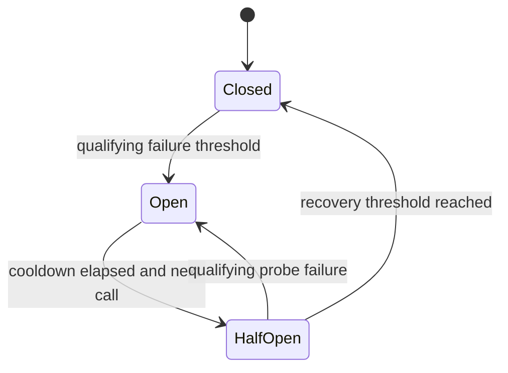

<!-- BUNDLE_SIZE:START -->

> 2.83 kB minified + gzipped

<!-- BUNDLE_SIZE:END -->

## Core Behavior

`CircuitBreaker` wraps fallible tasks and temporarily blocks calls after enough qualifying failures.
A blocked call returns an error without running its task.

- In `Closed`, protected tasks run and qualifying failures count toward the threshold.
- In `Open`, calls return `CircuitBreaker.OpenError` until the cooldown has elapsed.
- In `HalfOpen`, one probe runs at a time. Enough successful probes close the circuit; a qualifying
  failure opens it again.

## Example: Package Registry Requests

A build service retrieves package metadata from a registry. If the registry repeatedly fails, the
service can pause requests briefly and then try one request to check recovery.

The breaker opens after the configured number of failures. Once the cooldown has elapsed, the next
protected call is admitted as a probe:



### Protecting a Registry Request

`Task.Result.tryCatch` turns request failures into strings. The protected task can also return a
`CircuitBreaker.OpenError` while the circuit is blocking calls:

```ts
import { CircuitBreaker, Duration, Result, Task, pipe } from "@pplnd/core";

const registry = CircuitBreaker.make<string>({
  failureThreshold: 2,
  resetTimeout: Duration.seconds(30),
});

const readPackage = (name: string): Task.Result<string, string> =>
  Task.Result.tryCatch(
    async (signal) => {
      const response = await fetch(`/registry/${encodeURIComponent(name)}`, { signal });
      if (!response.ok) throw new Error(`Registry HTTP ${response.status}`);
      return response.text();
    },
    { onError: (error) => String(error) },
  );

const packageDescription = async (name: string): Promise<string> => {
  const outcome = await pipe(readPackage(name), registry.protect)();
  return pipe(
    outcome,
    Result.match({
      ok: (description) => description,
      err: (error) =>
        CircuitBreaker.is.openError(error)
          ? `Registry cooling down; retry after ${error.retryAfterMs}ms`
          : `Registry request failed: ${error}`,
    }),
  );
};

console.log(await packageDescription("parser"));
```

## Core Operations

### Creating and Protecting

| Signature                                                 | What it does                                             | Result                                                  |
| :-------------------------------------------------------- | :------------------------------------------------------- | :------------------------------------------------------ |
| `CircuitBreaker.make(config)`                             | Creates a breaker with a failure threshold and cooldown. | A breaker instance.                                     |
| `breaker.protect(task)`                                   | Wraps a `Task.Result`.                                   | A task whose error includes `CircuitBreaker.OpenError`. |
| `breaker.state()`                                         | Reads the current state.                                 | `Closed`, `Open`, or `HalfOpen`.                        |
| `breaker.subscribe(listener)`                             | Observes state notifications.                            | An unsubscribe function.                                |
| `breaker.reset()`                                         | Clears the recorded failures and closes the circuit.     | `void`.                                                 |
| `CircuitBreaker.is.openError/closed/open/halfOpen(value)` | Checks an error or state.                                | Type guard.                                             |

`failureThreshold` sets the number of failures needed to open. `resetTimeout` controls the cooldown.
`successThreshold` sets the number of recovery probes needed to close and defaults to one.
`shouldTrip` selects which errors count. With `failureWindow`, qualifying failures are counted over
that duration; without it, successful calls reset the consecutive-failure count.

## Failure Behavior and Edge Cases

A non-tripping error still reaches the caller. During a recovery probe it also counts toward the
recovery threshold, because `shouldTrip` classifies it as not indicating an unavailable dependency:

```ts
import { CircuitBreaker, Duration, Task } from "@pplnd/core";

const registry = CircuitBreaker.make<string>({
  failureThreshold: 1,
  resetTimeout: Duration.milliseconds(0),
  shouldTrip: (error) => error !== "package not found",
});

await registry.protect(Task.Result.make.err("registry unavailable"))();
// The cooldown has elapsed, so registry.state().kind is "HalfOpen".
await registry.protect(Task.Result.make.err("package not found"))();
// The caller receives Err("package not found"); registry.state().kind is "Closed".
```

A concurrent call during an active probe receives `CircuitBreaker.OpenError` with `retryAfterMs` of
zero. `state()` can report `HalfOpen` after the cooldown even before a call starts a probe.

If a protected task throws when invoked, the caller receives `CircuitBreaker.Unexpected` with the
original cause. The exception counts as a failure and can become the `lastError` in open state; an
already-aborted call does not count toward the failure threshold.
