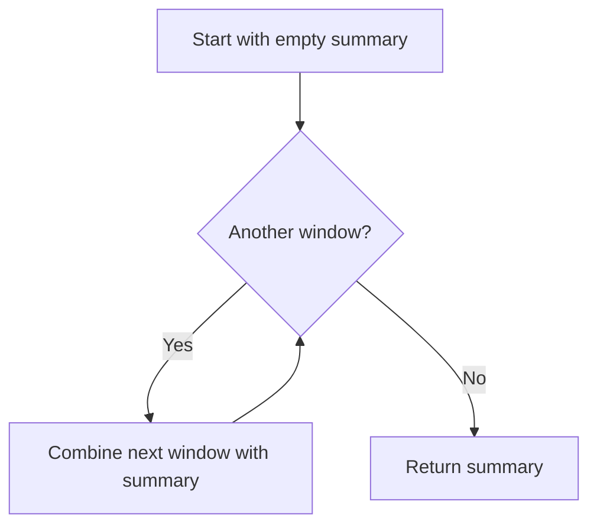

<!-- BUNDLE_SIZE:START -->

> 1.78 kB minified + gzipped

<!-- BUNDLE_SIZE:END -->

## Core Behavior

`Combinable<A>` contains an `empty` starting value and a `combine(next)(accumulated)` function for
combining values.

- `combineAll` starts with `empty` and combines items in input order.
- `struct` combines each selected field using its own rule.
- `maybe` treats `None` as empty and combines the values when both inputs are `Some`.

## Example: Traffic Summaries

A service records request counts and warning messages for each time window. It can combine several
window summaries into a report, including a useful result when there are no windows.

`combineAll` starts with the rule's empty value, then passes each item and the current accumulation
to `combine`:



### Combining Window Summaries

```ts
import { Combinable, pipe } from "@pplnd/core";

const summaryRule = Combinable.struct({
  requests: Combinable.sum,
  warnings: Combinable.array<string>(),
});
const windows = [
  { requests: 12, warnings: ["slow response"] },
  { requests: 8, warnings: ["retry"] },
];
const summary = pipe(windows, Combinable.combineAll(summaryRule));
// { requests: 20, warnings: ["slow response", "retry"] }
```

## Core Operations

| Signature                     | What it does                                  | Empty value                              |
| :---------------------------- | :-------------------------------------------- | :--------------------------------------- |
| `Combinable.string`           | Concatenates strings.                         | `""`                                     |
| `Combinable.sum` / `product`  | Adds / multiplies numbers.                    | `0` / `1`                                |
| `Combinable.all` / `any`      | Combines booleans with AND / OR.              | `true` / `false`                         |
| `Combinable.array<A>()`       | Concatenates arrays.                          | `[]`                                     |
| `Combinable.maybe(rule)`      | Combines optional values with the inner rule. | `None`                                   |
| `Combinable.struct(fields)`   | Builds a rule for a record from field rules.  | Record of each field's empty value.      |
| `Combinable.combineAll(rule)` | Combines an array in order.                   | Returns the rule's empty value for `[]`. |

## Failure Behavior and Edge Cases

For a custom rule, the function receives the next item first and the accumulated value second. This
matters when order affects the result:

```ts
import { Combinable, pipe } from "@pplnd/core";

pipe(["slow", "retry"], Combinable.combineAll(Combinable.string)); // "slowretry"
Combinable.string.combine("retry")("slow"); // "slowretry"
```

A custom `empty` and `combine` should agree on the intended identity: combining `empty` with a value
in either position should return that value.
