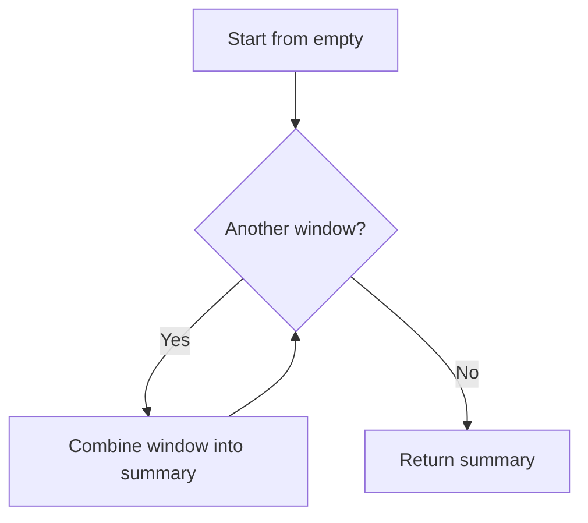

<!-- BUNDLE_SIZE:START -->

> 1.74 kB minified + gzipped

<!-- BUNDLE_SIZE:END -->

Each time window reports its own request count and warning messages. A report over four windows must
total the counts, concatenate the lists, and still produce zero requests and no warnings when the
list is empty. Writers who loop by hand repeat the starting values at each call site, and one of
them starts the count at one.

## Core Behavior

`Combinable<A>` is a pair: an `empty` value and `combine(next)(accumulated)`, which merges one more
value into the running result.

- `combine` receives the new item first and the accumulated value second; `combineAll` starts from
  `empty` and processes items in input order.
- `struct` derives a rule from field rules, building an empty record and a fresh record for every
  combination.
- `maybe` treats `None` as the identity and combines the inner values when both sides are `Some`.
- Built-in identities are `""` for `string`, `0` for `sum`, `1` for `product`, `true` for `all`,
  `false` for `any`, and `[]` for `array`.

Reach for `Combinable` when a collection must fold into one value under defined merge rules. When
two records merge by shallow overwrite, [`Rec`](/guides/rec/) provides `merge` and `mergeWith`. The
[choosing guide](/basics/choosing/) compares the modules that share this problem.

## Example: Traffic Summaries

A service records request counts and warning messages for each time window. The report combines
every window into one summary and has to return a useful summary when the list is empty.

`combineAll` starts from the rule's empty value, then passes each item and the current accumulation
to `combine`:



### Combining Window Summaries

```ts
import { Combinable, pipe } from "@pplnd/core";

type WindowSummary = { requests: number; warnings: readonly string[] };

const summaryRule = Combinable.struct({
  requests: Combinable.sum,
  warnings: Combinable.array<string>(),
});

const windows: readonly WindowSummary[] = [
  { requests: 12, warnings: ["slow response"] },
  { requests: 8, warnings: ["retry"] },
];

const summary = pipe(windows, Combinable.combineAll(summaryRule));
// { requests: 20, warnings: ["slow response", "retry"] }

const noWindows: readonly WindowSummary[] = [];
const emptySummary = pipe(noWindows, Combinable.combineAll(summaryRule));
// { requests: 0, warnings: [] }
```

`array` concatenates without mutating either input, and `struct` applies each field rule and creates
a new record. The empty list returns the struct's empty record, with zero requests and no warnings.

### Overriding Window Fields

A report sometimes needs the latest window to override earlier fields instead of accumulating them.
`Rec.merge` performs a shallow merge with right precedence:

```ts
import { pipe, Rec } from "@pplnd/core";

const baseWindow = { requests: 12, warnings: ["slow response"] };
const latestWindow = { requests: 8, warnings: ["retry"] };
const merged = pipe(baseWindow, Rec.merge(latestWindow));
// { requests: 8, warnings: ["retry"] }
```

The [Rec guide](/guides/rec/) covers key selection and collision handling with `mergeWith`.

## Core Operations

### Creating Rules

| Signature                 | What it does                            | Identity |
| :------------------------ | :-------------------------------------- | :------- |
| `Combinable.string`       | Concatenates strings.                   | `""`     |
| `Combinable.sum`          | Adds numbers.                           | `0`      |
| `Combinable.product`      | Multiplies numbers.                     | `1`      |
| `Combinable.all`          | Combines booleans with AND.             | `true`   |
| `Combinable.any`          | Combines booleans with OR.              | `false`  |
| `Combinable.array<A>()`   | Concatenates arrays.                    | `[]`     |
| `Combinable.maybe(inner)` | Lifts an inner rule to optional values. | `None`   |

### Building Structured Rules

| Signature                   | What it does                            | Result          |
| :-------------------------- | :-------------------------------------- | :-------------- |
| `Combinable.struct(fields)` | Derives a record rule from field rules. | `Combinable<R>` |

### Running a Fold

| Signature                     | What it does                   | Result                                |
| :---------------------------- | :----------------------------- | :------------------------------------ |
| `Combinable.combineAll(rule)` | Folds an array in input order. | `A`; the rule's empty value for `[]`. |

## Failure Behavior and Edge Cases

`combine` receives the next item first. For `string` and `array`, reversing the arguments changes
the result:

```ts
import { Combinable, pipe } from "@pplnd/core";

pipe(["slow", "retry"], Combinable.combineAll(Combinable.string)); // "slowretry"
Combinable.string.combine("retry")("slow"); // "slowretry"
```

`combineAll` returns `empty` for an empty array and never calls `combine`.

`struct` captures its rule keys when it is built and writes only those keys into the result. Fields
on an input that the rule does not list are absent from the combined record; the rule does not start
from the first item.

`maybe` treats `None` on either side as the identity, so `None` combined with `None` returns `None`.
Two `Some` values combine the inner values and wrap the result in `Some`.

`empty` and `combine` are not checked against each other. A custom rule whose `empty` is not an
identity produces a different result for an empty array than for the same value combined explicitly;
verify both argument orders when defining one.
