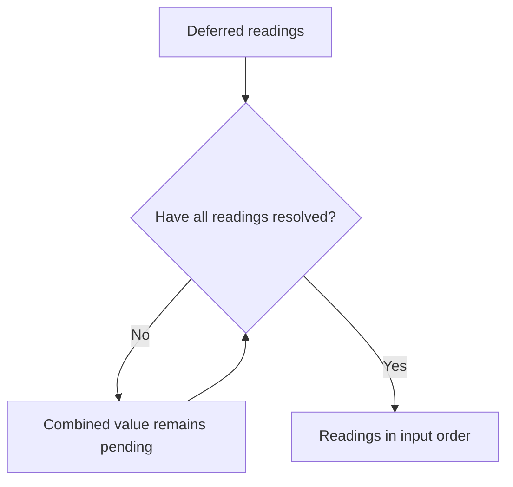

<!-- BUNDLE_SIZE:START -->

> 108 B minified + gzipped

<!-- BUNDLE_SIZE:END -->

## Core Behavior

`Deferred<A>` is an awaitable value for an asynchronous operation that is expected to resolve
without rejecting. It is the return type of a `Task` and of `Op` manager runs.

- Await a `Deferred` to get its value; use `Deferred.to.Promise` when an API needs a native Promise.
- `Deferred.all` waits for every value; `Deferred.race` returns the first value to resolve.
- `Deferred.from.Promise` assumes its input will not reject. Handle failures before wrapping it.

## Example: Snapshot Status

A snapshot exporter might wait for several independent status readings after each source has already
converted its own errors into a fallback. `Deferred` lets the exporter await those values without
adding another error channel.

`Deferred.all` combines values that are already in progress. Its output resolves only after every
input resolves, and preserves the input order:



### Collecting Status Readings

Each status source handles a failure before its Promise is wrapped. The exporter can then wait for
both readings and format a single status line:

```ts
import { Deferred } from "@pplnd/core";

const readStatus = (url: string): Deferred<string> =>
  Deferred.from.Promise(
    fetch(url)
      .then((response) => {
        if (!response.ok) throw new Error(`HTTP ${response.status}`);
        return response.text();
      })
      .catch(() => "unavailable"),
  );

const report = async (): Promise<string> => {
  const [primary, replica] = await Deferred.all([
    readStatus("/snapshot/primary"),
    readStatus("/snapshot/replica"),
  ]);
  return `Snapshot sources: primary=${primary}, replica=${replica}`;
};

console.log(await report());
```

The calls to `readStatus` start the requests. `Deferred.all` only combines their results; it does
not start or cancel the requests.

## Core Operations

### Creating and Converting

| Signature                       | What it does                                      | Return type   |
| :------------------------------ | :------------------------------------------------ | :------------ |
| `Deferred.from.Promise(value)`  | Wraps a promise or thenable that will not reject. | `Deferred<A>` |
| `Deferred.to.Promise(deferred)` | Converts an awaitable value to a native Promise.  | `Promise<A>`  |

### Combining and Reading

| Signature               | What it does                                   | Return type              |
| :---------------------- | :--------------------------------------------- | :----------------------- |
| `Deferred.all(values)`  | Waits for every value, preserving input order. | `Deferred` of the tuple. |
| `Deferred.race(values)` | Resolves with the first value to resolve.      | `Deferred<A>`            |
| `await deferred`        | Reads the resolved value.                      | `A`                      |

## Failure Behavior and Edge Cases

`Deferred.from.Promise` does not catch rejections. If its input rejects, awaiting the wrapper can
remain pending and the rejection can be unhandled. Use `Task.Result.tryCatch` for work that can
fail, or handle the rejection before wrapping as in the example above.

`Deferred.race([])` stays pending because there is no value to resolve it. A race does not cancel
its other inputs after one resolves.
