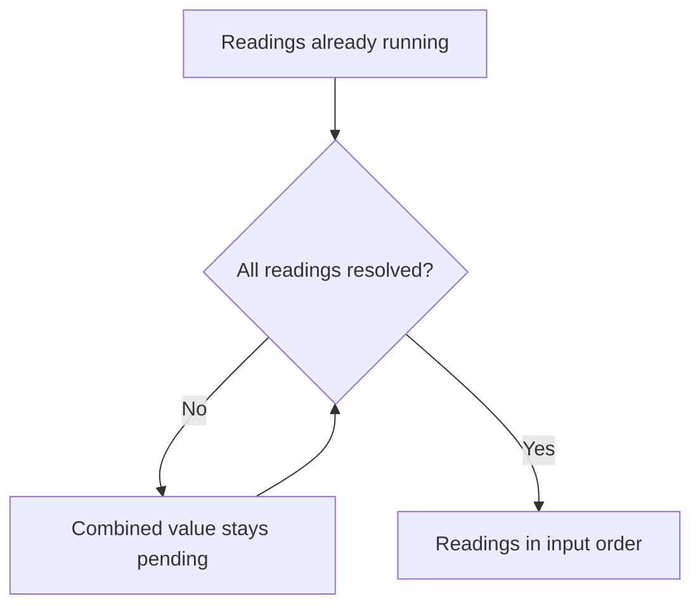

<!-- BUNDLE_SIZE:START -->

> 142 B minified + gzipped

<!-- BUNDLE_SIZE:END -->

A snapshot exporter asks a primary and a replica source for the same reading. Each source already
turns its own network failure into a fallback string, so what remains is a value that arrives later.
Passing those promises around leaves the reader guessing which stage can still reject, and a
rejection that is never observed surfaces as an unhandled promise warning far from the code that
dropped it.

## Core Behavior

`Deferred<A>` is a one-shot awaitable value for asynchronous work that resolves without rejecting.

- `await` yields the value. The type has no rejection handler, so there is no `.catch()` to call.
- `map`, `chain`, and `tap` reshape the settled value and keep it awaitable; they start no work.
- `Deferred.all` waits for every input and preserves input order. `Deferred.race` settles with the
  first input.
- `Deferred.from.Promise` assumes its input resolves, and `Deferred.to.Promise` produces a native
  promise for an API that requires one.

Use `Deferred` when the work is already running and only the value is missing. A
[`Task`](/guides/task/) describes work that has not started and produces a deferred value when it is
run. [Reading the Types](/basics/types/) covers the split between definitions, instances, and
settled values, and the [choosing guide](/basics/choosing/) lists the shapes that produce one.

## Example: Snapshot Status

A snapshot exporter waits for readings from a primary and a replica source. Each source converts its
own request failure into the string `"unavailable"` before the exporter sees it, so the exporter
combines values that are already in progress.

`Deferred.all` resolves only after every input resolves, and it keeps the input order. The diagram
shows the state of the combined value, not the work of the sources:



### Collecting Status Readings

The `.catch` runs before the promise is wrapped, which keeps the rejection channel out of the
awaitable type:

```ts
import { Deferred } from "@pplnd/core";

const readStatus = (url: string): Deferred<string> =>
  Deferred.from.Promise(
    fetch(url)
      .then((response) => {
        if (!response.ok) throw new Error(`HTTP ${response.status}`);
        return response.text();
      })
      .catch(() => "unavailable"),
  );

const report = async (): Promise<string> => {
  const [primary, replica] = await Deferred.all([
    readStatus("/snapshot/primary"),
    readStatus("/snapshot/replica"),
  ]);
  return `Snapshot sources: primary=${primary}, replica=${replica}`;
};

console.log(await report());
```

The calls to `readStatus` start the requests. `Deferred.all` only combines their results; it starts
nothing and cancels nothing.

A pipeline can reshape the combined value without converting it back to a promise. The mapper
receives the resolved pair and returns a new value, and the result stays awaitable:

```ts
import { Deferred, pipe } from "@pplnd/core";

const summary = pipe(
  Deferred.all([readStatus("/snapshot/primary"), readStatus("/snapshot/replica")]),
  Deferred.map(([primary, replica]: [string, string]) => `primary=${primary}, replica=${replica}`),
);

console.log(await summary); // "primary=ready, replica=unavailable"
```

### Owning the Refresh

A dashboard can refresh the same two readings when the user selects a different snapshot. `Op` takes
the composed value as one task and decides what a second refresh does to the first:

```ts
import { Deferred, Op, Task, pipe } from "@pplnd/core";

const readSnapshot: Task<string> = () =>
  pipe(
    Deferred.all([readStatus("/snapshot/primary"), readStatus("/snapshot/replica")]),
    Deferred.map(([primary, replica]) => `primary=${primary}, replica=${replica}`),
  );

const snapshot = Op.interpret(Op.make(() => Task.Result.from.Task(readSnapshot)), {
  strategy: "exclusive",
});

const outcome = await snapshot.run();
// OpOk("primary=ready, replica=unavailable"), or OpNil("dropped") while a refresh is in flight
```

The manager settles `run()` to one outcome, so the dashboard awaits the same kind of value it
awaited before. The [Op guide](/guides/op/) covers strategies that replace or queue overlapping
work.

## Core Operations

### Creating and Converting

| Signature                        | What it does                                      | Return type   |
| :------------------------------- | :------------------------------------------------ | :------------ |
| `Deferred.from.Promise(promise)` | Wraps a promise or thenable that will not reject. | `Deferred<A>` |
| `Deferred.to.Promise(deferred)`  | Converts an awaitable value to a native promise.  | `Promise<A>`  |

### Transforming

| Signature                   | What it does                                         | Return type   |
| :-------------------------- | :--------------------------------------------------- | :------------ |
| `Deferred.map(transform)`   | Transforms the resolved value.                       | `Deferred<B>` |
| `Deferred.chain(transform)` | Runs the next deferred step after this one resolves. | `Deferred<B>` |
| `Deferred.tap(sideEffect)`  | Observes the resolved value and passes it through.   | `Deferred<A>` |

### Combining and Reading

| Signature               | What it does                                   | Return type             |
| :---------------------- | :--------------------------------------------- | :---------------------- |
| `Deferred.all(values)`  | Waits for every value, preserving input order. | `Deferred` of the tuple |
| `Deferred.race(values)` | Settles with the first value to resolve.       | `Deferred<A>`           |
| `await deferred`        | Reads the resolved value.                      | `A`                     |

## Failure Behavior and Edge Cases

`Deferred.from.Promise` does not catch rejections. If its input rejects, the wrapper never resolves
and the rejection is unhandled. Handle the failure before wrapping, as `readStatus` does with
`.catch`, or use [`Task.Result.tryCatch`](/guides/task/) for work that can fail.

`Deferred.race([])` stays pending because no value can resolve it. A race does not cancel its other
inputs after one resolves; cancelling the work is the producer's job, through the `AbortSignal`
given to the [`Task`](/guides/task/) or [`Op`](/guides/op/) that started it.

Callbacks passed to `map`, `chain`, and `tap` must not throw. A throw rejects the internal promise,
which has no rejection handler, so the returned value stays pending instead of surfacing an error.

`Deferred.all` resolves only after every input resolves and keeps the input order. One input that
never resolves keeps the combined value pending. `Deferred.to.Promise` inherits the same rule: a
value that never resolves produces a promise that never settles.
