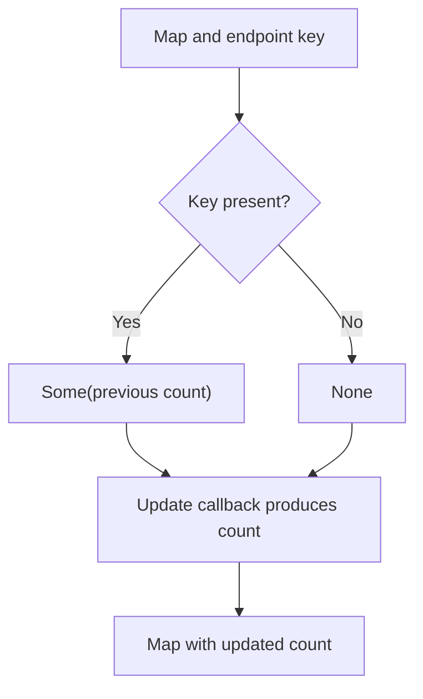

<!-- BUNDLE_SIZE:START -->

> 2.43 kB minified + gzipped

<!-- BUNDLE_SIZE:END -->

## Core Behavior

`Dict` operates on `ReadonlyMap` values, including maps with object keys. Updates return a map
without mutating the input.

- `lookup` distinguishes a missing key from a present key containing `undefined`.
- `upsert` receives the previous value as `Maybe` and writes the callback's result.
- `union` takes values from the supplied map when both maps contain the same key.

## Example: Counts by Endpoint

A service tracks request counts by endpoint object. A new request should increment an existing count
or start one at zero.

`upsert` calls the same update function for both cases, passing the previous value when present:



### Updating Counts

```ts
import { Dict, Maybe, pipe } from "@pplnd/core";

type Endpoint = { path: string };
const reports: Endpoint = { path: "/reports" };
const counts: ReadonlyMap<Endpoint, number> = Dict.empty();

const increment = (endpoint: Endpoint, current: ReadonlyMap<Endpoint, number>) =>
  pipe(
    current,
    Dict.upsert(endpoint, (previous: Maybe<number>) =>
      pipe(previous, Maybe.getOrElse(() => 0)) + 1
    ),
  );

const updated = increment(reports, increment(reports, counts));
pipe(updated, Dict.lookup(reports)); // Some(2)
Dict.size(counts); // 0
```

## Core Operations

### Creating and Reading

| Signature                                                                 | What it does                             | Result                                      |
| :------------------------------------------------------------------------ | :--------------------------------------- | :------------------------------------------ |
| `Dict.empty()` / `singleton(key, value)`                                  | Creates an empty / single-entry map.     | `ReadonlyMap`.                              |
| `Dict.from.entries(pairs)` / `from.record(record)` / `from.nullable(map)` | Converts existing data to a map.         | A map, or `Maybe` for nullable input.       |
| `Dict.lookup(key)` / `has(key)`                                           | Reads a value / tests key membership.    | `Maybe` / boolean.                          |
| `Dict.keys` / `values` / `entries` / `size`                               | Reads map contents or size.              | Arrays or a count.                          |
| `Dict.to.record(map)`                                                     | Converts a string-keyed map to a record. | A record.                                   |
| `Dict.is.empty` / `is.nonEmpty` / `Dict.NonEmpty.from.map(map)`           | Checks whether entries exist.            | Boolean guard / `Maybe` of a non-empty map. |

### Updating and Combining

| Signature                                                             | What it does                           | Behavior                                     |
| :-------------------------------------------------------------------- | :------------------------------------- | :------------------------------------------- |
| `Dict.insert(key, value)` / `remove(key)` / `upsert(key, fn)`         | Inserts, removes, or updates an entry. | Returns a map.                               |
| `Dict.map(fn)` / `mapWithKey(fn)` / `mapKeys(fn)` / `mapEntries(fn)`  | Transforms values, keys, or entries.   | Key collisions keep the later entry.         |
| `Dict.filter(fn)` / `filterWithKey(fn)` / `filterMap(fn)` / `compact` | Selects or unwraps values.             | Returns a map.                               |
| `Dict.groupBy(fn)`                                                    | Groups array items by a key.           | Returns a map of non-empty arrays.           |
| `Dict.union(other)` / `intersection(other)` / `difference(other)`     | Combines or selects keys.              | `difference` keeps keys absent from `other`. |
| `Dict.mergeWith(combine)(other)`                                      | Merges values at matching keys.        | Callback receives first and second values.   |
| `Dict.reduce(initial, fn)` / `reduceWithKey(initial, fn)`             | Accumulates entries.                   | Returns the final value.                     |
| `Dict.NonEmpty.keys/values/entries/map/reduce`                        | Works with a known non-empty map.      | Non-empty results where applicable.          |

## Failure Behavior and Edge Cases

Map keys use JavaScript's key equality. Two separate objects with the same fields are different
keys, so looking up an endpoint requires the same object used to insert it. Use a stable string key
if equivalent endpoint objects should address the same entry.

`Dict.lookup` returns `Some(undefined)` for a present key with that value and `None` for a missing
key. `intersection` keeps values from the input map, while `union` prefers the supplied map's
values.
