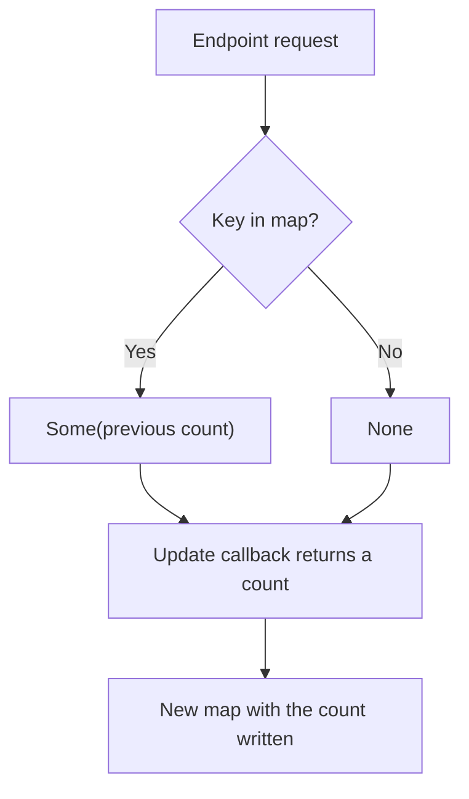

<!-- BUNDLE_SIZE:START -->

> 2.44 kB minified + gzipped

<!-- BUNDLE_SIZE:END -->

A gateway counts requests per endpoint. The router builds an endpoint descriptor for each request,
and the counter table is keyed by that descriptor. A rebuilt descriptor with the same method and
path is a different key, so every request starts a new count at one and the dashboard never sees the
traffic.

## Core Behavior

`Dict` operates on `ReadonlyMap`, so keys can be any value and membership follows JavaScript key
equality. No operation modifies the input map.

- `lookup` distinguishes a missing key from a present key holding `undefined`.
- `upsert` receives the previous value as `Maybe` and writes the callback's result.
- `union` takes the supplied map's values on collisions; `intersection` and `difference` keep the
  input map's values.
- `groupBy` returns a map whose values are non-empty arrays.

Reach for `Dict` when keys are arbitrary values and identity matters. [`Rec`](/guides/rec/) covers
plain string-keyed objects and converts through `Rec.to.Dict` and `Dict.to.record`. The
[choosing guide](/basics/choosing/) compares them.

## Example: Request Counts by Endpoint

An API gateway tallies requests per endpoint. The endpoint descriptor is assembled once at startup,
so repeated lookups use the same object; a second descriptor with identical fields stays a separate
key.

`upsert` calls the same update function whether the key is present or not, passing the previous
count as a `Maybe`:



### Tallying Requests

```ts
import { Dict, Maybe, pipe } from "@pplnd/core";

type Endpoint = { method: string; path: string };

const reports: Endpoint = { method: "GET", path: "/reports" };
const invoices: Endpoint = { method: "GET", path: "/invoices" };

const tally =
  (endpoint: Endpoint) =>
  (counts: ReadonlyMap<Endpoint, number>): ReadonlyMap<Endpoint, number> =>
    pipe(
      counts,
      Dict.upsert(
        endpoint,
        (previous: Maybe<number>) => pipe(previous, Maybe.getOrElse(() => 0)) + 1,
      ),
    );

const empty: ReadonlyMap<Endpoint, number> = Dict.empty();
const counted = pipe(empty, tally(reports), tally(reports), tally(invoices));

pipe(counted, Dict.lookup(reports)); // Some(2)
pipe(counted, Dict.lookup({ method: "GET", path: "/reports" })); // None
Dict.size(empty); // 0
```

`counted` is a new map. The last lookup passes a freshly built descriptor, which is a distinct key
even though its fields match `reports`.

### Handoff: Writing Counts Into a JSON Body

The dashboard sends the counts under string keys. `Dict.mapKeys` flattens each descriptor, and
`Dict.to.record` produces the object that `JSON.stringify` expects:

```ts
const report = pipe(
  counted,
  Dict.mapKeys((endpoint: Endpoint) => `${endpoint.method} ${endpoint.path}`),
  Dict.to.record,
);
// { "GET /reports": 2, "GET /invoices": 1 }
```

From there [`Rec`](/guides/rec/) can map or merge the object with other response fields. Object
identity ends at the conversion: the record has string keys only.

## Core Operations

### Creating and Reading

| Signature                                                                           | What it does                                  | Result                                 |
| :---------------------------------------------------------------------------------- | :-------------------------------------------- | :------------------------------------- |
| `Dict.empty()` / `Dict.singleton(key, value)`                                       | Creates an empty or one-entry map.            | `ReadonlyMap`                          |
| `Dict.from.entries(pairs)` / `Dict.from.record(record)` / `Dict.from.nullable(map)` | Converts pairs, an object, or a nullable map. | A map; `from.nullable` returns `Maybe` |
| `Dict.lookup(key)` / `Dict.has(key)`                                                | Reads a value / tests membership.             | `Maybe` / boolean                      |
| `Dict.keys` / `values` / `entries` / `size`                                         | Reads contents or the entry count.            | Arrays or a count                      |
| `Dict.is.empty` / `Dict.is.nonEmpty`                                                | Tests for entries.                            | Boolean; `is.nonEmpty` narrows         |
| `Dict.to.record(map)`                                                               | Converts a string-keyed map to an object.     | `Record<string, V>`                    |

### Updating

| Signature                                                                                                      | What it does                                            | Result                                         |
| :------------------------------------------------------------------------------------------------------------- | :------------------------------------------------------ | :--------------------------------------------- |
| `Dict.insert(key, value)`                                                                                      | Sets a key.                                             | A new map                                      |
| `Dict.remove(key)`                                                                                             | Deletes a key.                                          | A new map, or the input when the key is absent |
| `Dict.upsert(key, update)`                                                                                     | Writes the callback result, passing the previous value. | A new map                                      |
| `Dict.map(transform)` / `Dict.mapWithKey(transform)`                                                           | Transforms values.                                      | A new map                                      |
| `Dict.mapKeys(transform)` / `Dict.mapEntries(transform)`                                                       | Transforms keys or entries.                             | A new map; later collisions win                |
| `Dict.filter(predicate)` / `Dict.filterWithKey(predicate)` / `Dict.filterMap(transform)` / `Dict.compact(map)` | Selects or unwraps values.                              | A new map                                      |

### Combining and Running

| Signature                                                                   | What it does                    | Result                                                    |
| :-------------------------------------------------------------------------- | :------------------------------ | :-------------------------------------------------------- |
| `Dict.union(other)` / `Dict.intersection(other)` / `Dict.difference(other)` | Combines maps or selects keys.  | `union` prefers `other`; the others keep the input values |
| `Dict.mergeWith(combine)`                                                   | Merges values at matching keys. | Curried or uncurried; `combine` receives both values      |
| `Dict.groupBy(keyBy)`                                                       | Groups array items by a key.    | `ReadonlyMap<K, NonEmptyArr<A>>` in input order           |
| `Dict.reduce(initial, reducer)` / `Dict.reduceWithKey(initial, reducer)`    | Accumulates values / entries.   | The final accumulator                                     |

### Working with Non-Empty Maps

| Signature                                     | What it does                        | Result                             |
| :-------------------------------------------- | :---------------------------------- | :--------------------------------- |
| `Dict.NonEmpty.singleton(key, value)`         | Creates a one-entry map.            | `Dict.NonEmpty`                    |
| `Dict.NonEmpty.from.map(map)`                 | Checks for at least one entry.      | `Maybe<Dict.NonEmpty<...>>`        |
| `Dict.NonEmpty.keys` / `values` / `entries`   | Reads contents as non-empty arrays. | `NonEmptyArr`                      |
| `Dict.NonEmpty.map` / `mapWithKey` / `reduce` | Transforms or folds values.         | A non-empty map or the final value |

## Failure Behavior and Edge Cases

Map keys follow same-value equality: object keys compare by reference, `NaN` matches `NaN`, and `-0`
and `0` name the same entry. Looking up an equivalent descriptor requires the same object, or a
string key produced with `Dict.mapKeys`.

`lookup` returns `Some(undefined)` when the key exists with that value and `None` when it does not;
`has` makes the same distinction. `upsert` passes `Some(undefined)` for that case and `None` only
for an absent key.

`remove` returns the input map unchanged when the key is absent, so reference equality between the
input and the result is possible; `insert` and `upsert` always copy. `union` returns the supplied
map when the input is empty and the input map when the supplied one is empty.

`mapKeys` and `mapEntries` keep the later entry when two keys collide. `mergeWith(combine)` calls
`combine` with the input map's value first and the supplied map's value second. `intersection` and
`difference` keep the input map's values for the keys they retain. `Dict.to.record` accepts string
keys only and writes a `__proto__` key as an own property; [`Rec`](/guides/rec/) covers the
resulting object.
