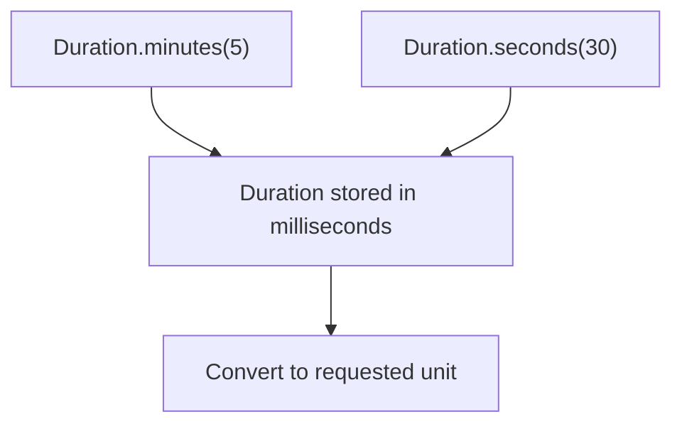

<!-- BUNDLE_SIZE:START -->

> 150 B minified + gzipped

<!-- BUNDLE_SIZE:END -->

A report cache has a five-minute lifetime and a thirty-second grace period. One module passes the
lifetime as seconds, another as milliseconds, and the cache evicts reports while a request is still
reading them. The units survive in variable names rather than in the type.

## Core Behavior

`Duration` is a branded number of milliseconds.

- Constructors convert milliseconds, seconds, minutes, hours, or days into milliseconds; `to.*`
  divides back and can return fractions.
- `add` and `subtract` operate on the stored milliseconds and return a new Duration.
- A plain number is not assignable to Duration; produce one through a constructor.
- Conversions do not clamp: negative and non-finite inputs are stored as given.

Reach for `Duration` when a time quantity crosses a boundary and its unit must survive the trip.
When the quantity configures retry attempts and backoff, a [`RetryPolicy`](/guides/policies/)
consumes it. The [choosing guide](/basics/choosing/) maps value containers; duration is the
primitive those timing options accept.

## Example: Report Cache Expiration

A report cache has a base lifetime and a grace period. The cache API expects milliseconds, while the
policy is easier to read in minutes and seconds.

All constructors produce the same duration type in milliseconds, so arithmetic can combine units:



### Calculating the Cache Lifetime

```ts
import { Duration, pipe } from "@pplnd/core";

const baseLifetime = Duration.minutes(5);
const gracePeriod = Duration.seconds(30);

const cacheLifetime = pipe(baseLifetime, Duration.add(gracePeriod));
const cacheLifetimeMs = Duration.to.milliseconds(cacheLifetime);
const cacheLifetimeSeconds = Duration.to.seconds(cacheLifetime);
// cacheLifetimeMs: 330000
// cacheLifetimeSeconds: 330
```

Pass `cacheLifetime` to APIs that accept `Duration`; pass `cacheLifetimeMs` to a timer or cache API
that accepts a number of milliseconds.

### The same durations in a retry policy

The cache refreshes from a report service that can fail transiently. A
[`RetryPolicy`](/guides/policies/) stores the backoff delays as durations, and [`Op`](/guides/op/)
applies the policy to the call:

```ts
import { Duration, Op, RetryPolicy, Task } from "@pplnd/core";

const retry = RetryPolicy.exponential({
  attempts: 3,
  initial: Duration.seconds(1),
  maxDelay: Duration.seconds(10),
});

const refreshReport = Op.make((reportId: string) =>
  Task.Result.tryCatch(
    (signal) => fetch(`/reports/${reportId}`, { signal }).then((response) => response.json()),
    { onError: () => "NETWORK" as const },
  )
);

const manager = Op.interpret(refreshReport, { strategy: "once", retry });
const outcome = await manager.run("quarterly");
```

The policy caps each delay at `maxDelay` and turns `attempts` into the number of tries; the
[operation](/guides/op/) owns cancellation and overlapping calls, and [Aborted](/guides/aborted/)
covers stopping one call inside it.

## Core Operations

### Creating Durations

| Signature                  | Stores                       |
| :------------------------- | :--------------------------- |
| `Duration.milliseconds(n)` | `n` milliseconds.            |
| `Duration.seconds(n)`      | `n` seconds as milliseconds. |
| `Duration.minutes(n)`      | `n` minutes as milliseconds. |
| `Duration.hours(n)`        | `n` hours as milliseconds.   |
| `Duration.days(n)`         | `n` days as milliseconds.    |

### Converting Durations

| Signature                     | Returns                           |
| :---------------------------- | :-------------------------------- |
| `Duration.to.milliseconds(d)` | The stored milliseconds.          |
| `Duration.to.seconds(d)`      | Milliseconds divided by 1000.     |
| `Duration.to.minutes(d)`      | Milliseconds divided by 60000.    |
| `Duration.to.hours(d)`        | Milliseconds divided by 3600000.  |
| `Duration.to.days(d)`         | Milliseconds divided by 86400000. |

### Calculating

| Signature                   | What it does                                    | Result      |
| :-------------------------- | :---------------------------------------------- | :---------- |
| `Duration.add(amount)`      | Adds the supplied duration to the input.        | `Duration`. |
| `Duration.subtract(amount)` | Subtracts the supplied duration from the input. | `Duration`. |

## Failure Behavior and Edge Cases

Duration constructors do not reject negative or non-finite numbers. `Duration.subtract` can also
produce a negative duration. Check input ranges before using a duration where a positive finite
value is required.

A Duration is a number at runtime and is assignable to `number`, so a function typed to accept a
number receives the stored milliseconds without conversion. Use `Duration.to.<unit>` when the target
expects another unit.

Conversion can return a fraction. `Duration.to.seconds(Duration.milliseconds(1500))` is `1.5`; round
at the call site when the consumer requires an integer.

`RetryPolicy.exponential` clamps its initial and maximum delays to non-negative values and caps
generated delays at `maxDelay`; it does not modify the durations passed in. See [`Op`](/guides/op/)
for retry execution.
