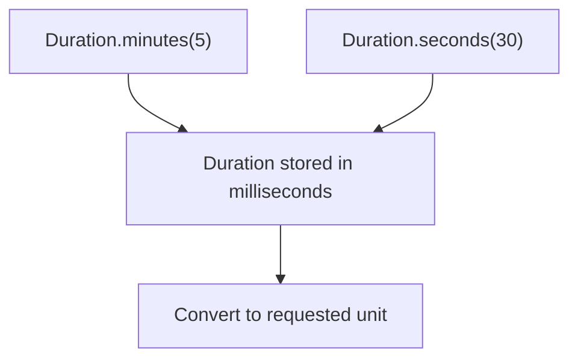

<!-- BUNDLE_SIZE:START -->

> 150 B minified + gzipped

<!-- BUNDLE_SIZE:END -->

## Core Behavior

`Duration` represents a time quantity as a branded number of milliseconds.

- Constructors accept milliseconds, seconds, minutes, hours, or days and convert to milliseconds.
- `add` and `subtract` combine durations; `to` converts a duration back to a number in a chosen
  unit.
- A raw number does not satisfy a parameter typed as `Duration`.

## Example: Report Cache Expiration

A report cache has a base lifetime and a grace period. The cache API expects milliseconds, while the
policy is easier to read in minutes and seconds.

All constructors produce the same duration type in milliseconds, so arithmetic can combine units:



### Calculating the Cache Lifetime

```ts
import { Duration, pipe } from "@pplnd/core";

const baseLifetime = Duration.minutes(5);
const gracePeriod = Duration.seconds(30);

const cacheLifetime = pipe(baseLifetime, Duration.add(gracePeriod));
const cacheLifetimeMs = Duration.to.milliseconds(cacheLifetime);
const cacheLifetimeSeconds = Duration.to.seconds(cacheLifetime);
// cacheLifetimeMs: 330000
// cacheLifetimeSeconds: 330
```

Pass `cacheLifetime` to APIs that accept `Duration`; pass `cacheLifetimeMs` to a timer or cache API
that accepts a number of milliseconds.

## Core Operations

### Creating and Converting

| Signature                                                                                                | What it does                           | Result      |
| :------------------------------------------------------------------------------------------------------- | :------------------------------------- | :---------- |
| `Duration.milliseconds(n)` / `seconds(n)` / `minutes(n)` / `hours(n)` / `days(n)`                        | Converts the named unit to a duration. | `Duration`. |
| `Duration.to.milliseconds(value)` / `seconds(value)` / `minutes(value)` / `hours(value)` / `days(value)` | Reads the duration in the named unit.  | `number`.   |

### Calculating

| Signature                   | What it does                                    | Result      |
| :-------------------------- | :---------------------------------------------- | :---------- |
| `Duration.add(amount)`      | Adds the supplied duration to the input.        | `Duration`. |
| `Duration.subtract(amount)` | Subtracts the supplied duration from the input. | `Duration`. |

## Failure Behavior and Edge Cases

Duration constructors do not reject negative or non-finite numbers. `subtract` can also produce a
negative duration. Check input ranges before using a duration where a positive finite value is
required.
