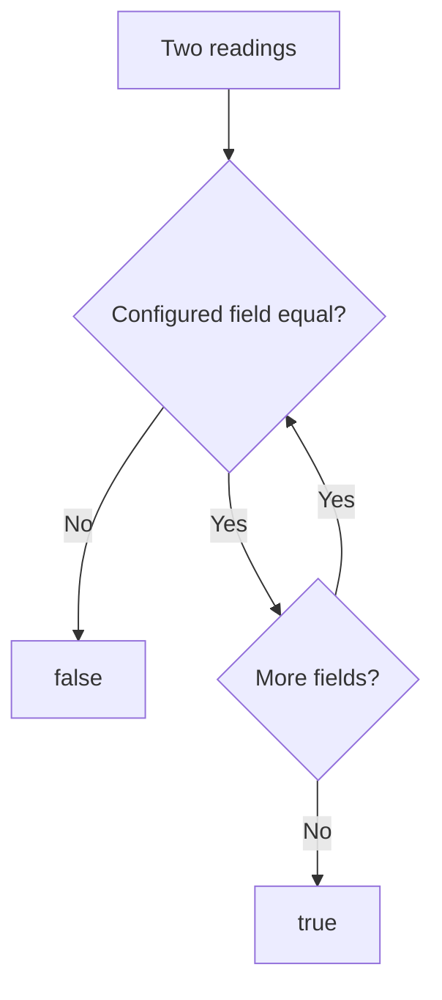

<!-- BUNDLE_SIZE:START -->

> 281 B minified + gzipped

<!-- BUNDLE_SIZE:END -->

A monitoring service stores each sensor reading as a fresh object, so two arrivals of the same
measurement never share a reference. Comparing them with `===` marks every duplicate as new, and
comparing the whole object rejects readings whose temperature changed between transmissions. The
duplicate check has to name the fields that identify a reading, and every caller has to apply the
same rule.

## Core Behavior

`Equality<A>` is a function that takes two values of type `A` and returns whether they match under a
chosen rule.

- `Equality.string` is a case-sensitive strict comparison; `Equality.number` uses SameValueZero, so
  `NaN` equals `NaN` and `0` equals `-0`.
- `Equality.boolean` uses strict equality; `Equality.date` compares numeric timestamps with the same
  SameValueZero rule.
- `by` lifts a rule to a selected field, while `and`, `struct`, and `tuple` combine rules and stop
  at the first failed check.
- `struct` compares the configured own keys and ignores every other field; `array` and `tuple` check
  length before elements.

Reach for `Equality` when two values must be judged the same. When that judgment feeds a sort,
[`Ordering`](/guides/ordering/) turns the same selected fields into a comparator. The
[choosing guide](/basics/choosing/) lists the comparison modules together.

## Example: Duplicate Device Readings

A monitoring service receives the same device reading more than once. A reading is the same when the
device identifier and the recorded timestamp match; the temperature may differ between
retransmissions and must not create a second entry.

`struct` checks the configured fields in order. A failed field stops the comparison:



### Comparing Readings

```ts
import { Arr, Equality, pipe } from "@pplnd/core";

type Reading = { deviceId: string; recordedAt: string; celsius: number };

const sameReading = Equality.struct({
  deviceId: Equality.string,
  recordedAt: Equality.string,
});

const readings: readonly Reading[] = [
  { deviceId: "sensor-a", recordedAt: "09:00", celsius: 21 },
  { deviceId: "sensor-a", recordedAt: "09:00", celsius: 21.4 },
  { deviceId: "sensor-a", recordedAt: "09:05", celsius: 22 },
];

const unique = pipe(readings, Arr.uniqWith(sameReading));
// Two readings remain: 09:00 and 09:05.
```

`sameReading` compares the two configured fields and ignores `celsius`. Two readings that share an
identifier and a timestamp are duplicates even when the temperature changed.

### Ordering the Same Readings

An equality rule answers whether two readings match, but a display that lists them still needs an
order. The same field selection becomes a comparator, with the timestamp first and the device
identifier as a tiebreaker:

```ts
import { Ordering, pipe } from "@pplnd/core";

const byRecordedAt = pipe(Ordering.string, Ordering.by((reading: Reading) => reading.recordedAt));
const byDeviceId = pipe(Ordering.string, Ordering.by((reading: Reading) => reading.deviceId));
const readingOrder = pipe(byRecordedAt, Ordering.thenBy(byDeviceId));
```

The [Ordering guide](/guides/ordering/) covers descending order and additional tiebreakers.

## Core Operations

### Creating Checks

| Signature          | What it does                                             | Return type         |
| :----------------- | :------------------------------------------------------- | :------------------ |
| `Equality.string`  | Compares strings with case-sensitive strict equality.    | `Equality<string>`  |
| `Equality.number`  | Compares numbers with SameValueZero; `NaN` equals `NaN`. | `Equality<number>`  |
| `Equality.boolean` | Compares booleans with strict equality.                  | `Equality<boolean>` |
| `Equality.date`    | Compares `getTime()` values with SameValueZero.          | `Equality<Date>`    |

### Adapting and Combining

| Signature              | What it does                                                   | Return type                      |
| :--------------------- | :------------------------------------------------------------- | :------------------------------- |
| `by(extract)`          | Lifts a rule to a selected field; data-last.                   | `Equality<B>` from `Equality<A>` |
| `and(other)`           | Requires the piped rule and `other`; stops at the first false. | Combined `Equality<B>`           |
| `struct(fields)`       | Builds a record rule from field rules.                         | `Equality<R>`                    |
| `array(itemEquality)`  | Compares length, then items in order.                          | `Equality<readonly A[]>`         |
| `tuple(...equalities)` | Compares length, then positions with their rules.              | `Equality<T>`                    |

## Failure Behavior and Edge Cases

`Equality.number` uses SameValueZero instead of `===`: `NaN` equals `NaN`, and `0` equals `-0`. A
duplicate rule built on it treats two missing measurements as equal when both are `NaN`. When those
values reach a sort, [`Ordering`](/guides/ordering/) places every `NaN` after the valid numbers.

`Equality.date` compares timestamps with the same rule, so two `Invalid Date` values compare equal.
Validate dates before they enter the rule when invalid input must stay distinct.

`struct` fixes its key list when the rule is built and compares only those own keys, including
symbol keys. `array` returns `false` on a length mismatch without calling the item rule; `tuple`
does the same and then compares positions in argument order. `and` evaluates the piped rule first
and skips `other` when it fails.
