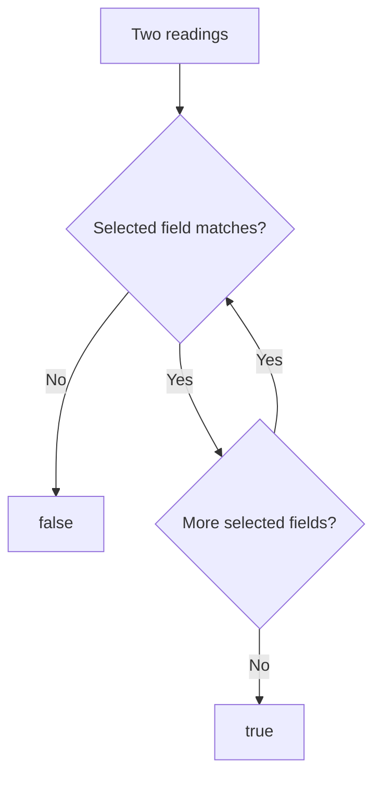

<!-- BUNDLE_SIZE:START -->

> 281 B minified + gzipped

<!-- BUNDLE_SIZE:END -->

## Core Behavior

`Equality<A>` is a function that takes two values and returns whether they are equal according to a
chosen rule.

- `by` compares a selected value from each input.
- `and`, `struct`, and `tuple` combine comparisons and stop when a check fails.
- Built-in number and string checks use strict equality; dates are compared by their timestamps.

## Example: Duplicate Device Readings

A monitoring service may receive the same reading twice as separate objects. To detect duplicates,
it can compare the device identifier and timestamp rather than object references.

`Equality.struct` checks the selected fields in order. A failure stops the comparison:



### Comparing Readings

```ts
import { Arr, Equality, pipe } from "@pplnd/core";

type Reading = { deviceId: string; recordedAt: string; celsius: number };
const sameReading = Equality.struct({
  deviceId: Equality.string,
  recordedAt: Equality.string,
});

const readings: readonly Reading[] = [
  { deviceId: "sensor-a", recordedAt: "09:00", celsius: 21 },
  { deviceId: "sensor-a", recordedAt: "09:00", celsius: 21 },
  { deviceId: "sensor-a", recordedAt: "09:05", celsius: 22 },
];
const unique = pipe(readings, Arr.uniqWith(sameReading));
// Two readings remain: 09:00 and 09:05.
```

Only the configured fields participate in `sameReading`. Add a temperature comparison if readings
with the same identifier and timestamp but different values must remain distinct.

## Core Operations

| Signature                                         | What it does                                           | Result                               |
| :------------------------------------------------ | :----------------------------------------------------- | :----------------------------------- |
| `Equality.string` / `number` / `boolean` / `date` | Compares primitive values or date timestamps.          | `Equality<A>`.                       |
| `Equality.by(select)`                             | Compares inputs using a selected value.                | An equality for the original inputs. |
| `Equality.and(other)`                             | Requires two comparisons to pass.                      | Stops when the first returns false.  |
| `Equality.struct(fields)`                         | Compares specified object fields.                      | Other fields are ignored.            |
| `Equality.array(itemEquality)`                    | Compares length and items in order.                    | An equality for readonly arrays.     |
| `Equality.tuple(...equalities)`                   | Compares tuple positions with their respective checks. | A tuple equality.                    |

## Failure Behavior and Edge Cases

`Equality.number` uses `===`, so `NaN` does not equal itself. `Equality.date` compares timestamps;
invalid dates also compare unequal because their timestamps are `NaN`. Choose a different check if
those values need special treatment.
