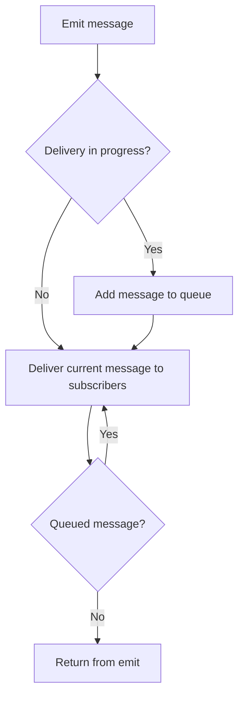

<!-- BUNDLE_SIZE:START -->

> 1.21 kB minified + gzipped

<!-- BUNDLE_SIZE:END -->

## Core Behavior

`EventBus` delivers typed messages to subscribers in the same process. Each message has a `kind` and
a payload in `value`.

- `emit` delivers messages synchronously. If a subscriber emits another message on the same bus,
  that message waits until delivery of the current message finishes.
- Subscriptions can observe all events, selected event kinds, or an ordered sequence.
- `tap` observes matching messages, `reduce` maintains state, and `collect` gathers sequence
  payloads.

## Example: Parcel Tracking

A parcel service publishes receipt, scan, and dispatch events. A consumer wants to combine the
receipt and dispatch details; a scan may occur between them but is optional.

When a subscriber emits during delivery, the bus queues the new message until the current message
has been delivered to its subscribers:



### Collecting a Parcel Sequence

`ordered: true` matches the declared order. Marking `scanned` optional allows a dispatch to complete
the sequence even when no scan event arrived:

```ts
import { EventBus } from "@pplnd/core";

type ParcelEvents = {
  received: { trackingId: string };
  scanned: { location: string };
  dispatched: { destination: string };
};

const parcels = EventBus.make<ParcelEvents>({
  onError: (error) => console.error("Parcel subscriber failed:", error),
});
const stop = EventBus.subscribe(
  parcels,
  ["received", "scanned", "dispatched"],
  { ordered: true, optional: ["scanned"] },
).collect((events) => {
  const scan = events.scanned?.location ?? "no scan";
  console.log(`${events.received.trackingId}: ${scan}; to ${events.dispatched.destination}`);
});

EventBus.emit(parcels, { kind: "received", value: { trackingId: "parcel-42" } });
EventBus.emit(parcels, { kind: "dispatched", value: { destination: "north depot" } });
// parcel-42: no scan; to north depot
stop();
```

`collect` clears its accumulated payloads after a complete match, so it can collect another
sequence.

## Core Operations

### Creating and Publishing

| Signature                               | What it does                                         | Result                            |
| :-------------------------------------- | :--------------------------------------------------- | :-------------------------------- |
| `EventBus.make<Events>(options?)`       | Creates a bus for an event schema.                   | `EventBus<Events>`.               |
| `EventBus.emit(bus, message)`           | Delivers a message to a bus or array of buses.       | `void`; delivery is synchronous.  |
| `EventBus.forward({ from, to, only? })` | Forwards all or selected event kinds to other buses. | A function that stops forwarding. |

### Subscribing

| Signature                                  | What it does                                         | Result                                           |
| :----------------------------------------- | :--------------------------------------------------- | :----------------------------------------------- |
| `EventBus.subscribe(bus)`                  | Selects all message kinds.                           | A builder with `tap` and `reduce`.               |
| `EventBus.subscribe(bus, kinds, options?)` | Selects kinds or a sequence.                         | A builder with `tap`, `reduce`, and `collect`.   |
| `subscription.tap(fn)`                     | Runs a callback for a match.                         | An unsubscribe function.                         |
| `subscription.reduce(fn, initial)`         | Updates state for each match.                        | An object with `getState()` and `unsubscribe()`. |
| `subscription.collect(fn)`                 | Accumulates payloads until the selected kinds match. | An unsubscribe function.                         |

`ordered` requires the selected kinds in sequence. `strict` resets an ordered sequence on an
unexpected event; without it, events outside the selected sequence are ignored. `reset` names events
that clear progress, `optional` names sequence steps that may be skipped, and `once` removes the
subscription after its first match. In ordered mode, `tap` and `reduce` run when the sequence
completes and receive its final message; `collect` receives the gathered payloads.

## Failure Behavior and Edge Cases

Without `onError`, a subscriber exception escapes `EventBus.emit` and stops the remaining delivery.
When `onError` returns normally, the bus reports the exception and continues to the next subscriber.
If the error handler throws, its exception propagates to the emitter.

Unsubscribing takes effect immediately: a subscriber removed before its turn does not receive the
current message. A callback already running finishes normally. Subscriptions added during delivery
start with the next message.

An ordered optional step is skipped when a later expected event arrives. A trailing optional step
has no later step to trigger that skip, so the sequence waits for it. In unordered `collect`, each
completed collection starts fresh; a previously collected payload is not reused for the next match.
