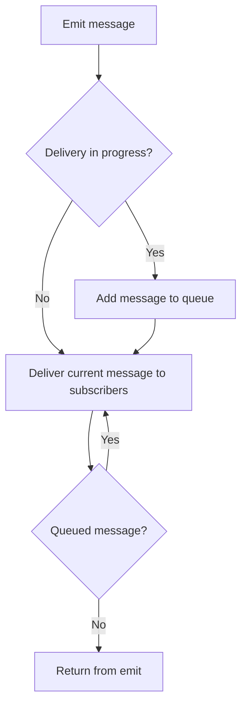

<!-- BUNDLE_SIZE:START -->

> 1.61 kB minified + gzipped

<!-- BUNDLE_SIZE:END -->

A warehouse scanner updates the tracking page when a parcel is scanned. The customer email is queued
from inside that same update, so a mail failure now decides whether the page updates. When the mail
handler emits its own event, the scanner runs again while the first update is halfway through.

## Core Behavior

`EventBus<S>` delivers typed messages to subscribers in the same process. Each message is a
`{ kind, value }` pair whose `value` matches `S[kind]`.

- `emit` delivers synchronously to the current subscribers in registration order.
- A subscriber that emits while delivery is in progress queues the new message until the current one
  finishes.
- A subscription observes every kind, selected kinds, or an ordered sequence. `ordered` matches the
  declared order; `optional` marks steps that may be skipped.
- `tap` observes matching messages, `reduce` keeps state, and `collect` gathers the payloads of one
  completed sequence.

Reach for `EventBus` when several consumers need the same message and the emitter should not know
them. When a receiver's handling depends on which state it is in, [`Machine`](/guides/machine/)
routes the same messages through explicit states and transitions. The [type model](/basics/types/)
notes that a bus is usable as soon as it is created, and the [choosing guide](/basics/choosing/)
compares the modules that share this problem.

## Example: Parcel Tracking

A parcel service publishes receipt, scan, and dispatch events. A consumer wants to combine the
receipt and dispatch details; a scan may occur between them but is optional.

When a subscriber emits during delivery, the bus queues the new message until the current message
has been delivered to its subscribers:



### Collecting a Parcel Sequence

`ordered: true` matches the declared order. Marking `scanned` optional allows a dispatch to complete
the sequence even when no scan event arrived:

```ts
import { EventBus } from "@pplnd/core";

type ParcelEvents = {
  received: { trackingId: string };
  scanned: { location: string };
  dispatched: { destination: string };
};

const parcels = EventBus.make<ParcelEvents>();
const stop = EventBus.subscribe(
  parcels,
  ["received", "scanned", "dispatched"],
  { ordered: true, optional: ["scanned"] },
).collect((events) => {
  const scan = events.scanned?.location ?? "no scan";
  console.log(`${events.received.trackingId}: ${scan}; to ${events.dispatched.destination}`);
});

EventBus.emit(parcels, { kind: "received", value: { trackingId: "parcel-42" } });
EventBus.emit(parcels, { kind: "dispatched", value: { destination: "north depot" } });
// parcel-42: no scan; to north depot
stop();
```

`collect` clears its accumulated payloads after a complete match, so the same subscription can
collect another sequence.

### Driving an Actor from the Bus

The same events can drive explicit states. `Machine.interpret` accepts the bus and subscribes the
actor to every kind the bus carries; kinds the machine does not declare leave the current state
unchanged:

```ts
import { Machine } from "@pplnd/core";

type ParcelState =
  | Machine.State<"waiting", void, "moving">
  | Machine.State<"moving", { readonly trackingId: string }, "delivered">
  | Machine.State<"delivered", { readonly destination: string }, "waiting">;

const parcelMachine = Machine.make<ParcelState, ParcelEvents>({
  waiting: { on: { received: (_state, parcel) => Machine.state("moving", parcel) } },
  moving: { on: { dispatched: (_state, parcel) => Machine.state("delivered", parcel) } },
  delivered: { on: {} },
});

const actor = Machine.interpret(parcelMachine, {
  initial: Machine.state("waiting"),
  bus: parcels,
});
```

The actor reads `received` and `dispatched` from the bus and ignores `scanned`. See
[`Machine`](/guides/machine/) for transitions and entry effects.

## Core Operations

### Creating and Publishing

| Signature                               | What it does                                         | Result or behavior                          |
| :-------------------------------------- | :--------------------------------------------------- | :------------------------------------------ |
| `EventBus.make<Events>(options?)`       | Creates a bus for an event schema.                   | `EventBus<Events>`; `options.id` labels it. |
| `EventBus.emit(bus, message)`           | Delivers a message to a bus.                         | `void`; delivery is synchronous.            |
| `EventBus.emit([busA, busB], message)`  | Delivers one message to several buses.               | Every listed bus must accept the message.   |
| `EventBus.forward({ from, to, only? })` | Forwards all or selected kinds to one or more buses. | Returns a function that stops forwarding.   |

### Subscribing

| Signature                                  | What it does                                     | Result                                         |
| :----------------------------------------- | :----------------------------------------------- | :--------------------------------------------- |
| `EventBus.subscribe(bus)`                  | Selects every kind on the schema.                | A builder with `tap` and `reduce`.             |
| `EventBus.subscribe(bus, kinds, options?)` | Selects kinds or an ordered sequence.            | A builder with `tap`, `reduce`, and `collect`. |
| `subscription.tap(effect)`                 | Runs a callback for a match.                     | An unsubscribe function.                       |
| `subscription.reduce(reducer, initial)`    | Updates state for each match.                    | `{ getState, unsubscribe }`.                   |
| `subscription.collect(effect)`             | Gathers payloads until the selected kinds match. | An unsubscribe function.                       |

`ordered` requires the selected kinds in sequence. `strict` resets an ordered sequence on an
unexpected event; without it, events outside the sequence are ignored. `reset` names events that
clear progress and collected payloads, `optional` names sequence steps that may be skipped, and
`once` removes the subscription after its first match.

In ordered mode, `tap` and `reduce` run when the sequence completes and receive its final message;
`collect` receives the gathered payloads, with skipped optional events typed as `undefined`. In
unordered mode they match each selected event independently, and `collect` fires once every required
kind has appeared at least once. `forward` with `only` can bridge buses with different schemas when
the selected payload types are compatible.

## Failure Behavior and Edge Cases

Subscriber callbacks must handle expected failures. If a callback throws, the exception escapes
`EventBus.emit`, stops remaining delivery, and discards messages already queued behind the current
one. Use `Result.tryCatch` for fallible synchronous work. Asynchronous work is not awaited: run a
`Task.Result` inside the subscriber and handle its outcome there.

Forwarding a message back to a bus it already visited in the same emission throws an error naming
the source bus and the message kind, because the same message object would otherwise circulate
forever. This stops cycles like `A → B → A` on the first repeat. Bidirectional forwards whose `only`
filters never overlap stay valid, and diamond fan-in remains valid because each path is checked
separately. A subscriber that intentionally re-injects a message should emit a copy (`{ ...msg }`)
or defer to a new emission; a new message object or a new emission starts a fresh cycle check.

Unsubscribing takes effect immediately: a subscriber removed before its turn does not receive the
current message, while a callback already running finishes normally. A subscriber added during
delivery misses the message in flight, but can receive a message already queued behind it, because
the subscriber list is rebuilt when that delivery starts.

An optional step is skipped when a later expected event arrives. A trailing optional step has no
later step to trigger the skip, so the sequence waits for it. In unordered `collect`, each completed
collection starts fresh; a previously collected payload is not reused for the next match.
