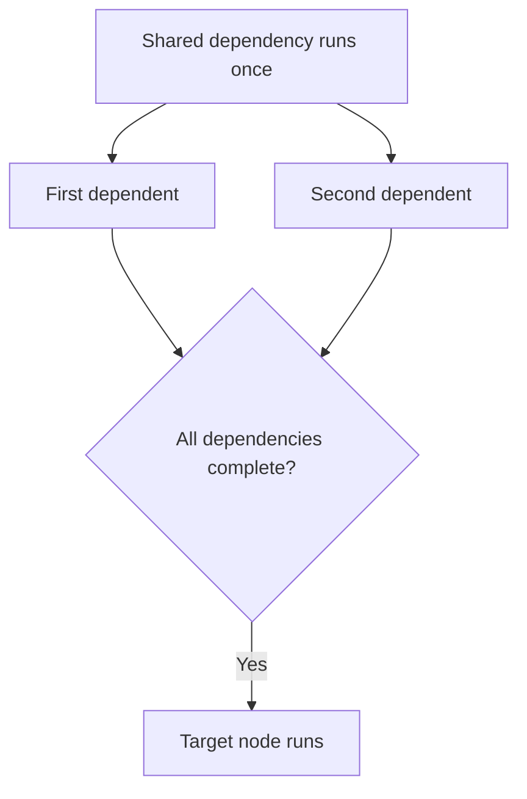

<!-- BUNDLE_SIZE:START -->

> 5.48 kB minified + gzipped

<!-- BUNDLE_SIZE:END -->

## Core Behavior

`Graph` runs asynchronous tasks according to their dependencies. Each node produces a `Task.Result`;
the graph returns the target node's result.

- A node starts when all its dependencies have succeeded. Independent ready nodes can run in
  parallel, subject to the `concurrency` option.
- A shared node executes once per graph run, even when multiple nodes depend on it.
- A node failure settles the graph with that error and signals active siblings to abort.

## Example: Build Metadata

A build report needs both the byte count and line count of a manifest. Both measurements depend on
reading the same file, so the file should be read once before either measurement starts.

A dependent node waits for every declared dependency. A shared dependency is reused by both
branches:



### Preparing the Report

This example reads the project's manifest, calculates two measurements, and combines them. Run it
from the project root:

```ts
import { readFile } from "node:fs/promises";
import { Graph, Task } from "@pplnd/core";

const manifest = Graph.node({
  id: "manifest",
  run: () => Task.Result.tryCatch(
    (signal) => readFile("package.json", { encoding: "utf8", signal }),
    { onError: (error) => `Could not read manifest: ${String(error)}` },
  ),
});

const bytes = Graph.node({
  id: "bytes",
  deps: { manifest },
  run: ({ manifest }) => Task.Result.make.ok(new TextEncoder().encode(manifest).length),
});
const lines = Graph.node({
  id: "lines",
  deps: { manifest },
  run: ({ manifest }) => Task.Result.make.ok(manifest.split("\n").length),
});
const report = Graph.node({
  id: "report",
  deps: { bytes, lines },
  run: ({ bytes, lines }) => Task.Result.make.ok({ bytes, lines }),
});

const result = await Graph.run(Graph.make(report), { concurrency: 2 })();
if (result.kind === "Ok") console.log(result.value);
else console.error(result.error);
```

## Core Operations

### Defining and Running

| Signature                       | What it does                                                   | Result or behavior                           |
| :------------------------------ | :------------------------------------------------------------- | :------------------------------------------- |
| `Graph.node({ id, deps, run })` | Defines a task and optional named dependencies.                | A node whose callback receives their values. |
| `Graph.make(target)`            | Builds a graph from the target and all reachable dependencies. | Throws for duplicate IDs or a cycle.         |
| `Graph.run(graph, options)`     | Creates a task that runs the graph.                            | A `Task.Result` for the target.              |

Node options also accept `retry` and `timeout`. Run options accept `concurrency` and `onRetry`; the
retry hook receives the node ID along with retry metadata.

## Failure Behavior and Edge Cases

A failure prevents unstarted dependents from running. Active work receives an aborted signal, but
must cooperate with that signal to stop. A caller can also pass a signal when invoking the task:
`Graph.run(graph)(signal)`.

Cancellation returns `Graph.Aborted` with the signal's reason. A thrown node callback or task
returns `Graph.Unexpected` with the original cause. If a node's `onTimeout` callback throws, the
graph returns `Task.TimeoutUnexpected` with that cause. These errors appear alongside node errors in
the task's error type.

`Graph.make` validates node IDs and checks for cycles at runtime. A nonpositive or non-integer
`concurrency` value is treated as unbounded. Wrap fallible work in `Task.Result.tryCatch` to map
expected errors to the intended type.
