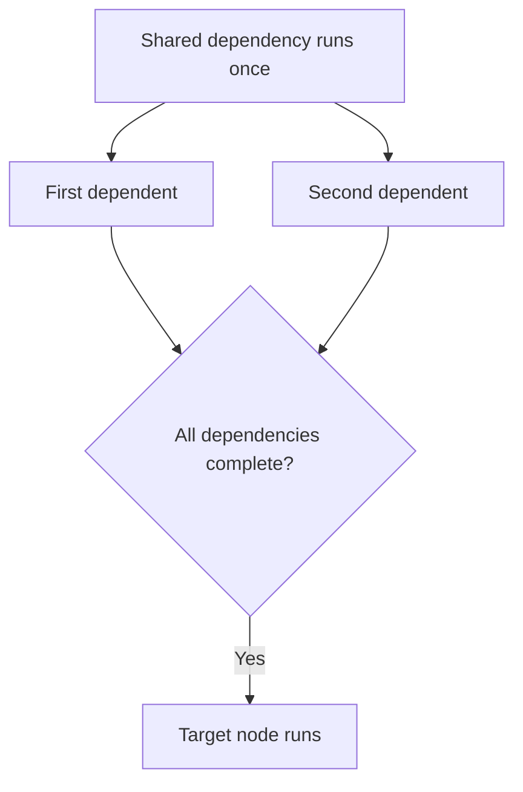

<!-- BUNDLE_SIZE:START -->

> 2.82 kB minified + gzipped

<!-- BUNDLE_SIZE:END -->

## Core Behavior

Building a report may require several calculations that share the same file read. Starting each
calculation separately can read the file more than once, while running everything in sequence wastes
time. `Graph` runs asynchronous tasks according to their dependencies. Each node produces a
`Task.Result`; each run starts immediately and returns the target node's result.

- A node starts when all its dependencies have succeeded. Independent ready nodes can run in
  parallel, subject to the `concurrency` option.
- A shared node executes once per graph run, even when multiple nodes depend on it.
- A node failure settles the graph with that error and signals active siblings to abort.

## Example: Build Metadata

A build report needs both the byte count and line count of a manifest. Both measurements depend on
reading the same file, so the file should be read once before either measurement starts.

A dependent node waits for every declared dependency. A shared dependency is reused by both
branches:



### Preparing the Report

This example reads the project's manifest, calculates two measurements, and combines them. Run it
from the project root:

```ts
import { readFile } from "node:fs/promises";
import { Graph, Task } from "@pplnd/core";

type ReportInput = { path: string };
const node = Graph.nodeFactory<ReportInput>();

const manifest = node("manifest", {
  run: ({ ctx }) => Task.Result.tryCatch(
    (signal) => readFile(ctx.input.path, { encoding: "utf8", signal }),
    { onError: (error) => `Could not read manifest: ${String(error)}` },
  ),
});

const bytes = node("bytes", {
  deps: { manifest },
  run: ({ deps }) => Task.Result.make.ok(new TextEncoder().encode(deps.manifest).length),
});
const lines = node("lines", {
  deps: { manifest },
  run: ({ deps }) => Task.Result.make.ok(deps.manifest.split("\n").length),
});
const report = node("report", {
  deps: { bytes, lines },
  run: ({ deps }) => Task.Result.make.ok({ bytes: deps.bytes, lines: deps.lines }),
});

const reportGraph = Graph.make(report, { concurrency: 2 });
const result = await Graph.run(reportGraph, { input: { path: "package.json" } });
if (result.kind === "Ok") console.log(result.value);
else console.error(result.error);
```

## Core Operations

### Defining and Running

| Signature                       | What it does                                         | Result or behavior                      |
| :------------------------------ | :--------------------------------------------------- | :-------------------------------------- |
| `Graph.nodeFactory<Input>()`    | Creates a node constructor sharing an input type.    | Infers dependencies and outputs.        |
| `Graph.node(id, { deps, run })` | Defines a task and optional named dependencies.      | The callback receives `ctx` and `deps`. |
| `Graph.make(target, options?)`  | Builds a reusable graph from reachable dependencies. | Throws for duplicate IDs or a cycle.    |
| `Graph.run(graph, options?)`    | Starts an independent graph execution.               | A deferred result for the target.       |

A typed node factory lets reusable nodes share an input contract without repeating its type.
`Graph.node` also creates nodes directly. Graph options accept `concurrency`. Supply `input` to
`Graph.run` when nodes require it. Runs have separate input and execution state, so a shared
dependency runs once per run. Nodes receive the run's input as `ctx.input` and dependency outputs
under `deps`: `run: ({ ctx, deps }) => task`. If neither is needed, use `run: () => task`.

Apply `Task.Result.retry(policy)` or `Task.Result.timeout(options)` to the task returned by a node
when it needs retries or a deadline. The signal supplied to the task includes graph cancellation and
any cancellation applied by task wrappers.

For a dynamically assembled dependency record, preserve its input contract with
`Record<string, Graph.AnyNode<ReportInput>>`. A record typed as `Graph.AnyNode` erases the input
contract and cannot be used to construct a graph until its input type is specified.

## Failure Behavior and Edge Cases

A failure prevents unstarted dependents from running. Active work receives an aborted signal, but
must cooperate with that signal to stop. A caller can pass a signal in the run options:
`Graph.run(graph, { input, signal })`.

Cancellation settles the graph with `Graph.Aborted` and the signal's reason, even if an active task
ignores the signal and continues running. Node callbacks, tasks, timeout handlers, and retry
observers must not throw or reject; use `Task.Result` for expected failures.

`Graph.node` rejects an empty ID. `Graph.make` checks reachable nodes for duplicate IDs and cycles
at runtime. A nonpositive or non-integer `concurrency` value clamps to 1. Wrap fallible work in
`Task.Result.tryCatch` to map expected errors to the intended type.
