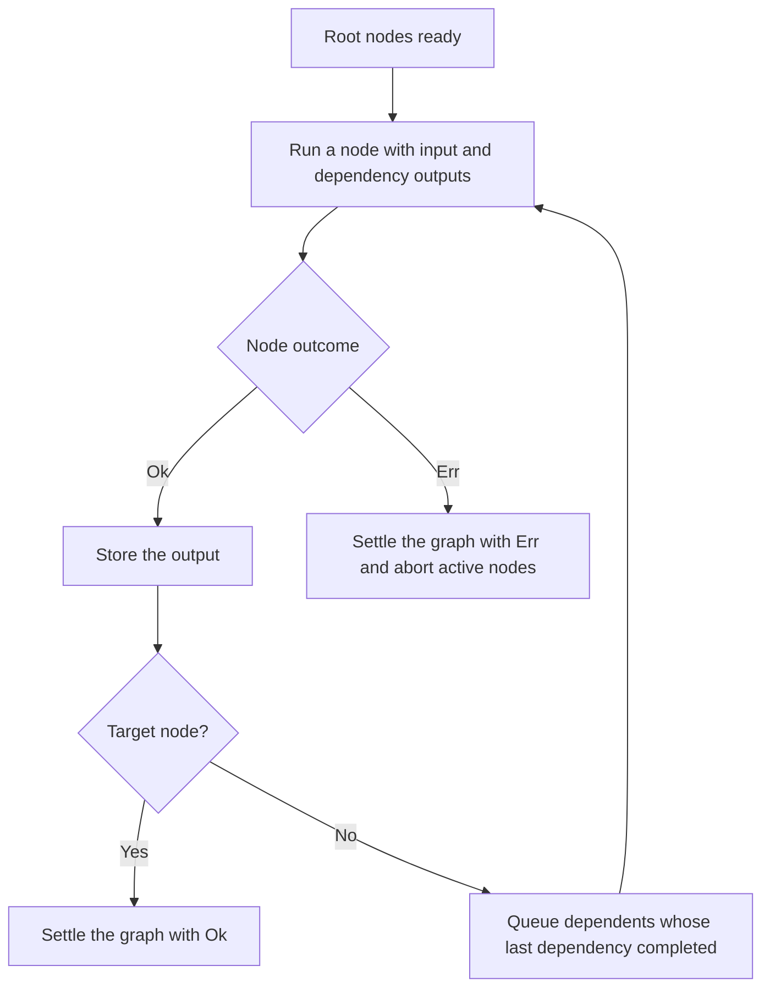

<!-- BUNDLE_SIZE:START -->

> 2.88 kB minified + gzipped

<!-- BUNDLE_SIZE:END -->

A customer page reads one customer record and feeds two panels from it. Each panel fetches the
record for itself, so the page reads it twice and the slower request decides when the page settles.
When the record lookup fails, the second request is still running for a page that will never render.

## Core Behavior

`Graph<E, Out, Input>` is a validated plan that runs a target node and the nodes it depends on as
asynchronous tasks.

- A node starts after every declared dependency succeeds. Ready nodes run concurrently, limited by
  `concurrency`, and a shared node runs once per run.
- The first node error settles the graph with that error and aborts the signal passed to active
  nodes.
- A caller abort settles the graph with `Aborted`, even when active tasks keep working.
- Node ids and cycles are checked when the graph is built, so a bad plan fails before any work
  starts.

Reach for `Graph` when several asynchronous computations share inputs and only some depend on
others. A single lazy operation needs only [`Task`](/guides/task/). The [type model](/basics/types/)
explains how a graph definition carries its input, and the [choosing guide](/basics/choosing/) puts
the execution shapes side by side.

## Example: Build Metadata

A build report needs both the byte count and line count of a manifest. Both measurements depend on
reading the same file, so the file should be read once before either measurement starts.

A dependent node waits for every declared dependency. A shared dependency is reused by both
branches:



### Preparing the Report

This example reads the project's manifest, calculates two measurements, and combines them. Run it
from the project root:

```ts
import { readFile } from "node:fs/promises";
import { Graph, Task } from "@pplnd/core";

type ReportInput = { readonly path: string };
const node = Graph.nodeFactory<ReportInput>();

const manifest = node("manifest", ({ ctx }) =>
  Task.Result.tryCatch(
    (signal) => readFile(ctx.input.path, { encoding: "utf8", signal }),
    { onError: (error) => `Could not read manifest: ${String(error)}` },
  ));

const bytes = node("bytes", { manifest }, ({ deps }) =>
  Task.Result.make.ok(new TextEncoder().encode(deps.manifest).length));

const lines = node("lines", { manifest }, ({ deps }) =>
  Task.Result.make.ok(deps.manifest.split("\n").length));

const report = node("report", { bytes, lines }, ({ deps }) =>
  Task.Result.make.ok({ bytes: deps.bytes, lines: deps.lines }));

const reportGraph = Graph.make(report, { concurrency: 2 });
const outcome = await Graph.run({ path: "package.json" })(reportGraph);

if (outcome.kind === "Ok") console.log(outcome.value);
else console.error(outcome.error);
```

`manifest` runs once, and both measurement nodes start after it succeeds. `report` then waits for
both measurements.

### Publishing the Report in a Transaction

The report is computed in memory. Writing it out and recording the build are two steps that must not
leave a partial result behind when the second one fails, which is where a transaction takes over:

```ts
import { appendFile, rm, writeFile } from "node:fs/promises";
import { Result, Transaction } from "@pplnd/core";

if (Result.is.ok(outcome)) {
  const built = outcome.value;
  const publish = Transaction.make(
    Transaction.step(
      "writeReport",
      () =>
        Task.Result.tryCatch(
          () => writeFile("report.json", JSON.stringify(built)),
          { onError: (error) => `Could not write report: ${String(error)}` },
        ),
      () =>
        Task.Result.tryCatch(
          () => rm("report.json", { force: true }),
          { onError: (error) => `Could not remove report: ${String(error)}` },
        ),
    ),
    Transaction.step(
      "appendBuildLog",
      () =>
        Task.Result.tryCatch(
          () => appendFile("build.log", `${built.bytes} bytes, ${built.lines} lines\n`),
          { onError: (error) => `Could not append to build log: ${String(error)}` },
        ),
    ),
  );
  const published = await Transaction.run()(publish);
  console.log(published);
}
```

If the build log step fails, the transaction runs the report step's undo and deletes the file before
returning the failure. See [`Transaction`](/guides/transaction/) for the full step surface.

## Core Operations

### Defining Nodes

| Signature                      | What it does                                             | Behavior or return type                 |
| :----------------------------- | :------------------------------------------------------- | :-------------------------------------- |
| `Graph.nodeFactory<Input>()`   | Creates a node constructor with a shared input contract. | Infers dependency outputs and errors.   |
| `Graph.node(id, run)`          | Defines a node without dependencies.                     | The callback receives `ctx`.            |
| `Graph.node(id, deps, run)`    | Defines a node with named dependencies.                  | The callback receives `ctx` and `deps`. |
| `Graph.make(target, options?)` | Collects the target and its reachable dependencies.      | Throws on duplicate ids or a cycle.     |

### Running Graphs

| Signature                           | What it does                            | Return type                                        |
| :---------------------------------- | :-------------------------------------- | :------------------------------------------------- |
| `Graph.run(input, options?)(graph)` | Runs the graph with a per-run input.    | Data-last; a deferred `Result<E \| Aborted, Out>`. |
| `Graph.run()(graph)`                | Runs a graph whose nodes need no input. | Same outcome, with `E \| Aborted`.                 |

A node reads the run input from `ctx.input` and dependency outputs from `deps`:
`({ ctx, deps }) => task`. A node with no input needs only the dependencies, or no argument at all.
The graph definition keeps its input type; `Graph.run` checks the value against that type instead of
widening the graph to accept it. A record assembled at runtime keeps the contract when it is typed
`Record<string, Graph.AnyNode<ReportInput>>`. A record typed as plain `Graph.AnyNode` erases the
input contract, and `Graph.make` rejects it.

`concurrency` limits how many nodes run at once and defaults to unbounded. A nonpositive or
non-integer value clamps to 1. Apply `Task.Result.retry(policy)` or
`Task.Result.timeout({ duration, onTimeout })` to the task a node returns when it needs retries or a
deadline; the signal supplied to that task includes graph cancellation.

## Failure Behavior and Edge Cases

A node error settles the graph with that error. Dependents that have not started are skipped, and
active nodes receive an aborted signal but must honour it to stop. When the target succeeds, any
sibling still running is signalled to stop as well.

A caller signal settles the graph with [`Aborted`](/guides/aborted/) immediately, carrying
`signal.reason`, even if node tasks ignore the signal. An already-aborted signal settles before any
node starts. A caller abort also aborts the signal passed to each node.

`Graph.node` throws a `TypeError` for an empty id or a missing run callback. `Graph.make` throws for
duplicate ids and for cycles among reachable nodes. Node callbacks and the tasks they return must
not throw or reject; a rejected node task leaves the run pending because the scheduler never
observes a settlement. Wrap fallible work in `Task.Result.tryCatch`.

A graph with no input is run as `Graph.run()(graph)`. When that graph also needs run options, pass
`undefined` in the input position: `Graph.run(undefined, { signal })(graph)`.
