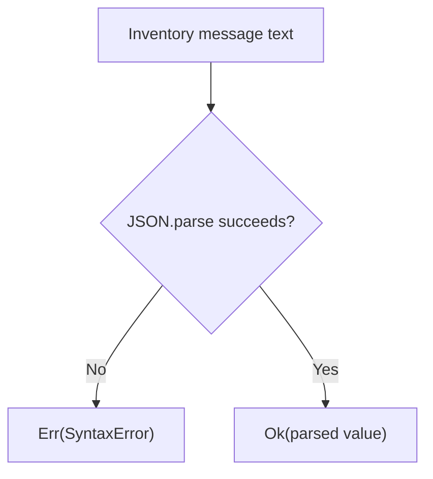

<!-- BUNDLE_SIZE:START -->

> 1.70 kB minified + gzipped

<!-- BUNDLE_SIZE:END -->

A device sends its inventory message as JSON. When the payload is truncated, the native parser
throws, and the thrown error is absent from the function's return type. When the payload is valid
but has no device identifier, parsing succeeds and the missing field surfaces later as `undefined`.

## Core Behavior

`Json` wraps native JSON parsing and serialization in `Result` values.

- `parse` returns `Err` containing a `SyntaxError` when `JSON.parse` throws.
- `stringify` returns `Err` containing a `TypeError` when serialization throws or produces no text.
- `parse` checks syntax only; the default value type is `unknown`, and a supplied type parameter is
  not validated.
- Errors are values, so `Result.mapError`, `ensure`, and `match` compose with the parsed value.

Use `Json` when JSON text crosses a boundary and a syntax failure must stay in the return type. When
the parsed value needs shape validation, [`Refinement`](/guides/refinement/) turns a reusable type
guard into a narrowing result. The [choosing guide](/basics/choosing/) lists the primitives side by
side.

## Example: Device Inventory Messages

An inventory service accepts a device message, checks that it carries an identifier and a firmware
version, and returns a response for the device.

`parse` turns a syntax error into an `Err`, while a successful parse leaves the value untyped:



### Reading an Inventory Message

```ts
import { Json, Result, pipe } from "@pplnd/core";

interface DeviceMessage {
  readonly deviceId: string;
  readonly firmware: string;
}

type IngestError = "INVALID_JSON" | "INVALID_SHAPE";

const isDeviceMessage = (value: unknown): value is DeviceMessage => {
  if (typeof value !== "object" || value === null || Array.isArray(value)) return false;
  const fields = value as Record<string, unknown>;
  return typeof fields.deviceId === "string" && typeof fields.firmware === "string";
};

const ingest = (text: string): Result<IngestError, DeviceMessage> =>
  pipe(
    Json.parse(text),
    Result.mapError(() => "INVALID_JSON" as const),
    Result.ensure(isDeviceMessage, () => "INVALID_SHAPE" as const),
  );

const respond = (text: string): string =>
  pipe(
    ingest(text),
    Result.match({
      ok: (message) => `Acknowledged ${message.deviceId} with firmware ${message.firmware}`,
      err: (error) => `Rejected: ${error}`,
    }),
  );

respond('{"deviceId":"sensor-7","firmware":"2.4.1"}');
// "Acknowledged sensor-7 with firmware 2.4.1"
respond('{"deviceId":"sensor-7"}');
// "Rejected: INVALID_SHAPE"
respond("{");
// "Rejected: INVALID_JSON"
```

The guard rejects `null`, arrays, and objects with missing fields before any handler reads a
property.

### Handing the Guard to Refinement

The same guard satisfies `Refinement<unknown, DeviceMessage>`, so the inline check can move into a
reusable value once another boundary needs it:

```ts
import { Json, Refinement, Result, pipe } from "@pplnd/core";

const ingestWithRefinement = (text: string): Result<IngestError, DeviceMessage> =>
  pipe(
    Json.parse(text),
    Result.mapError(() => "INVALID_JSON" as const),
    Result.chain(Refinement.to.Result(isDeviceMessage, () => "INVALID_SHAPE" as const)),
  );
```

[`Refinement`](/guides/refinement/) covers composing guards before a parsed value reaches the
domain.

## Core Operations

### Parsing

| Signature             | What it does                              | Result                                          |
| :-------------------- | :---------------------------------------- | :---------------------------------------------- |
| `Json.parse(text)`    | Parses JSON text.                         | `Result<SyntaxError, unknown>`.                 |
| `Json.parse<T>(text)` | Parses text with the result typed as `T`. | `Result<SyntaxError, T>`; `T` is not validated. |

### Serializing

| Signature                                  | What it does                                                     | Result                       |
| :----------------------------------------- | :--------------------------------------------------------------- | :--------------------------- |
| `Json.stringify(value, replacer?, space?)` | Serializes a value, optionally using a replacer and indentation. | `Result<TypeError, string>`. |

## Failure Behavior and Edge Cases

Supplying a type parameter to `Json.parse<T>` does not validate the parsed value. Parse as `unknown`
and check the shape at an untrusted boundary, as in the example. `JSON.parse` accepts primitives, so
`"null"`, `"42"`, and `"[]"` all parse successfully; a guard that expects an object must reject
them.

`Json.stringify(undefined)` returns an error because JSON serialization produces no text at the
root. A function or symbol at the root produces the same error. Circular references and `bigint`
values throw during serialization and become `Err(TypeError)`. The wrapper catches every thrown
value; one that is not already a `TypeError` is replaced with `new TypeError(String(err))`.

`parse` takes no reviver argument, and `stringify` passes its replacer and space arguments to the
native implementation unchanged.
