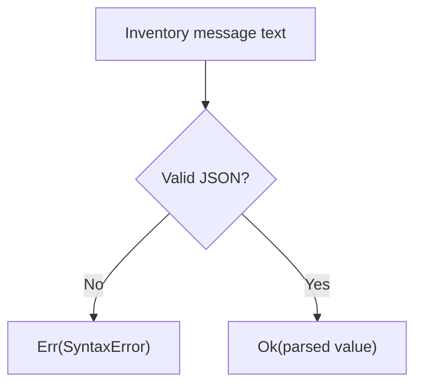

<!-- BUNDLE_SIZE:START -->

> 1.70 kB minified + gzipped

<!-- BUNDLE_SIZE:END -->

## Core Behavior

`Json.parse` and `Json.stringify` wrap JSON parsing and serialization results in `Result`.

- `parse` returns `Err<SyntaxError>` if parsing fails.
- `stringify` returns `Err<TypeError>` if serialization throws or produces no JSON text.
- Parsing checks JSON syntax, not the shape of the resulting value.

## Example: Device Inventory Messages

A service receives a JSON message containing a device identifier. It needs to report malformed JSON
and reject a valid JSON value that lacks the required field.

`Json.parse` returns a parsed value or a syntax error. The caller can then check the shape:



### Reading an Inventory Message

```ts
import { Json, Result, pipe } from "@pplnd/core";

type DeviceMessage = { deviceId: string };
const isDeviceMessage = (value: unknown): value is DeviceMessage =>
  typeof value === "object" && value !== null &&
  "deviceId" in value && typeof value.deviceId === "string";

const readMessage = (text: string): string =>
  pipe(
    Json.parse(text),
    Result.mapError(() => "Invalid JSON"),
    Result.ensure(isDeviceMessage, () => "Missing device identifier"),
    Result.match({
      ok: (message) => `Received ${message.deviceId}`,
      err: (error) => error,
    }),
  );

readMessage('{"deviceId":"sensor-7"}'); // "Received sensor-7"
readMessage('{}');                        // "Missing device identifier"
readMessage('{');                         // "Invalid JSON"
```

## Core Operations

| Signature                                  | What it does                                                     | Result                                          |
| :----------------------------------------- | :--------------------------------------------------------------- | :---------------------------------------------- |
| `Json.parse(text)`                         | Parses JSON text.                                                | `Result<SyntaxError, unknown>`.                 |
| `Json.parse<T>(text)`                      | Parses text with the result typed as `T`.                        | `Result<SyntaxError, T>`; `T` is not validated. |
| `Json.stringify(value, replacer?, space?)` | Serializes a value, optionally using a replacer and indentation. | `Result<TypeError, string>`.                    |

## Failure Behavior and Edge Cases

Supplying a type parameter to `Json.parse<T>` does not validate the parsed value. Parse as `unknown`
and check its shape at an untrusted boundary, as in the example.

`Json.stringify(undefined)` returns an error because JSON serialization produces no text at the
root. Circular references and `bigint` values also produce errors. The wrapper converts thrown
serialization failures to `TypeError` values.
