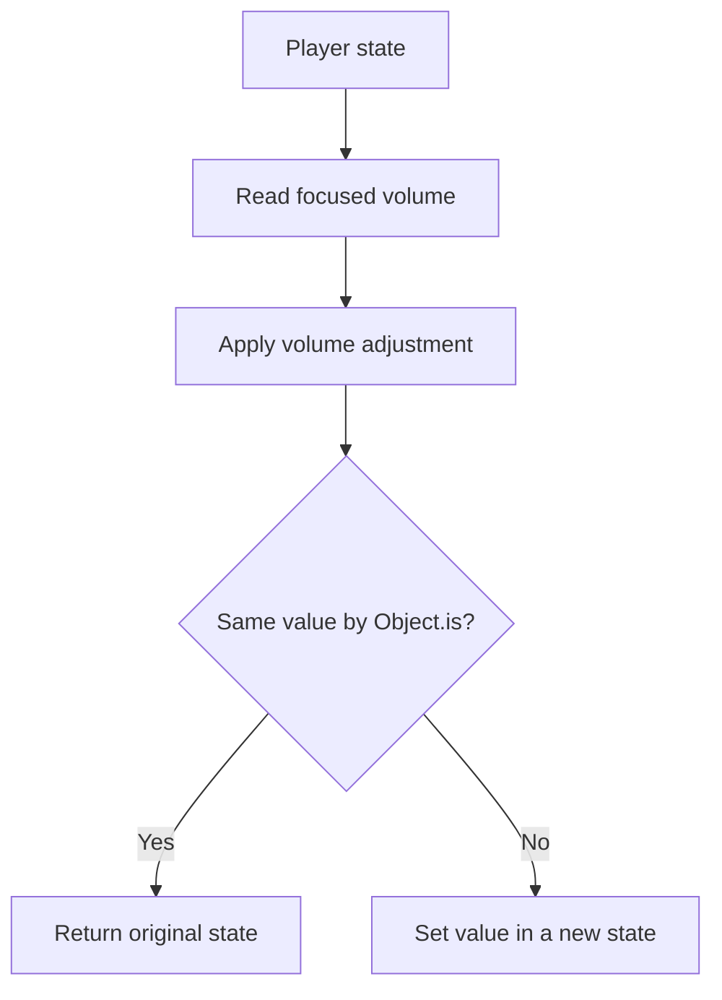

<!-- BUNDLE_SIZE:START -->

> 233 B minified + gzipped

<!-- BUNDLE_SIZE:END -->

A media player stores playback flags beside its volume. Changing the volume means copying the track,
the settings object, and every sibling field into a new object. A spread chain works for one level;
by the third level one spread drops a sibling field, and a volume adjustment silently resets the
captions setting.

## Core Behavior

`Lens<S, A>` pairs a getter `(structure: S) => A` with a setter `(value: A) => (structure: S) => S`
for a path that is guaranteed to exist.

- `from.property` reads one property and writes it with object spread; `from.accessors` takes custom
  read and write functions.
- `andThen` composes two required paths; `andThenOptional` continues into a nullable path and
  returns an Optional.
- `get` reads, `set` replaces, and `modify` transforms the focused value.
- `modify` returns the original structure when `Object.is` considers the transformed value
  identical.

Reach for `Lens` when every segment of the path is guaranteed to exist and the update should keep
the parent structure intact. When a property or array position may be absent,
[`Optional`](/guides/optional/) reads a `Maybe` and skips writes when the path breaks. The
[choosing guide](/basics/choosing/) separates guaranteed and optional focuses.

## Example: Media Player Settings

A media player stores volume inside its settings object. A volume adjustment should preserve the
other settings and the rest of the player state.

`modify` reads the focused value and compares it with the callback's result. It invokes the setter
only when the value changed:



### Updating Volume

```ts
import { Lens, pipe } from "@pplnd/core";

type Settings = { volume: number; captions: boolean; crossfade?: number };
type Player = { track: string; settings: Settings };

const volume = pipe(
  Lens.from.property<Player>()("settings"),
  Lens.andThen(Lens.from.property<Settings>()("volume")),
);
const player: Player = { track: "morning.ogg", settings: { volume: 40, captions: true } };
const quieter = pipe(player, Lens.modify(volume)((level) => Math.max(0, level - 10)));

pipe(quieter, Lens.get(volume)); // 30
// quieter.settings.captions is still true; player.settings.volume is still 40.
```

### Reaching an optional setting

The player also carries an optional crossfade override. Once that segment may be absent, the
previous lens becomes the outer focus and [`Optional`](/guides/optional/) owns the nullable part:

```ts
import { Lens, Optional, pipe } from "@pplnd/core";

const crossfade = pipe(
  Lens.from.property<Player>()("settings"),
  Lens.andThenOptional(Optional.from.property<Settings>()("crossfade")),
);

const playerWithFade: Player = {
  ...player,
  settings: { volume: 40, captions: true, crossfade: 300 },
};
pipe(playerWithFade, Optional.get(crossfade)); // Some(300)
```

## Core Operations

### Creating and Composing

| Signature                       | What it does                                          | Result                      |
| :------------------------------ | :---------------------------------------------------- | :-------------------------- |
| `Lens.from.property<S>()(key)`  | Focuses on a property.                                | `Lens<S, S[K]>`.            |
| `Lens.from.accessors(get, set)` | Builds a lens from custom functions.                  | `Lens<S, A>`.               |
| `Lens.andThen(inner)`           | Combines two required paths.                          | A lens to the nested value. |
| `Lens.andThenOptional(inner)`   | Continues through an optional path.                   | `Optional<S, B>`.           |
| `Lens.to.Optional(lens)`        | Converts a lens to an always-present optional getter. | `Optional<S, A>`.           |

### Reading and Updating

| Signature               | What it does                  | Result                                                                                     |
| :---------------------- | :---------------------------- | :----------------------------------------------------------------------------------------- |
| `Lens.get(lens)`        | Reads the focused value.      | `A`.                                                                                       |
| `Lens.set(lens)(value)` | Replaces the focused value.   | Updated structure.                                                                         |
| `Lens.modify(lens)(fn)` | Transforms the focused value. | Original structure if the result is unchanged by `Object.is`; otherwise the setter result. |

## Failure Behavior and Edge Cases

A lens assumes its path exists. The built-in property getter has no runtime check, so a composed
getter throws when a required-typed property holds `null` or `undefined` at runtime. Validate at the
boundary or use [`Optional`](/guides/optional/) when a segment can be absent.

The property setter performs a shallow spread at each level it touches. Sibling fields keep their
references, and the original structure is not modified.

`modify` compares the focused value with the callback's result using `Object.is`. A callback that
mutates the focused object in place and returns it produces the same reference, so `modify` returns
the original structure with mutated internals. Return a new object from the callback.

Custom accessors define their own update behavior; the guarantees above apply to the built-in
property lens.
