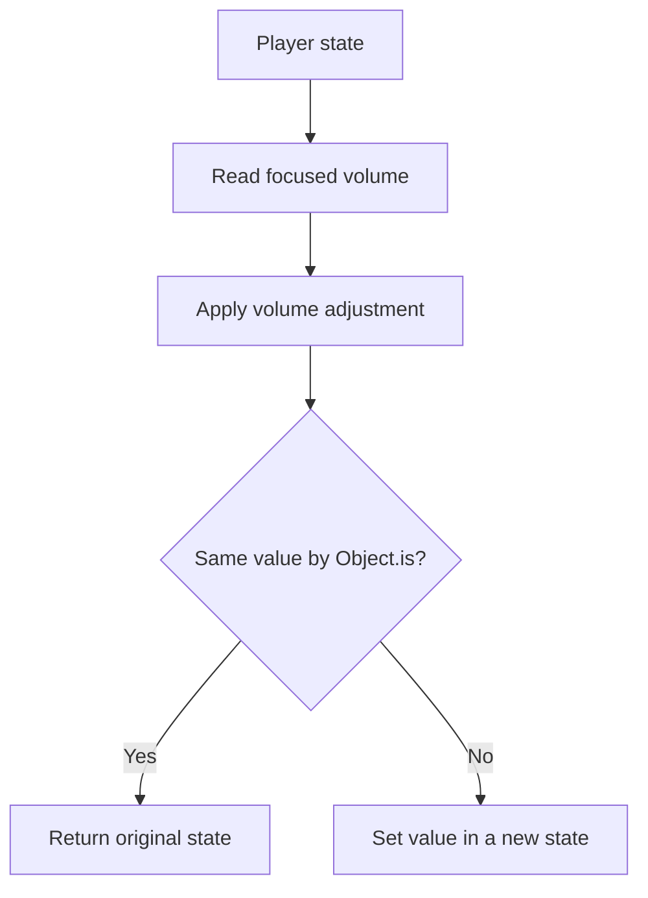

<!-- BUNDLE_SIZE:START -->

> 233 B minified + gzipped

<!-- BUNDLE_SIZE:END -->

## Core Behavior

`Lens<S, A>` describes how to read a required value `A` from a structure `S` and set it back.

- `andThen` combines lenses to reach a nested value.
- `get`, `set`, and `modify` read, replace, or transform the focused value.
- `modify` returns the original structure when `Object.is` considers the transformed value
  unchanged.

## Example: Media Player Settings

A media player stores volume inside its settings object. A volume adjustment should preserve the
other settings and the rest of the player state.

`modify` reads the focused value and compares it with the callback's result. It invokes the setter
only when the value changed:



### Updating Volume

```ts
import { Lens, pipe } from "@pplnd/core";

type Settings = { volume: number; captions: boolean };
type Player = { track: string; settings: Settings };

const volume = pipe(
  Lens.from.property<Player>()("settings"),
  Lens.andThen(Lens.from.property<Settings>()("volume")),
);
const player: Player = { track: "morning.ogg", settings: { volume: 40, captions: true } };
const quieter = pipe(player, Lens.modify(volume)((level) => Math.max(0, level - 10)));

pipe(quieter, Lens.get(volume)); // 30
// quieter.settings.captions is still true; player.settings.volume is still 40.
```

## Core Operations

### Creating and Composing

| Signature                       | What it does                                          | Result                      |
| :------------------------------ | :---------------------------------------------------- | :-------------------------- |
| `Lens.from.property<S>()(key)`  | Focuses on a property.                                | `Lens<S, S[K]>`.            |
| `Lens.from.accessors(get, set)` | Builds a lens from custom functions.                  | `Lens<S, A>`.               |
| `Lens.andThen(inner)`           | Combines two required paths.                          | A lens to the nested value. |
| `Lens.andThenOptional(inner)`   | Continues through an optional path.                   | `Optional<S, B>`.           |
| `Lens.to.Optional(lens)`        | Converts a lens to an always-present optional getter. | `Optional<S, A>`.           |

### Reading and Updating

| Signature               | What it does                  | Result                                                                                     |
| :---------------------- | :---------------------------- | :----------------------------------------------------------------------------------------- |
| `Lens.get(lens)`        | Reads the focused value.      | `A`.                                                                                       |
| `Lens.set(lens)(value)` | Replaces the focused value.   | Updated structure.                                                                         |
| `Lens.modify(lens)(fn)` | Transforms the focused value. | Original structure if the result is unchanged by `Object.is`; otherwise the setter result. |

## Failure Behavior and Edge Cases

A lens assumes its path exists. Use `Optional` when an intermediate property or array index may be
absent. The built-in property lens uses object spread when setting; custom accessors determine their
own update behavior.
