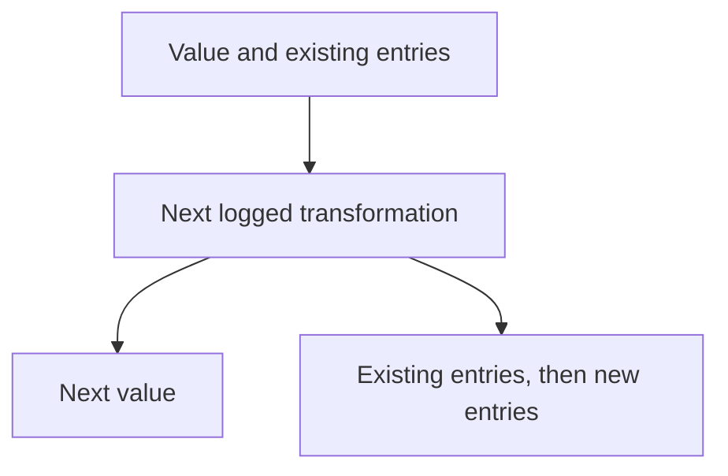

<!-- BUNDLE_SIZE:START -->

> 266 B minified + gzipped

<!-- BUNDLE_SIZE:END -->

## Core Behavior

`Logged<L, A>` holds a value `A` and a readonly list of log entries `L`.

- `map` changes the value and keeps its log; `chain` combines the current log with the next step's
  log in that order.
- `apply` combines the function's log followed by the argument's log.
- Entries are data. The application decides whether and where to write them.

## Example: Document Indexing

An indexer normalizes document text before creating search terms. It can return the terms together
with a record of the transformations applied, leaving the caller to store or display that record.

Each chained step returns a value and its own entries. `chain` passes the value forward and appends
the new entries after those already collected:



### Normalizing and Indexing Text

Whitespace normalization and term extraction each describe their work. The caller reads the terms
and entries together:

```ts
import { Logged, pipe } from "@pplnd/core";

const normalizeWhitespace = (text: string): Logged<string, string> =>
  Logged.make(text.trim().replace(/\s+/g, " "), ["Normalized whitespace"]);

const makeSearchTerms = (text: string): Logged<string, readonly string[]> =>
  Logged.make(text.toLowerCase().split(" ").filter(Boolean), ["Created lowercase search terms"]);

const indexed = pipe(
  Logged.make("  Winter   Report  "),
  Logged.chain(normalizeWhitespace),
  Logged.chain(makeSearchTerms),
);

const [terms, entries] = Logged.to.Pair(indexed);
// terms: ["winter", "report"]
// entries: ["Normalized whitespace", "Created lowercase search terms"]
```

## Core Operations

### Creating and Reading

| Signature                     | What it does                                   | Return type            |
| :---------------------------- | :--------------------------------------------- | :--------------------- |
| `Logged.make(value, entries)` | Creates a value with optional initial entries. | `Logged<L, A>`         |
| `Logged.from.entry(entry)`    | Creates one entry with an `undefined` value.   | `Logged<L, undefined>` |
| `Logged.to.Pair(logged)`      | Returns the value and its log as a pair.       | `[A, readonly L[]]`    |

The `value` and `log` properties can also be read directly.

### Combining and Transforming

| Signature                                  | What it does                                         | Behavior                                   |
| :----------------------------------------- | :--------------------------------------------------- | :----------------------------------------- |
| `Logged.map(fn)` / `mapLog(fn)`            | Transforms the value / each existing log entry.      | Preserves the other part.                  |
| `Logged.chain(fn)`                         | Runs a transformation that returns another `Logged`. | Appends its entries after existing ones.   |
| `Logged.apply(argument)`                   | Applies a logged function to a logged argument.      | Function entries precede argument entries. |
| `Logged.assignTo(key)` / `assign(key, fn)` | Starts a record / adds a later result.               | `assign` appends the new entries.          |
| `Logged.focus(lens)(fn)`                   | Applies a logged transformation to part of a value.  | Replaces that part and appends its log.    |
| `Logged.tap(fn)` / `tapLog(fn)`            | Observes the value / the log.                        | Returns the original `Logged`.             |

## Failure Behavior and Edge Cases

`mapLog` transforms entries present at that point in the pipeline. Entries appended by later `chain`
or `assign` steps are not transformed retroactively. Apply `mapLog` after those steps when all
entries need the same formatting.
