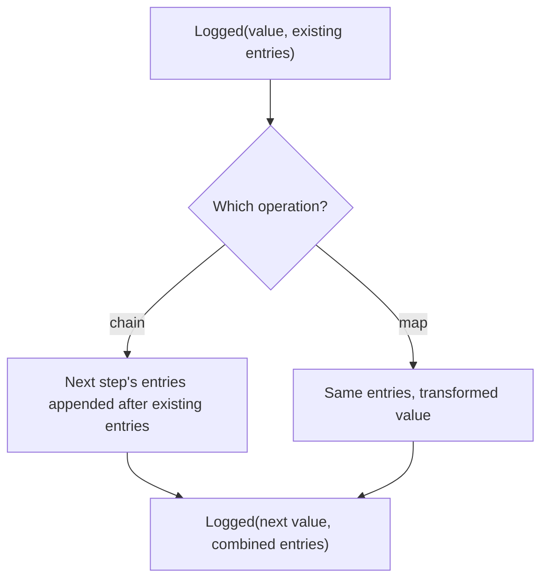

<!-- BUNDLE_SIZE:START -->

> 266 B minified + gzipped

<!-- BUNDLE_SIZE:END -->

An indexer trims and lowercases a document before it extracts search terms. When a document produces
bad terms in production, the stored output shows only the final words; nothing records which
transformation changed them. Reproducing the run means editing the pipeline to print intermediate
values.

## Core Behavior

`Logged<L, A>` pairs a value with a readonly, ordered list of log entries.

- `map` transforms the value and keeps the log; `mapLog` transforms the entries and keeps the value.
- `chain` passes the value to the next step and appends that step's entries after the existing ones.
  `apply` puts the function's entries before the argument's entries.
- `assign` appends the new computation's entries; `focus` appends the sub-computation's entries and
  writes the result back through a lens.
- Entries are data. Nothing writes them to a console, file, or service.

Use `Logged` when the pipeline itself must explain what it did. [`Pair`](/guides/pair/) holds two
values with no accumulation rule, so it fits once the log is a single value rather than a growing
sequence. The [choosing guide](/basics/choosing/) compares the containers side by side.

## Example: Document Indexing

An indexer normalizes document text before creating search terms. It returns the terms together with
a record of the transformations applied, leaving the caller to store or display that record.

Each chained step returns a value and its own entries. `chain` passes the value forward and appends
the new entries after those already collected:



### Normalizing and Indexing Text

Whitespace normalization, header removal, and term extraction each describe their work. The caller
reads the terms and entries together:

```ts
import { Logged, pipe } from "@pplnd/core";

type SearchTerms = readonly string[];

const normalizeWhitespace = (text: string): Logged<string, string> => {
  const normalized = text.trim().replace(/\s+/g, " ");
  return normalized === text
    ? Logged.make(text)
    : Logged.make(normalized, ["Normalized whitespace"]);
};

const CONFIDENTIAL_HEADER = "Confidential — ";

const stripConfidentialHeader = (text: string): Logged<string, string> => {
  if (!text.toLowerCase().startsWith(CONFIDENTIAL_HEADER.toLowerCase())) {
    return Logged.make(text);
  }
  return Logged.make(
    text.slice(CONFIDENTIAL_HEADER.length),
    ["Removed confidentiality header"],
  );
};

const makeSearchTerms = (text: string): Logged<string, SearchTerms> =>
  Logged.make(
    text.toLowerCase().split(" ").filter(Boolean),
    ["Created lowercase search terms"],
  );

const indexDocument = (raw: string): Logged<string, SearchTerms> =>
  pipe(
    Logged.make(raw),
    Logged.chain(normalizeWhitespace),
    Logged.chain(stripConfidentialHeader),
    Logged.chain(makeSearchTerms),
  );

const [terms, entries] = Logged.to.Pair(
  indexDocument("  Confidential — Winter   Report  "),
);
// terms: ["winter", "report"]
// entries: ["Normalized whitespace", "Removed confidentiality header",
//   "Created lowercase search terms"]
```

The initial `Logged.make(raw)` starts with an empty log. Each `chain` step adds entries only when it
changes the text, so a clean document produces fewer entries without changing the shape of the
pipeline. `to.Pair` is the boundary operation: after it, the terms are ordinary data and the entries
are an ordinary array.

### Publishing After the Trail Is Stored

Once the entries are persisted, the remaining work has one decision left: whether the index write
succeeded. That is a two-case outcome, and [`Result`](/guides/result/) carries its reason:

```ts
import { Result } from "@pplnd/core";

const [terms, entries] = Logged.to.Pair(indexDocument(rawText));
auditStore.append(documentId, entries);

const published = Result.tryCatch(
  () => searchIndex.replace(documentId, terms),
  { onError: (error) => `INDEX_WRITE_FAILED: ${String(error)}` },
);
```

The log stays at the audit boundary. `Result` receives a plain value and reports only the write
outcome, so the failure path does not need to thread a log through an error branch.

## Core Operations

### Creating and Reading

| Signature                     | What it does                                   | Return type            |
| :---------------------------- | :--------------------------------------------- | :--------------------- |
| `Logged.make(value, entries)` | Creates a value with optional initial entries. | `Logged<L, A>`         |
| `Logged.from.entry(entry)`    | Creates one entry with an `undefined` value.   | `Logged<L, undefined>` |
| `Logged.to.Pair(logged)`      | Returns the value and its log as a pair.       | `[A, readonly L[]]`    |

The `value` and `log` properties can also be read directly.

### Combining and Transforming

| Signature                                  | What it does                                         | Behavior                                   |
| :----------------------------------------- | :--------------------------------------------------- | :----------------------------------------- |
| `Logged.map(fn)` / `mapLog(fn)`            | Transforms the value / each existing log entry.      | Preserves the other part.                  |
| `Logged.chain(fn)`                         | Runs a transformation that returns another `Logged`. | Appends its entries after existing ones.   |
| `Logged.apply(argument)`                   | Applies a logged function to a logged argument.      | Function entries precede argument entries. |
| `Logged.assignTo(key)` / `assign(key, fn)` | Starts a record / adds a later result.               | `assign` appends the new entries.          |
| `Logged.focus(lens)(fn)`                   | Applies a logged transformation to part of a value.  | Replaces that part and appends its log.    |
| `Logged.tap(fn)` / `tapLog(fn)`            | Observes the value / the log.                        | Returns the original `Logged`.             |

## Failure Behavior and Edge Cases

`mapLog` transforms entries present at that point in the pipeline. Entries appended by later `chain`
or `assign` steps are not transformed retroactively. Apply `mapLog` after those steps when all
entries need the same formatting.

`Logged` has no error channel, so a step that can fail must return a [`Result`](/guides/result/)
outside the container or place `Logged` inside the success channel of a `Result`. The same applies
to asynchronous work: `Logged` does not await anything.

`Logged.from.entry("Started")` has the value `undefined`. Chaining it directly after a value
replaces that value, so use `map` to keep the value while recording an entry:

```ts
import { pipe, Logged } from "@pplnd/core";

const started = pipe(
  Logged.make("invoice-42"),
  Logged.chain((id) =>
    pipe(
      Logged.from.entry("Loaded invoice"),
      Logged.map(() => id),
    ),
  ),
);
// { value: "invoice-42", log: ["Loaded invoice"] }
```

`assign` rejects a key that already exists on the accumulator at the type level; use `map` to update
an existing field. `focus` requires a [`Lens`](/guides/lens/) and appends the log from the focused
computation after the entries collected so far. None of the callbacks are wrapped in a try/catch: an
exception raised by `map`, `chain`, `assign`, or `focus` escapes to the caller.
