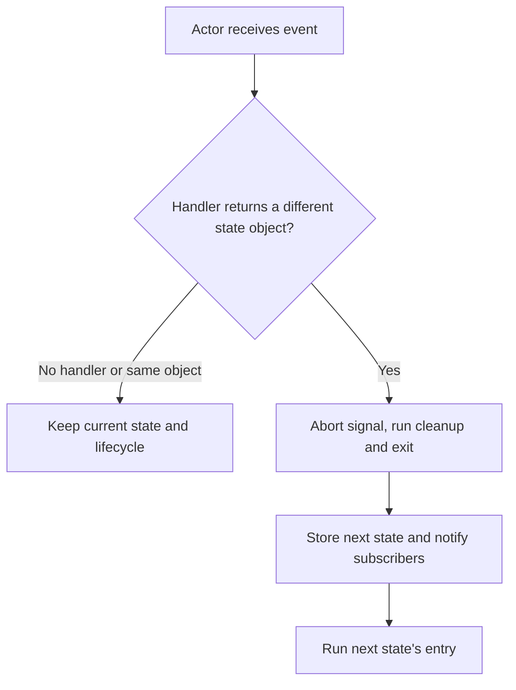

<!-- BUNDLE_SIZE:START -->

> 2.04 kB minified + gzipped

<!-- BUNDLE_SIZE:END -->

An upload screen lets the operator cancel while the request is in flight. The response arrives
afterwards and the handler stores it, so the cancelled file reappears as uploaded. The same gap
shows up wherever a screen's behaviour depends on which mode it is currently in, and the conditional
checks scatter across the component.

## Core Behavior

`Machine<States, Events>` is a transition table that maps each state kind to the events it handles
and the next state each handler returns.

- A handler returns the next state; an event without a handler leaves the current state unchanged.
- `Machine.interpret` creates an actor that runs entry effects when a state is entered and aborts
  the previous entry's signal when the state changes.
- A state change also runs the previous entry's cleanup, then its exit hook, notifies subscribers,
  and enters the new state.
- `send` queues re-entrant events and processes them in order; `abort` stops the actor and runs the
  active cleanup.

Reach for `Machine` when handling an event depends on the state the actor is in. A plain
[`EventBus`](/guides/event-bus/) broadcasts messages without state, so every subscriber sees every
matching event. The [type model](/basics/types/) covers definitions and instances, and the
[choosing guide](/basics/choosing/) places the execution shapes side by side.

## Example: File Upload

An upload screen can be idle, uploading, complete, or failed. If the user cancels an upload, a late
response from that upload should not replace the current state.

When an actor receives an event, it checks the current state's handler. A handler returning the same
state object leaves the lifecycle alone; a different state object triggers exit and entry:



### Managing an Upload

The upload state starts a request on entry. The actor passes the signal to `fetch`, and a response
sends either `COMPLETE` or `FAIL`. `CANCEL` returns to idle while the request is pending:

```ts
import { Machine } from "@pplnd/core";

type UploadState =
  | Machine.State<"idle", void, "uploading">
  | Machine.State<"uploading", { fileName: string; contents: string }, "idle" | "complete" | "failed">
  | Machine.State<"complete", { location: string }, "idle">
  | Machine.State<"failed", { message: string }, "idle" | "uploading">;

type UploadEvents = {
  START: { fileName: string; contents: string };
  COMPLETE: { location: string };
  FAIL: { message: string };
  CANCEL: void;
};

const uploadMachine = Machine.make<UploadState, UploadEvents>({
  idle: {
    on: { START: (_state, file) => Machine.state("uploading", file) },
  },
  uploading: {
    entry: (state, { send, signal }) => {
      void fetch(`/api/uploads/${encodeURIComponent(state.value.fileName)}`, {
        method: "POST",
        body: state.value.contents,
        signal,
      })
        .then((response) => {
          if (!response.ok) throw new Error(`HTTP ${response.status}`);
          return response.text();
        })
        .then((location) => send({ kind: "COMPLETE", value: { location } }))
        .catch((error: unknown) => {
          if (!signal.aborted) send({ kind: "FAIL", value: { message: String(error) } });
        });
    },
    on: {
      COMPLETE: (_state, result) => Machine.state("complete", result),
      FAIL: (_state, error) => Machine.state("failed", error),
      CANCEL: () => Machine.state("idle"),
    },
  },
  complete: { on: { CANCEL: () => Machine.state("idle") } },
  failed: {
    on: {
      START: (_state, file) => Machine.state("uploading", file),
      CANCEL: () => Machine.state("idle"),
    },
  },
});

const describe = (state: UploadState) =>
  Machine.match(state, {
    idle: () => "Select a file",
    uploading: ({ value }) => `Uploading ${value.fileName}`,
    complete: ({ value }) => `Uploaded to ${value.location}`,
    failed: ({ value }) => `Upload failed: ${value.message}`,
  });

const actor = Machine.interpret(uploadMachine, {
  initial: Machine.state("idle"),
});
const unsubscribe = actor.subscribe((state) => console.log(describe(state)));

actor.send({ kind: "START", value: { fileName: "report.txt", contents: "Report" } });
actor.send({ kind: "CANCEL" }); // Aborts the request and returns to idle.
unsubscribe();
actor.abort();
```

The actor's guarded `send` prevents an old entry from updating the new state even if the underlying
work ignores its signal. Events accepted by an entry stay queued and are processed in order; the
state at each event's turn decides the transition. To use a machine as a reducer without entry or
exit effects, call `Machine.transition` or `Machine.to.reducer` instead.

### Feeding the Actor from a Bus

When the commands arrive from elsewhere in the application, subscribe the actor to those kinds. The
subscription forwards only `START` and `CANCEL`; completion is reported by the entry effect that
started the request, through its own `send`:

```ts
import { EventBus } from "@pplnd/core";

const uploadCommands = EventBus.make<UploadEvents>();
const uploadActor = Machine.interpret(uploadMachine, {
  initial: Machine.state("idle"),
});

const stop = EventBus.subscribe(uploadCommands, ["START", "CANCEL"]).tap((message) => {
  uploadActor.send(message);
});
```

`Machine.interpret` also accepts the bus directly as `bus`, which forwards every kind and lets
unhandled events leave the state unchanged. See [`EventBus`](/guides/event-bus/) for forwarding and
sequence matching.

## Core Operations

### Defining and Inspecting

| Signature                         | What it does                                         | Return type or behavior              |
| :-------------------------------- | :--------------------------------------------------- | :----------------------------------- |
| `Machine.state(kind, value?)`     | Creates a state, optionally with a payload.          | A state with a `kind` discriminator. |
| `Machine.make(states)`            | Defines a state transition table.                    | `Machine<States, Events>`            |
| `Machine.is(kind)`                | Checks a state's kind.                               | A curried type guard.                |
| `Machine.match(state, cases)`     | Handles each state kind and infers the return union. | The matching handler's result.       |
| `Machine.match<States, R>(cases)` | Curried form for `pipe`; requires explicit types.    | The matching handler's result.       |

### Transitioning and Running

| Signature                             | What it does                                        | Behavior                                    |
| :------------------------------------ | :-------------------------------------------------- | :------------------------------------------ |
| `Machine.transition(machine, event)`  | Computes the next state from a supplied state.      | Does not run entry or exit effects.         |
| `Machine.to.reducer(machine)`         | Creates a `(state, event) => state` reducer.        | Pass the initial state to `useReducer`.     |
| `Machine.interpret(machine, options)` | Starts a stateful actor and runs the initial entry. | Options include `initial`, `id`, and `bus`. |
| `actor.send(event)` / `getState()`    | Sends an event / reads the current state.           | Re-entrant sends are queued.                |
| `actor.subscribe(fn)`                 | Observes state changes.                             | Returns an unsubscribe function.            |
| `actor.abort()` / `isRunning()`       | Stops the actor / checks whether it is running.     | Abort runs active cleanup and exit.         |

`Machine.State<Kind, Data, AllowedTargets>` restricts which state kinds a transition handler may
return; returning the current state is always allowed. `Machine.is` is curried:
`Machine.is("uploading")(state)`. The data-first `Machine.match` infers payloads and the union of
branch results; the curried form needs both type arguments because it cannot see the state value.

`Machine.transition(machine, event)(state)` is data-last. `Machine.to.reducer` is uncurried and fits
`useReducer` directly. `Machine.interpret` runs the initial entry immediately, so an entry effect
that fetches starts before the first `send`.

## Failure Behavior and Edge Cases

An unhandled event returns the same state, and the actor uses object identity to detect a change:
returning the original object skips lifecycle hooks and subscribers, while a new object triggers
them even when its `kind` is unchanged. `Machine.transition` lets an exception from a handler escape
immediately. `actor.send` rethrows synchronous exceptions from transitions, entry, exit, cleanup,
and listeners after the transition or cleanup in progress completes, so the actor is not left
half-way through a state change.

Callbacks must handle expected failures themselves. Use `Result` for synchronous work and
`Task.Result` for asynchronous work. Handle rejected promises inside an async entry effect, as in
the upload example: the actor does not observe a promise returned from an entry, and a rejection is
unhandled. `subscribe` reports subsequent changes only; read `getState()` for the initial state.

After `actor.abort()`, later events are ignored, the active cleanup and exit hook run, and
`getState()` keeps the last state. Aborting is local to the actor and returns no result; it does not
produce the shared [`Aborted`](/guides/aborted/) outcome used by engines that settle one. `send`
called from a transition, an entry or exit effect, or a subscriber while another event is processing
queues the event and returns the current state immediately; the queued event is processed after the
current one finishes.

The optional `bus` must share at least one event kind with the machine, and the shared payloads must
be compatible; that requirement is checked by the compiler. Kinds the machine does not declare are
delivered to `send` and leave the state unchanged. If the initial entry throws, the actor does not
start, its bus subscription is removed, and the error is rethrown.
