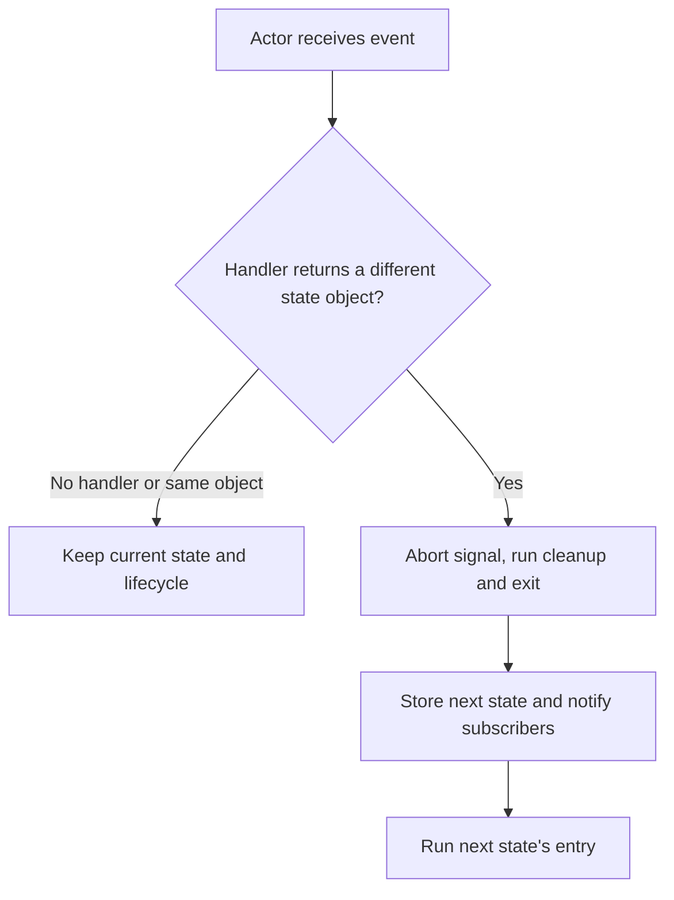

<!-- BUNDLE_SIZE:START -->

> 2.02 kB minified + gzipped

<!-- BUNDLE_SIZE:END -->

## Core Behavior

An upload screen needs to ignore a late response after the user cancels the upload. `Machine`
defines named states and the events each state handles. A transition returns the next state; an
event without a handler leaves the current state unchanged.

- `Machine.State` can specify allowed destination kinds for each state's transition handlers.
- `Machine.transition` computes a next state. `Machine.interpret` creates an actor that holds the
  current state and runs entry and exit effects.
- On a state change, the actor aborts the previous entry's signal, runs its cleanup and exit hook,
  notifies subscribers, and enters the new state.

## Example: File Upload

An upload screen can be idle, uploading, complete, or failed. If the user cancels an upload, a late
response from that upload should not replace the current state.

When an actor receives an event, it checks the current state's handler. A handler returning the same
state object leaves the lifecycle alone; a different state object triggers exit and entry:



An entry effect gets a state-scoped signal and `send` function. After the actor leaves that state,
the signal is aborted and that entry's `send` ignores late events. Events accepted before the entry
becomes stale remain in the actor's queue and are processed in order against the state active at
each event's turn.

### Managing an Upload

The upload state starts a request on entry. The actor passes the signal to `fetch`, and a response
sends either `COMPLETE` or `FAIL`. `CANCEL` returns to idle while the request is pending:

```ts
import { Machine, pipe } from "@pplnd/core";

type UploadState =
  | Machine.State<"idle", void, "uploading">
  | Machine.State<"uploading", { fileName: string; contents: string }, "idle" | "complete" | "failed">
  | Machine.State<"complete", { location: string }, "idle">
  | Machine.State<"failed", { message: string }, "idle" | "uploading">;

type UploadEvents = {
  START: { fileName: string; contents: string };
  COMPLETE: { location: string };
  FAIL: { message: string };
  CANCEL: void;
};

const uploadMachine = Machine.make<UploadState, UploadEvents>({
    idle: {
      on: { START: (_state, file) => Machine.state("uploading", file) },
    },
    uploading: {
      entry: (state, { send, signal }) => {
        void fetch(`/api/uploads/${encodeURIComponent(state.value.fileName)}`, {
          method: "POST",
          body: state.value.contents,
          signal,
        })
          .then((response) => {
            if (!response.ok) throw new Error(`HTTP ${response.status}`);
            return response.text();
          })
          .then((location) => send({ kind: "COMPLETE", value: { location } }))
          .catch((error: unknown) => {
            if (!signal.aborted) send({ kind: "FAIL", value: { message: String(error) } });
          });
      },
      on: {
        COMPLETE: (_state, result) => Machine.state("complete", result),
        FAIL: (_state, error) => Machine.state("failed", error),
        CANCEL: () => Machine.state("idle"),
      },
    },
    complete: { on: { CANCEL: () => Machine.state("idle") } },
    failed: {
      on: {
        START: (_state, file) => Machine.state("uploading", file),
        CANCEL: () => Machine.state("idle"),
      },
    },
  });

const describe = Machine.match<UploadState, string>({
  idle: () => "Select a file",
  uploading: ({ value }) => `Uploading ${value.fileName}`,
  complete: ({ value }) => `Uploaded to ${value.location}`,
  failed: ({ value }) => `Upload failed: ${value.message}`,
});

const actor = Machine.interpret(uploadMachine, {
  initial: Machine.state("idle"),
});
const unsubscribe = actor.subscribe((state) => console.log(pipe(state, describe)));

actor.send({ kind: "START", value: { fileName: "report.txt", contents: "Report" } });
actor.send({ kind: "CANCEL" }); // Aborts the request and returns to idle.
unsubscribe();
actor.abort();
```

The actor's guarded `send` prevents an old entry from updating the new state even if the underlying
work ignores its signal. To use a machine as a reducer without entry or exit effects, call
`Machine.transition` or `Machine.to.reducer` instead.

## Core Operations

### Defining and Inspecting

| Signature                     | What it does                                | Return type or behavior              |
| :---------------------------- | :------------------------------------------ | :----------------------------------- |
| `Machine.state(kind, value?)` | Creates a state, optionally with a payload. | A state with a `kind` discriminator. |
| `Machine.make(states)`        | Defines a state transition table.           | `Machine<States, Events>`            |
| `Machine.is(kind)`            | Checks a state's kind.                      | Type guard.                          |
| `Machine.match(cases)`        | Handles each state kind.                    | The matching handler's result.       |

### Transitioning and Running

| Signature                             | What it does                                        | Behavior                                |
| :------------------------------------ | :-------------------------------------------------- | :-------------------------------------- |
| `Machine.transition(machine, event)`  | Computes the next state from a supplied state.      | Does not run entry or exit effects.     |
| `Machine.to.reducer(machine)`         | Creates a `(state, event) => state` reducer.        | Pass the initial state to `useReducer`. |
| `Machine.interpret(machine, options)` | Starts a stateful actor and runs the initial entry. | Options include an EventBus.            |
| `actor.send(event)` / `getState()`    | Sends an event / reads the current state.           | Re-entrant sends are queued.            |
| `actor.subscribe(fn)`                 | Observes state changes.                             | Returns an unsubscribe function.        |
| `actor.abort()` / `isRunning()`       | Stops the actor / checks whether it is running.     | Abort runs active cleanup and exit.     |

## Failure Behavior and Edge Cases

An unhandled event returns the same state. The actor also uses object identity to detect a change:
returning the original object skips lifecycle hooks and subscribers, while a new object triggers
them even when its `kind` is unchanged.

```ts
import { Machine } from "@pplnd/core";

type UploadState = Machine.State<"uploading", { progress: number }>;
type UploadEvents = { SAME: void; UPDATE: void };
let entries = 0;

const machine = Machine.make<UploadState, UploadEvents>({
    uploading: {
      entry: () => { entries += 1; },
      on: {
        SAME: (state) => state,
        UPDATE: (state) => Machine.state("uploading", { progress: state.value.progress + 1 }),
      },
    },
  });
const actor = Machine.interpret(machine, { initial: Machine.state("uploading", { progress: 0 }) });
// Initial entry: entries is 1.
actor.send({ kind: "SAME" });            // entries is still 1.
actor.send({ kind: "UPDATE" });          // New object: entries is 2.
actor.abort();
```

`Machine.transition` lets a transition handler's exception escape. `Machine.interpret` propagates
synchronous exceptions from transitions, entry, exit, cleanup, and listeners after completing any
active state transition or cleanup. Callbacks must handle expected failures themselves; use `Result`
for synchronous work and `Task.Result` for asynchronous work. Handle rejected promises inside an
async effect, as in the upload example. `subscribe` reports subsequent changes; read `getState()`
for the initial state. After `actor.abort()`, later events are ignored and `getState()` retains the
last state.

`actor.send()` normally returns the state after processing the event. If called from a transition,
entry or exit effect, or subscriber while another event is being processed, it queues the event and
returns the current state immediately. The queued event is processed after the current event
finishes.
