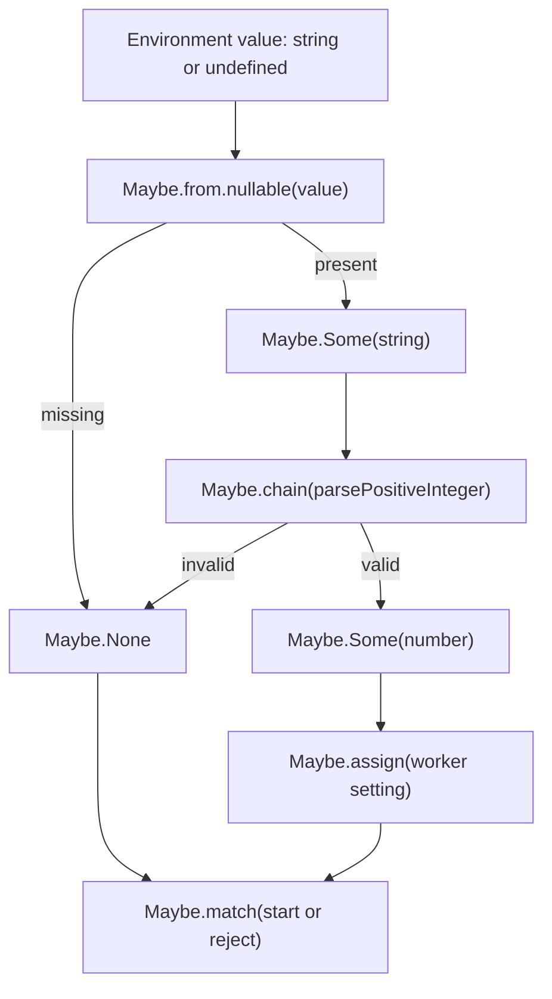

<!-- BUNDLE_SIZE:START -->

> 1.56 kB minified + gzipped

<!-- BUNDLE_SIZE:END -->

## Core Behavior

`Maybe<A>` holds either a present value (`Some`) or an explicit absence (`None`), so a configuration
loader can carry missing input through its pipeline without sprinkling null checks through every
step.

- `map`, `chain`, `filter`, and `tap` run their callbacks only for `Some`; `None` skips the callback
  and continues unchanged.
- `assign` skips later callbacks after `None`. `struct` inspects already-created fields in key order
  and returns the first `None` it encounters.
- `recover`, `getOrElse`, `match`, `to.Result`, and `to.Validation` evaluate their absence handlers
  only for `None`.
- `Maybe` carries presence or absence only. It does not retain a validation reason or handle an
  asynchronous rejection.

## How Execution Flows



A `Maybe` has two object shapes: `Some` includes a `value`, while `None` does not. `Maybe.is.some`
and `Maybe.is.none` narrow it when an imperative boundary needs to inspect the value. Within a
pipeline, callbacks that consume the wrapped value run only for `Some`. Absence handlers run for
`None` and receive no wrapped value.

## Architecture: Invoice Worker Configuration

An invoice worker needs a secure queue URL, a bounded concurrency value, a visibility timeout, and a
label for its process manager. With raw environment values, each setting needs its own null, blank,
and parsing branch:

```ts
const concurrency = Number(process.env.INVOICE_WORKER_CONCURRENCY);

if (
  !process.env.INVOICE_QUEUE_URL ||
  !Number.isSafeInteger(concurrency) ||
  concurrency < 1 ||
  concurrency > 64
) {
  throw new Error("Invoice worker configuration is invalid");
}
```

This check accepts `"1e1"` as a concurrency of 10, even if the configuration requires decimal
digits. It also leaves the URL, timeout, and label unchecked. Start by wrapping the queue variable
and trimming it only when it is present:

```ts
import { Maybe, pipe } from "@pplnd/core";

const queueUrl = pipe(
  Maybe.from.nullable(process.env.INVOICE_QUEUE_URL),
  Maybe.map((value) => value.trim()),
); // Maybe<string>
```

`from.nullable` changes only `null` and `undefined` into `None`; `map` skips trimming when the
variable is missing. An empty string still becomes `Some("")`. The full loader must reject blank
values, parse the settings, apply range limits, and make a startup decision.

```ts
import { Arr, Maybe, pipe, Str } from "@pplnd/core";

type Environment = Readonly<Record<string, string | undefined>>;

type InvoiceWorkerConfiguration = {
  queueUrl: URL;
  concurrency: number;
  visibilityTimeoutSeconds: number;
  workerLabel: string;
};

type InvoiceWorkerBoot =
  | { kind: "ready"; configuration: InvoiceWorkerConfiguration }
  | {
      kind: "rejected";
      error: {
        code: "INVALID_INVOICE_WORKER_CONFIGURATION";
        message: string;
      };
    };

const nonBlank = (value: string): Maybe<string> =>
  pipe(
    value.trim(),
    Maybe.from.Predicate((candidate) => candidate.length > 0),
  );

const requiredEnvironment = (environment: Environment, name: string): Maybe<string> =>
  pipe(
    Maybe.from.nullable(environment[name]),
    Maybe.chain(nonBlank),
  );

const isPositiveDecimalText = (value: string): boolean =>
  Str.is.nonEmpty(value) &&
  !Str.startsWith("0")(value) &&
  pipe(
    value,
    Str.split(""),
    Arr.every((character) => character >= "0" && character <= "9"),
  );

const parsePositiveInteger = (raw: string): Maybe<number> =>
  pipe(
    raw.trim(),
    Maybe.from.Predicate((candidate: string) => isPositiveDecimalText(candidate)),
    Maybe.map(Number),
    Maybe.filter((value: number) => Number.isSafeInteger(value)),
  );

const parseHttpsUrl = (raw: string): Maybe<URL> =>
  pipe(
    Maybe.tryCatch(() => new URL(raw)),
    Maybe.filter((url) => url.protocol === "https:"),
  );

const workerLabel = (environment: Environment): Maybe<string> =>
  pipe(
    Maybe.from.nullable(environment.WORKER_LABEL),
    Maybe.chain(nonBlank),
    Maybe.recover(() => Maybe.make.some("invoice-worker")),
  );

const loadInvoiceWorkerConfiguration = (
  environment: Environment,
): Maybe<InvoiceWorkerConfiguration> =>
  pipe(
    requiredEnvironment(environment, "INVOICE_QUEUE_URL"),
    Maybe.chain(parseHttpsUrl),
    Maybe.assignTo("queueUrl"),
    Maybe.assign("concurrency", () =>
      pipe(
        requiredEnvironment(environment, "INVOICE_WORKER_CONCURRENCY"),
        Maybe.chain(parsePositiveInteger),
        Maybe.filter((value) => value <= 64),
      ),
    ),
    Maybe.assign("visibilityTimeoutSeconds", () =>
      pipe(
        requiredEnvironment(environment, "INVOICE_VISIBILITY_TIMEOUT_SECONDS"),
        Maybe.chain(parsePositiveInteger),
        Maybe.filter((value) => value <= 43_200),
      ),
    ),
    Maybe.assign("workerLabel", () => workerLabel(environment)),
  );

const resolveInvoiceWorkerBoot = (environment: Environment): InvoiceWorkerBoot =>
  pipe(
    loadInvoiceWorkerConfiguration(environment),
    Maybe.match({
      some: (configuration): InvoiceWorkerBoot => ({ kind: "ready", configuration }),
      none: (): InvoiceWorkerBoot => ({
        kind: "rejected",
        error: {
          code: "INVALID_INVOICE_WORKER_CONFIGURATION",
          message: "Invoice worker configuration is missing or invalid",
        },
      }),
    }),
  );

const boot = resolveInvoiceWorkerBoot({
  INVOICE_QUEUE_URL: "https://queue.example.com/invoices",
  INVOICE_WORKER_CONCURRENCY: "8",
  INVOICE_VISIBILITY_TIMEOUT_SECONDS: "300",
});
// { kind: "ready", configuration: { queueUrl: URL, concurrency: 8,
//   visibilityTimeoutSeconds: 300, workerLabel: "invoice-worker" } }
```

`assignTo` starts an accumulator after the queue URL has passed validation. Each `assign` receives
that accumulator, but this worker uses only the environment for its remaining independent settings.
If any required setting becomes `None`, later assignments and the `some` handler never run. The
label uses `recover`, so a missing or blank label becomes `Some("invoice-worker")`. The process
manager receives `InvoiceWorkerBoot` and can start the worker only for the `ready` case.

`struct` is useful when the settings are already available as independent `Maybe` values. Its
argument is an ordinary object, so JavaScript evaluates the field expressions before `struct` is
called; stopping at the first `None` does not skip that work. Use `assign` callbacks when later
lookups or parsing should be skipped after an earlier failure.

## Core Operations

### Creating Values

| Signature                                                         | What it does                                                                     | Guarantee                                                                     |
| :---------------------------------------------------------------- | :------------------------------------------------------------------------------- | :---------------------------------------------------------------------------- |
| `Maybe.make.some(value)`                                          | Marks a known worker setting as present.                                         | Produces `Some(value)` without changing the value.                            |
| `Maybe.make.none()`                                               | Creates an explicit missing-setting result.                                      | Produces `None`.                                                              |
| `Maybe.from.nullable(value)`                                      | Admits an environment value at the boundary.                                     | `null` and `undefined` become `None`; every other value becomes `Some`.       |
| `Maybe.from.Predicate(predicate)(value)`                          | Accepts a raw setting only when it passes a test.                                | A failed predicate produces `None`; a type guard also narrows the value type. |
| `Maybe.tryCatch(operation)`                                       | Runs synchronous parsing code such as `new URL(raw)`.                            | A synchronous throw produces `None`.                                          |
| `Maybe.from.Result(result)` / `Maybe.from.Validation(validation)` | Discards an existing validation error at a boundary where only presence matters. | Success becomes `Some`; failure becomes `None`.                               |

### Combining Values

| Signature                            | What it does                                               | Guarantee                                                                              |
| :----------------------------------- | :--------------------------------------------------------- | :------------------------------------------------------------------------------------- |
| `Maybe.assignTo(key)`                | Starts a configuration accumulator from a present value.   | `None` remains `None`.                                                                 |
| `Maybe.assign(key, operation)`       | Adds a dependent or independent setting to an accumulator. | Stops before the next assignment when the current value or operation result is `None`. |
| `Maybe.struct(fields)`               | Combines independent optional settings into one record.    | Visits own enumerable string keys in order and stops at the first `None`.              |
| `Maybe.apply(argument)`              | Feeds a present argument into a present curried function.  | Returns `None` if the function or its argument is absent.                              |
| `Maybe.sequence.Result(maybeResult)` | Moves a result outside an optional setting.                | `Some(Err)` remains an error; `None` becomes `Ok(None)`.                               |

### Transforming Values

| Signature                                     | What it does                                                               | Guarantee                                                                         |
| :-------------------------------------------- | :------------------------------------------------------------------------- | :-------------------------------------------------------------------------------- |
| `Maybe.map(transform)`                        | Converts a present setting, such as trimming a label.                      | The transform does not run for `None`.                                            |
| `Maybe.chain(transform)`                      | Runs a step that can itself reject a setting, such as integer parsing.     | Avoids nested `Maybe` values and bypasses the step for `None`.                    |
| `Maybe.filter(predicate)`                     | Rejects a present value that violates a rule, such as a concurrency limit. | A failed predicate becomes `None`; a type guard narrows `Some`.                   |
| `Maybe.recover(fallback)`                     | Supplies another optional value after an absence.                          | The fallback runs only for `None`.                                                |
| `Maybe.tap(effect)` / `Maybe.tapNone(effect)` | Records a startup metric without changing the pipeline value.              | Each runs its effect only for its matching case and returns the original `Maybe`. |

### Running Code and Leaving Maybe

| Signature                                                 | What it does                                                      | Return type                                     |
| :-------------------------------------------------------- | :---------------------------------------------------------------- | :---------------------------------------------- |
| `Maybe.match({ some, none })`                             | Handles both startup outcomes at the process boundary.            | The shared return type of the two handlers.     |
| `Maybe.getOrElse(fallback)`                               | Extracts a setting or supplies a plain fallback.                  | `A` or the fallback type; the fallback is lazy. |
| `Maybe.is.some(maybe)` / `Maybe.is.none(maybe)`           | Narrows a value for an imperative integration point.              | A TypeScript type guard.                        |
| `Maybe.to.nullable(maybe)` / `Maybe.to.undefined(maybe)`  | Returns to an API that expects a nullable primitive.              | `A` or `null`; `A` or `undefined`.              |
| `Maybe.to.Result(onNone)` / `Maybe.to.Validation(onNone)` | Attaches an error value when absence crosses a stricter boundary. | `Result(E, A)` or `Validation(E, A)`.           |

## Failure Behavior and Edge Cases

A `None` says only that the configuration value is unavailable or unacceptable. The example treats a
missing variable, blank text, malformed URL, non-decimal integer, and excessive limit alike. That is
appropriate when the process manager needs one safe reject message. If an operator needs to know
which rule failed, validate with `Result` from the first parsing step so each failure retains its
reason; converting an already-empty `Maybe` to `Result` can provide only a new generic error.

`Maybe.tryCatch` catches only synchronous exceptions thrown while it calls `operation`. It does not
catch exceptions thrown later by `map`, `chain`, `filter`, `tap`, `recover`, `getOrElse`, or
`match`. Those callbacks execute normally when their respective case is reached, so protect code
that can throw before putting it in a `Maybe` pipeline. It also does not await promises:
`Maybe.tryCatch(() => fetchConfiguration())` creates `Some(Promise)` and a later rejection remains a
rejected promise.

`Some` keeps the same object reference it receives. `Maybe` does not freeze configuration objects,
clone them, validate every property, or prevent a caller from mutating the object after it has
entered the pipeline.
