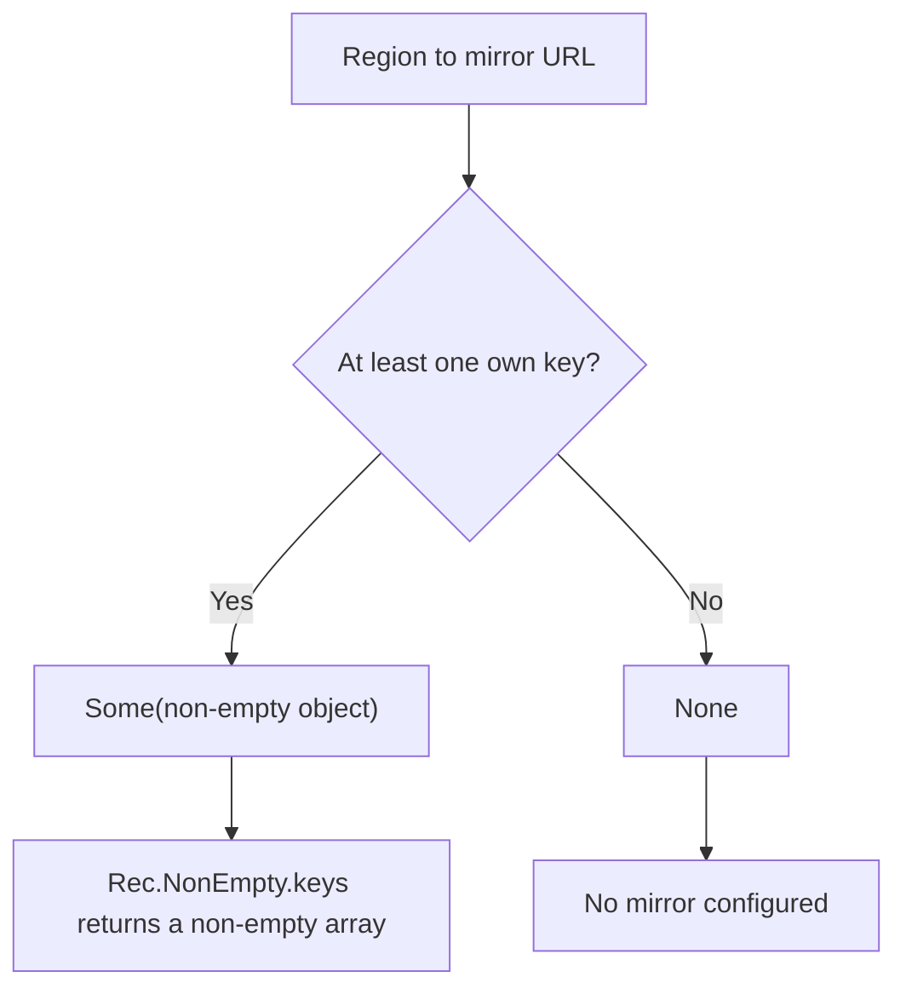

A release pipeline reads a mapping of regions to mirror URLs and deploys to the first entry. The
mapping is valid JSON but can arrive empty, and the first entry is then `undefined`. The deploy step
sends its request to the string `undefined` and reports success.

## Core Behavior

The collection modules export a non-empty variant for arrays, records, maps, sets, and strings. The
variant is the same runtime value with a type-level guarantee that at least one item is present.

- `Arr.NonEmpty<A>` is `readonly [A, ...A[]]`; `Rec`, `Dict`, `Uniq`, and `Str` brand their existing
  collection types.
- Each module's `NonEmpty.from` converter returns `Some` for a non-empty input and `None` otherwise;
  `is.nonEmpty` is the type guard.
- Accessors on the variant return items directly instead of `Maybe`; `Arr.NonEmpty.tail` may still
  be empty.
- The guarantee is not rechecked. It describes the value the guard produced, not a runtime lock.

Reach for a non-empty variant at the boundary where a collection must contain an item.
[`Arr`](/guides/arr/) turns a checked array into a tuple. The [choosing guide](/basics/choosing/)
places the collections beside each other.

## Example: Release Mirrors

A release configuration maps region names to mirror URLs, and every later step reads a primary
mirror. The pipeline refuses a configuration with no regions before that read.

`Rec.NonEmpty.from.record` checks the mapping once and the type carries the result:



### Describing the Release

```ts
import { Maybe, Rec, pipe } from "@pplnd/core";

const mirrorConfig: Readonly<Record<string, string>> = {
  "eu-west": "https://eu.mirror.example.com",
  "us-east": "https://us.mirror.example.com",
};

const describeRelease = (config: Readonly<Record<string, string>>): string =>
  pipe(
    Rec.NonEmpty.from.record(config),
    Maybe.match({
      some: (mirrors) => `Release mirrored to ${Rec.NonEmpty.keys(mirrors).join(", ")}`,
      none: () => "No mirror configured",
    }),
  );

describeRelease(mirrorConfig);
// "Release mirrored to eu-west, us-east"
describeRelease({});
// "No mirror configured"
```

Inside the `some` branch the object carries the guarantee, so `Rec.NonEmpty.keys` returns an array
type with a first element. No later length check is needed.

### Handoff: Reading the Primary Mirror Without a Maybe

The entries of a guarded mapping are also an array whose first element exists. That is enough to
index it directly:

```ts
import { Arr, Rec } from "@pplnd/core";

const plan = (mirrors: Rec.NonEmpty<string>) => {
  const entries = Rec.NonEmpty.entries(mirrors);
  return {
    primary: Arr.NonEmpty.head(entries),
    failover: Arr.NonEmpty.tail(entries),
  };
};
```

`Arr.NonEmpty.head` returns the first pair instead of a `Maybe`, and `Arr.NonEmpty.tail` returns the
remaining pairs. [`Arr`](/guides/arr/) documents the rest of the index and slice helpers.

## Core Operations

### Checking and Creating

| Signature                                                                                                                                       | What it checks                      | Result                                   |
| :---------------------------------------------------------------------------------------------------------------------------------------------- | :---------------------------------- | :--------------------------------------- |
| `Arr.NonEmpty.from.array(items)` / `Arr.is.nonEmpty(items)`                                                                                     | Array length.                       | `Maybe<Arr.NonEmpty<A>>` / type guard    |
| `Rec.NonEmpty.from.record(record)` / `Rec.is.nonEmpty(record)`                                                                                  | Own enumerable keys.                | `Maybe<Rec.NonEmpty<...>>` / type guard  |
| `Dict.NonEmpty.from.map(map)` / `Dict.is.nonEmpty(map)`                                                                                         | Map size.                           | `Maybe<Dict.NonEmpty<...>>` / type guard |
| `Uniq.NonEmpty.from.set(set)` / `Uniq.is.nonEmpty(set)`                                                                                         | Set size.                           | `Maybe<Uniq.NonEmpty<A>>` / type guard   |
| `Str.NonEmpty.from.string(text)` / `Str.is.nonEmpty(text)`                                                                                      | String length.                      | `Maybe<Str.NonEmpty>` / type guard       |
| `Arr.NonEmpty.singleton(item)` / `Rec.NonEmpty.singleton(key, value)` / `Dict.NonEmpty.singleton(key, value)` / `Uniq.NonEmpty.singleton(item)` | Creates a collection with one item. | The corresponding non-empty type         |

### Working with Non-Empty Values

| Signature                                                                                                     | What it does                               | Result                             |
| :------------------------------------------------------------------------------------------------------------ | :----------------------------------------- | :--------------------------------- |
| `Arr.NonEmpty.head(items)` / `last(items)` / `tail(items)`                                                    | Reads the first, last, or remaining items. | Item / item / array                |
| `Arr.NonEmpty.map(transform)` / `mapWithIndex(transform)` / `intersperse(item)` / `concat(other)` / `reverse` | Transforms a non-empty array.              | `Arr.NonEmpty`                     |
| `Arr.NonEmpty.reduce(reducer)`                                                                                | Folds from the first item.                 | The final accumulator              |
| `Rec.NonEmpty.keys` / `values` / `entries`                                                                    | Reads record contents.                     | `Arr.NonEmpty`                     |
| `Rec.NonEmpty.map(transform)` / `mapWithKey(transform)` / `reduce(reducer)`                                   | Transforms or folds values.                | `Rec.NonEmpty` or the final value  |
| `Dict.NonEmpty.keys` / `values` / `entries`                                                                   | Reads map contents.                        | `Arr.NonEmpty`                     |
| `Dict.NonEmpty.map(transform)` / `mapWithKey(transform)` / `reduce(reducer)`                                  | Transforms or folds values.                | `Dict.NonEmpty` or the final value |
| `Uniq.NonEmpty.map(transform)` / `reduce(reducer)`                                                            | Transforms or folds values.                | `Uniq.NonEmpty` or the final value |
| `Uniq.NonEmpty.to.array(set)`                                                                                 | Copies values.                             | `Arr.NonEmpty`                     |
| `Arr.prepend(item)` / `Arr.append(item)`                                                                      | Adds an item to any array.                 | `Arr.NonEmpty`                     |

## Failure Behavior and Edge Cases

A non-empty string can contain only whitespace. `Str.NonEmpty.from.string` checks the length, so
`"   "` passes; use `Str.is.blank` when a value must also contain non-whitespace characters.
[`Str`](/guides/str/) covers the string checks.

The guards do not copy. If a mutable array, map, set, or object is emptied through another reference
after a successful check, the previously checked value refers to that same empty collection. Keep a
stable copy when later mutation is possible.

`Arr.NonEmpty.tail` may return an empty array; only `head` and `last` are guaranteed to return an
item, and both return the same item for a one-element array. The keyed variants have no first-key
accessor; convert with `keys`, `values`, or `entries` to get a non-empty array. `Rec.is.nonEmpty`
counts own enumerable string keys, so an object whose only fields are symbol keys is empty.

The branded variants are erased at runtime. A value that was serialized, stored, or received over
the wire has no guarantee when it comes back; run the `from` converter again at the boundary.
[`Brand`](/guides/brand/) describes the underlying brand mechanism.
