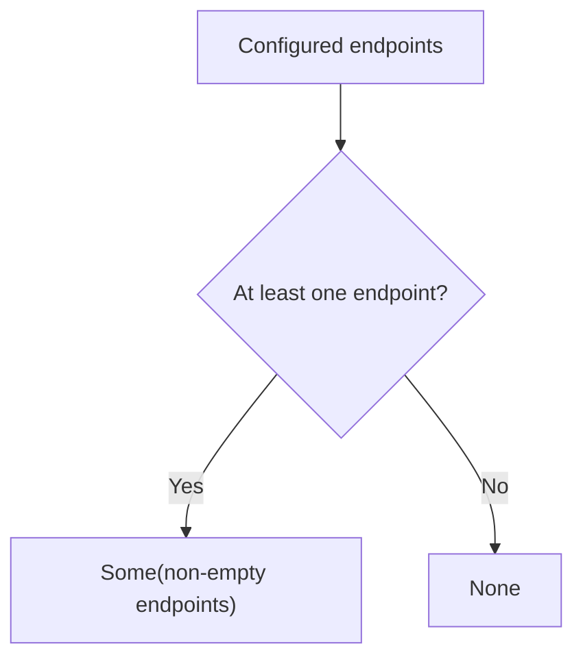

## Core Behavior

The collection modules provide non-empty types for arrays, records, maps, sets, and strings. These
types let a function require at least one item.

- `Arr.NonEmpty<A>` is a readonly tuple with at least one `A`; the other collection types carry a
  non-empty brand.
- Each module has a `NonEmpty.from` conversion that returns `Some` when the input is non-empty and
  `None` otherwise.
- Non-empty array helpers can read the first or last value directly; their `tail` may be empty.

## Example: Failover Endpoints

A client selects the first endpoint from a configured list. If the list is empty, it reports that no
endpoint is available.

`Arr.NonEmpty.from.array` checks length and returns an optional non-empty array:



### Selecting an Endpoint

```ts
import { Arr, Maybe, pipe } from "@pplnd/core";

const selectEndpoint = (endpoints: readonly string[]): string =>
  pipe(
    Arr.NonEmpty.from.array(endpoints),
    Maybe.match({
      some: (available) => Arr.NonEmpty.head(available),
      none: () => "No endpoints configured",
    }),
  );

selectEndpoint(["https://primary.example.com", "https://backup.example.com"]);
// "https://primary.example.com"
selectEndpoint([]); // "No endpoints configured"
```

## Core Operations

### Checking and Creating

| Signature                                                                                                                                       | What it does                             | Result                                 |
| :---------------------------------------------------------------------------------------------------------------------------------------------- | :--------------------------------------- | :------------------------------------- |
| `Arr.NonEmpty.from.array(items)` / `Arr.is.nonEmpty(items)`                                                                                     | Checks an array.                         | `Maybe<Arr.NonEmpty<A>>` / type guard. |
| `Rec.NonEmpty.from.record(record)` / `Rec.is.nonEmpty(record)`                                                                                  | Checks a record for own enumerable keys. | `Maybe` / type guard.                  |
| `Dict.NonEmpty.from.map(map)` / `Dict.is.nonEmpty(map)`                                                                                         | Checks a map.                            | `Maybe` / type guard.                  |
| `Uniq.NonEmpty.from.set(set)` / `Uniq.is.nonEmpty(set)`                                                                                         | Checks a set.                            | `Maybe` / type guard.                  |
| `Str.NonEmpty.from.string(text)` / `Str.is.nonEmpty(text)`                                                                                      | Checks a string's length.                | `Maybe` / type guard.                  |
| `Arr.NonEmpty.singleton(item)` / `Rec.NonEmpty.singleton(key, value)` / `Dict.NonEmpty.singleton(key, value)` / `Uniq.NonEmpty.singleton(item)` | Creates a collection with one item.      | The corresponding non-empty type.      |

### Working with Non-Empty Values

| Signature                                                                                                       | What it does                               | Result                                  |
| :-------------------------------------------------------------------------------------------------------------- | :----------------------------------------- | :-------------------------------------- |
| `Arr.NonEmpty.head(items)` / `last(items)` / `tail(items)`                                                      | Reads the first, last, or remaining items. | Item / item / readonly array.           |
| `Arr.NonEmpty.map(fn)` / `mapWithIndex(fn)` / `concat(other)` / `intersperse(item)` / `reverse`                 | Transforms a non-empty array.              | A non-empty array.                      |
| `Arr.NonEmpty.reduce(fn)` / `Rec.NonEmpty.reduce(fn)` / `Dict.NonEmpty.reduce(fn)` / `Uniq.NonEmpty.reduce(fn)` | Reduces without a separate initial value.  | One item.                               |
| `Rec.NonEmpty.keys/values/entries` / `Dict.NonEmpty.keys/values/entries` / `Uniq.NonEmpty.to.array`             | Extracts entries or values.                | A non-empty array.                      |
| `Rec.NonEmpty.map/mapWithKey` / `Dict.NonEmpty.map/mapWithKey` / `Uniq.NonEmpty.map`                            | Transforms values.                         | The corresponding non-empty collection. |
| `Arr.prepend(item)` / `append(item)`                                                                            | Adds an item to any array.                 | A non-empty array.                      |

## Failure Behavior and Edge Cases

A non-empty string can contain only whitespace. Use `Str.is.blank` when an endpoint or another
string must also contain non-whitespace characters.

The checks do not copy their input. If a mutable array is emptied through another reference after a
successful check, the previously checked value refers to that same now-empty array. Keep a stable
copy when later mutation is possible and the guarantee must remain valid.
