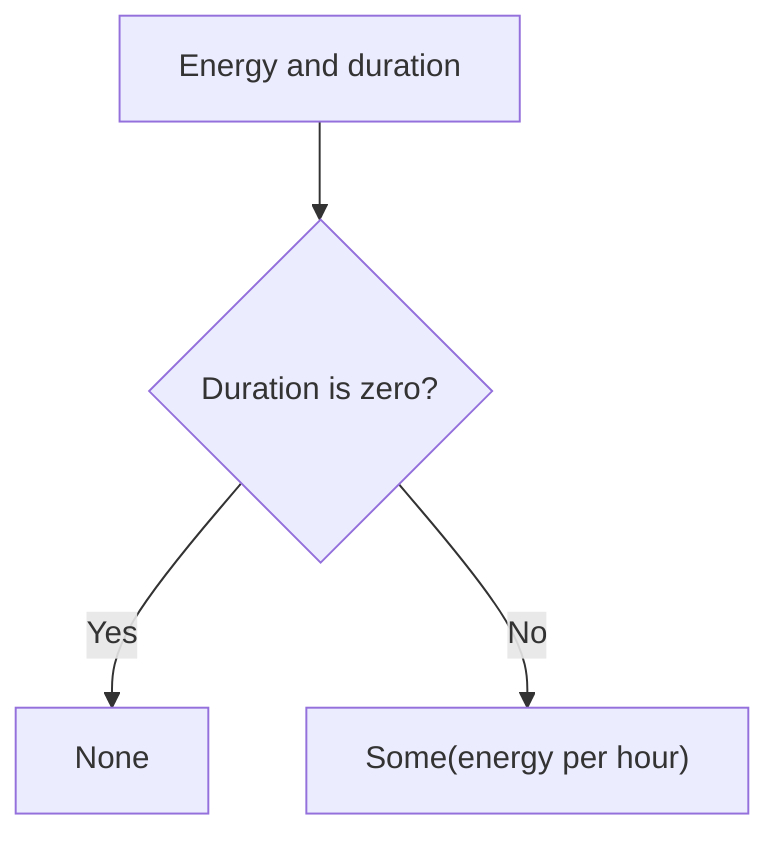

<!-- BUNDLE_SIZE:START -->

> 2.01 kB minified + gzipped

<!-- BUNDLE_SIZE:END -->

## Core Behavior

`Num` provides data-last arithmetic, numeric checks, parsing, and array aggregations.

- `from.string` returns `None` for blank or unparseable text.
- `divide` and `remainder` return `None` for a zero divisor.
- `mean`, `min`, and `max` return `None` for an empty array; `sum([])` is zero.

## Example: Energy Meter Readings

A meter reports the energy consumed over an interval. To calculate an hourly average, divide the
reported energy by the interval duration and handle a zero duration.

`divide` checks the divisor before calculating the result:



### Calculating the Rate

```ts
import { Maybe, Num, pipe } from "@pplnd/core";

const energyPerHour = (energyKwh: number, hours: number): string =>
  pipe(
    energyKwh,
    Num.divide(hours),
    Maybe.match({
      some: (rate) => `${rate.toFixed(1)} kWh per hour`,
      none: () => "Duration must be nonzero",
    }),
  );

energyPerHour(18, 3); // "6.0 kWh per hour"
energyPerHour(18, 0); // "Duration must be nonzero"
```

## Core Operations

### Parsing and Inspecting

| Signature                                                         | What it does                                        | Result           |
| :---------------------------------------------------------------- | :-------------------------------------------------- | :--------------- |
| `Num.from.string(text)`                                           | Parses using JavaScript's `Number` conversion.      | `Maybe<number>`. |
| `Num.is.zero/integer/float/finite/nan/even/odd/positive/negative` | Checks a numeric property.                          | Boolean.         |
| `Num.between(min, max)` / `inRange(start, end)`                   | Checks inclusive bounds / an exclusive upper bound. | Boolean.         |
| `Num.format(options, locales)`                                    | Formats a finite number.                            | `Maybe<string>`. |

### Calculating and Aggregating

| Signature                                                   | What it does                                                   | Result                                            |
| :---------------------------------------------------------- | :------------------------------------------------------------- | :------------------------------------------------ |
| `Num.add(amount)` / `subtract(amount)` / `multiply(factor)` | Applies arithmetic to the piped value.                         | Number.                                           |
| `Num.divide(divisor)` / `remainder(divisor)`                | Divides or calculates a remainder.                             | `Maybe<number>`.                                  |
| `Num.abs` / `negate` / `round` / `floor` / `ceil`           | Transforms or rounds a number.                                 | Number.                                           |
| `Num.clamp(min, max)`                                       | Restricts a value to inclusive bounds.                         | Number.                                           |
| `Num.range(from, to, step)`                                 | Generates an ascending sequence including reachable endpoints. | Array of numbers.                                 |
| `Num.sum` / `mean` / `min` / `max`                          | Aggregates an array.                                           | Number for `sum`; `Maybe<number>` for the others. |

## Failure Behavior and Edge Cases

`Num.from.string("Infinity")` returns `Some(Infinity)`: the parser rejects `NaN`, not infinity.
Check `Num.is.finite` when a finite measurement is required. `divide` checks for a zero divisor but
does not validate whether either input is finite.

`range` returns an empty array for a non-finite bound or step, a nonpositive step, or a start above
the end. `Num.format` returns `None` for a non-finite value; invalid `Intl.NumberFormat` options can
still throw.
