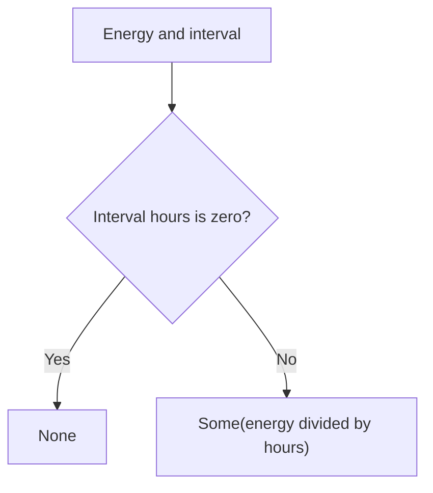

<!-- BUNDLE_SIZE:START -->

> 2.04 kB minified + gzipped

<!-- BUNDLE_SIZE:END -->

A meter reports the energy consumed over an interval and the length of that interval. When the
length arrives as zero, division produces `Infinity`, which flows into totals and comparisons as if
it were a valid measurement. A later rounding step hides the bad input while the rate stays wrong.

## Core Behavior

`Num` provides data-last arithmetic, range checks, parsing, aggregation, and formatting for ordinary
JavaScript numbers.

- `from.string` returns `None` for blank text and for values that are not finite; the whole trimmed
  string must parse.
- `divide` and `remainder` return `None` when the divisor is zero or the result is `NaN`.
- `min` and `max` return `None` for an empty array or one containing `NaN`; `sum([])` is `0`.
- `clamp` restricts a value to inclusive bounds; `format` returns `None` for a non-finite value.

Use `Num` when the values are ordinary numbers and the operation must stay inside `number`
precision. When totals are exact integers that can exceed `2^53`, [`BigNum`](/guides/bignum/) keeps
them as `bigint`. The [choosing guide](/basics/choosing/) lists the primitives side by side.

## Example: Energy Meter Readings

A meter reports kilowatt-hours consumed over an interval measured in hours. The billing report needs
the average load in kilowatts, and it must say when the interval length is unusable rather than
print an infinite rate.

`divide` checks the divisor before it calculates the rate:



### Calculating the Average Load

```ts
import { Maybe, Num, pipe } from "@pplnd/core";

interface MeterReading {
  readonly meterId: string;
  readonly energyKwh: number;
  readonly intervalHours: number;
}

const averageLoad = (reading: MeterReading): Maybe<number> =>
  pipe(reading.energyKwh, Num.divide(reading.intervalHours));

const describeReading = (reading: MeterReading): string =>
  !Num.is.finite(reading.energyKwh)
    ? `${reading.meterId}: invalid energy reading`
    : pipe(
        averageLoad(reading),
        Maybe.match({
          some: (kilowatts) => `${reading.meterId}: ${kilowatts.toFixed(1)} kW`,
          none: () => `${reading.meterId}: interval must be nonzero`,
        }),
      );

describeReading({ meterId: "M-104", energyKwh: 18, intervalHours: 3 });
// "M-104: 6.0 kW"
describeReading({ meterId: "M-105", energyKwh: 18, intervalHours: 0 });
// "M-105: interval must be nonzero"
```

The finiteness check runs before the division, so a report never formats an infinite or `NaN`
reading as a kilowatt value.

### Handing the Fleet Total to BigNum

The same report can take its fleet total from lifetime counters kept in whole watt-hours. Once a
counter passes the safe integer range, exact addition requires `bigint`:

```ts
import { BigNum, pipe } from "@pplnd/core";

const counters: readonly bigint[] = [9007199254740993n, 9007199254740995n];
const totalWattHours = BigNum.sum(counters); // 18014398509481988n
const wholeKilowattHours = pipe(totalWattHours, BigNum.divide(1000n)); // Some(18014398509481n)
```

[`BigNum`](/guides/bignum/) covers exact integer division, remainders, and conversion back to
`number` when a value fits.

## Core Operations

### Reading and Parsing

| Signature                                                                                         | What it does                     | Result           |
| :------------------------------------------------------------------------------------------------ | :------------------------------- | :--------------- |
| `Num.from.string(text)`                                                                           | Parses the whole trimmed string. | `Maybe<number>`. |
| `Num.is.zero` / `integer` / `float` / `finite` / `nan` / `even` / `odd` / `positive` / `negative` | Checks a numeric property.       | Boolean.         |
| `Num.format(options?, locales?)`                                                                  | Formats a finite number.         | `Maybe<string>`. |

### Comparing

| Signature                 | What it does                                         | Result   |
| :------------------------ | :--------------------------------------------------- | :------- |
| `Num.between(min, max)`   | Checks inclusive bounds.                             | Boolean. |
| `Num.inRange(start, end)` | Checks `[start, end)` with an exclusive upper bound. | Boolean. |
| `Num.clamp(min, max)`     | Restricts a value to inclusive bounds.               | Number.  |

### Calculating and Aggregating

| Signature                                                   | What it does                               | Result                                            |
| :---------------------------------------------------------- | :----------------------------------------- | :------------------------------------------------ |
| `Num.add(amount)` / `subtract(amount)` / `multiply(factor)` | Applies arithmetic to the piped value.     | Number.                                           |
| `Num.divide(divisor)` / `remainder(divisor)`                | Divides or calculates a remainder.         | `Maybe<number>`.                                  |
| `Num.abs` / `negate` / `round` / `floor` / `ceil`           | Transforms or rounds a number.             | Number.                                           |
| `Num.range(from, to, step?)`                                | Generates values from `from` through `to`. | Readonly number array.                            |
| `Num.sum` / `mean` / `min` / `max`                          | Aggregates an array.                       | Number for `sum`; `Maybe<number>` for the others. |

## Failure Behavior and Edge Cases

`Num.from.string("Infinity")` returns `None` because the parser checks `Number.isFinite`;
`Num.from.string("42ms")` also returns `None` because `Number` rejects trailing text. The parser
delegates to `Number`, so hexadecimal text such as `"0x10"` becomes `Some(16)`.

`divide` rejects a zero divisor and a `NaN` result, but an infinite dividend or divisor can still
produce a value: `Num.divide(2)(Infinity)` returns `Some(Infinity)`. Use `Num.is.finite` at the
boundary when the result must be finite.

`min` and `max` return `None` when any element is `NaN`, regardless of its position. `sum` and
`mean` propagate `NaN` instead, and `mean` wraps it in `Some`; `mean([])` returns `None`.

`range` returns an empty array for a non-finite bound or step, a nonpositive step, or a start above
the end. The last value never exceeds `to` when the step does not land on it, and `range(3, 3)`
returns `[3]`. `format` returns `None` for `NaN` and infinities; invalid `Intl.NumberFormat` options
still throw at construction time.
