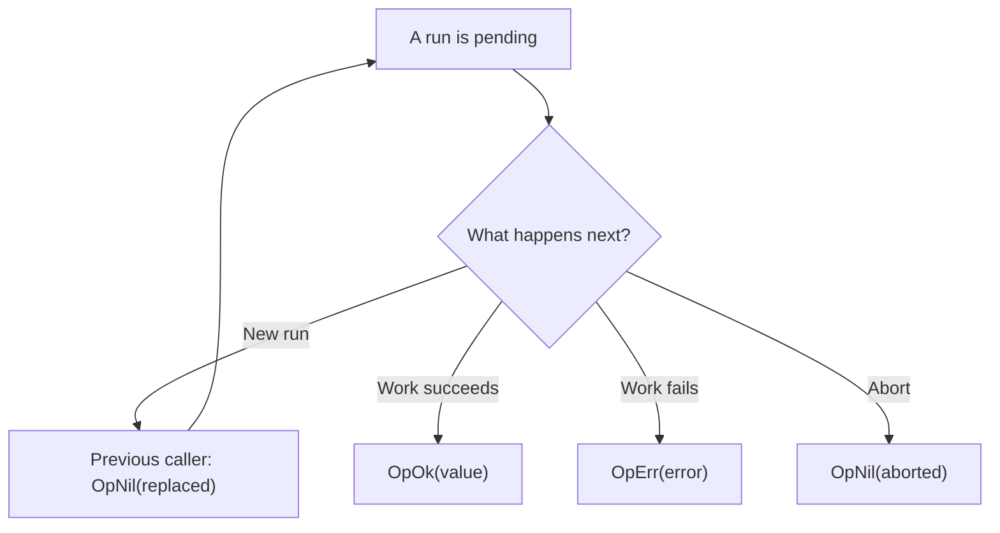

<!-- BUNDLE_SIZE:START -->

> 6.27 kB minified + gzipped

<!-- BUNDLE_SIZE:END -->

A user types a search query one letter at a time, and the network answers out of order. The response
for `par` can land after the response for `park`, replacing good results with stale ones, and the
loading indicator can disappear while the latest call is still running.

## Core Behavior

`Op<Args, E, A>` describes asynchronous work that takes arguments, can fail with `E`, and returns
`A`; `Op.interpret` turns that description into a manager that runs it.

- Each `run` settles into an outcome for that call: `OpOk` with a value, `OpErr` with an error, or
  `OpNil` with a reason.
- The strategy decides what happens when calls overlap: replace the active call, drop the new one,
  queue it, buffer it, debounce it, throttle it, limit concurrency, or keep a separate run per key.
- The manager exposes `state`, `subscribe`, `abort`, `reset`, and `poll`. Retry and timeout are
  configured when the operation is interpreted.

Reach for `Op` when calls can overlap and something must decide which one wins. A single lazy call
with no manager is a [`Task`](/guides/task/). [Reading the Types](/basics/types/) explains why the
manager is a separate object from the definition, and the [choosing guide](/basics/choosing/) maps
execution shapes to modules.

## Example: Search Requests

A search field runs a request for every query. With `restartable`, a new call aborts the previous
run and replaces it, so an older response cannot overwrite the results of a newer one.

The new call settles the previous caller as replaced, then runs its own work. Its work can succeed,
fail, or be aborted:



### Managing Search Requests

The task factory receives the query that `run` was called with and returns a `Task.Result`, so the
error channel is already typed before the manager sees it:

```ts
import { Op, pipe, Task } from "@pplnd/core";

const loadResults = (query: string): Task.Result<string, string> =>
  Task.Result.tryCatch(
    async (signal) => {
      const response = await fetch(`/api/search?q=${encodeURIComponent(query)}`, { signal });
      if (!response.ok) throw new Error(`HTTP ${response.status}`);
      return response.text();
    },
    { onError: (error) => `Search request failed: ${String(error)}` },
  );

const search = Op.make(loadResults);
const searches = Op.interpret(search, { strategy: "restartable" });

const unsubscribe = searches.subscribe((state) => {
  if (Op.is.pending(state)) console.log("Searching...");
  if (Op.Outcome.is.ok(state)) console.log(state.value);
  if (Op.Outcome.is.err(state)) console.error(state.error);
});

const previous = searches.run("pipe");
const current = searches.run("pipeline");

console.log(await previous); // OpNil with reason "replaced"

const message = pipe(
  await current,
  Op.Outcome.match({
    ok: (results) => results,
    err: (error) => error,
    nil: (reason) => `Search ${reason}`,
  }),
);
console.log(message);
unsubscribe();
```

`subscribe` reports manager state, while awaiting an individual `run` reports that call's outcome.
The two differ when a call is replaced: the caller receives `OpNil` and the manager continues with
the newer call.

### Protecting the Search Behind a Breaker

A search endpoint that starts timing out should stop receiving calls for a while. The breaker runs
the same task and returns an awaitable result, so it drops in at the task boundary:

```ts
import { CircuitBreaker, Duration } from "@pplnd/core";

const searchBreaker = CircuitBreaker.make<string>({
  failureThreshold: 3,
  resetTimeout: Duration.seconds(20),
});

const guardedSearches = Op.interpret(
  Op.make((query: string) => (signal?: AbortSignal) => searchBreaker.run(loadResults(query), { signal })),
  { strategy: "restartable" },
);

const outcome = await guardedSearches.run("park");
// OpErr(CircuitBreaker.OpenError) with retryAfterMs while the breaker blocks calls
```

While the breaker blocks, the run settles as `OpErr` carrying `CircuitBreaker.OpenError`, and
`retryAfterMs` tells the view how long to wait. The [CircuitBreaker guide](/guides/circuit-breaker/)
covers thresholds and probe behavior.

## Core Operations

### Creating and Running

| Signature                             | What it does                                              | Return type or behavior                     |
| :------------------------------------ | :-------------------------------------------------------- | :------------------------------------------ |
| `Op.make(taskFactory, { id })`        | Defines work from a factory that returns a `Task.Result`. | `Op<Args, E, A>`                            |
| `Op.interpret(op, options)`           | Creates a manager with a strategy and optional controls.  | An `Op` manager                             |
| `manager.run(...args)`                | Starts or schedules one invocation.                       | `Deferred` of that invocation's outcome     |
| `manager.state` / `subscribe(fn)`     | Reads state / observes changes.                           | `subscribe` returns an unsubscribe function |
| `manager.abort()` / `reset()`         | Aborts active work / returns the manager to idle.         | `reset` also aborts active work             |
| `manager.poll({ interval })(...args)` | Runs once now and again on every interval.                | Returns a function that stops polling       |
| `Op.wire(manager, sideEffect)`        | Calls the side effect for successful states.              | Returns an unsubscribe function             |

A new subscriber receives the current state unless the manager is idle. For `keyed`, the snapshot
arrives when the state map is not empty.

### Choosing a Strategy

| Strategy      | Behavior when calls overlap                                                                       |
| :------------ | :------------------------------------------------------------------------------------------------ |
| `once`        | Runs once until `reset`; later calls are dropped.                                                 |
| `restartable` | Replaces the active call. `minInterval` delays the start of a new call.                           |
| `exclusive`   | Drops calls while work is active or during `cooldown`.                                            |
| `queue`       | Waits for a slot. Options: `maxSize`, `overflow`, `concurrency`, `dedupe`.                        |
| `buffered`    | Runs one call and keeps up to `size` waiting; a full buffer evicts the oldest entry.              |
| `debounced`   | Waits for a quiet `duration`; a newer call evicts the waiting one. Options: `leading`, `maxWait`. |
| `throttled`   | Allows one call per `duration`; extras are dropped, or with `trailing` the newest waits.          |
| `concurrent`  | Runs up to `concurrency` calls; `overflow` is `drop` or `queue`.                                  |
| `keyed`       | Tracks a run per key. Options: `key`, `perKey`.                                                   |

`queue` starts one call at a time and clamps a nonpositive or non-integer `concurrency` or `maxSize`
to 1. `buffered` clamps `size` to 1. `concurrent` defaults to one call and drops the overflow unless
`overflow` is `queue`. `keyed` uses the first argument as the key and `exclusive` per key unless
configured otherwise. Retry is available for every strategy except `keyed`; timeout is available for
all of them.

### Reading and Transforming Outcomes

| Signature                                                    | What it does                                 | Behavior                                         |
| :----------------------------------------------------------- | :------------------------------------------- | :----------------------------------------------- |
| `Op.is.idle` / `pending` / `queued` / `retrying` / `settled` | Checks the manager state.                    | Type guard                                       |
| `Op.Outcome.is.ok` / `err` / `nil`                           | Checks a settled outcome or a manager state. | Type guard                                       |
| `Op.Outcome.make.ok` / `err` / `nil`                         | Builds an outcome.                           | Returns the selected variant                     |
| `Op.Outcome.match({ ok, err, nil })`                         | Handles all three cases.                     | Returns the selected handler's result            |
| `Op.Outcome.map(fn)` / `chain(fn)`                           | Transforms or replaces a success value.      | Error and nil pass through                       |
| `Op.Outcome.mapError(fn)` / `recover(fn)`                    | Transforms or replaces an error.             | Success and nil pass through                     |
| `Op.Outcome.tap(fn)` / `tapError(fn)`                        | Observes success or error.                   | Returns the original outcome                     |
| `Op.Outcome.getOrElse(fn)`                                   | Reads a success value or calls a fallback.   | The fallback handles both error and nil          |
| `Op.Outcome.to.Result(onNil)`                                | Converts an outcome to a `Result`.           | `onNil` turns the reason into an error           |
| `Op.Outcome.to.Maybe(outcome)`                               | Keeps only a success value.                  | Error and nil become `None`                      |
| `Op.Outcome.from.Result` / `from.Maybe(value, onNone?)`      | Creates an outcome from a container.         | `None` becomes `OpNil`, default reason `dropped` |

## Failure Behavior and Edge Cases

`OpNil` is separate from an operation error. Its reason records why that invocation produced no
value: `aborted` when the manager cancelled it, `dropped` when the strategy refused it, `replaced`
when a newer call took over, and `evicted` when a queue, buffer, debounce, or trailing throttle
discarded it. A dropped call is not a failed request, so render the reasons separately from `OpErr`.

`Op.make` takes a factory that returns a `Task.Result`, so map thrown or rejected work with
`Task.Result.tryCatch` before the task reaches the manager. The manager reads a resolved `Result`;
it does not inspect thrown values, and a task that rejects breaks the settlement guarantee and can
leave the caller's run unsettled.

Retry runs the whole task again and reports `Retrying` to subscribers between attempts. A policy
whose `attempts` is non-integer or below one means a single attempt, a zero delay skips the wait,
`when` filters which errors are retried, and `onRetry` runs before each delay. Timeout produces
`OpErr` from `onTimeout` and covers the entire retry sequence; when the deadline fires, the manager
aborts the work's signal.

Aborting a manager settles its pending run as `OpNil("aborted")` and reports the aborted state. The
manager can settle the caller before the work stops, so pass its signal to work that supports
cancellation and accept that work which ignores the signal keeps running. `Op` reports cancellation
as a nil reason; [Aborted](/guides/aborted/) describes the cancellation value that `Graph`,
`Transaction`, and `Batcher` carry in their error channels.

Polling starts one run immediately and schedules the rest at the interval. Stopping the poll
prevents future runs; the active run continues unless `abort` is called. For `keyed`, `abort()`
aborts every key while `abort(undefined)` aborts only the key `undefined`.

The retry predicate, `onRetry` callback, timeout handler, key function, and subscribers must not
throw. Subscriber callbacks run inside the manager's state transition, so a throw can skip the rest
of that transition and surface as an unhandled rejection.
