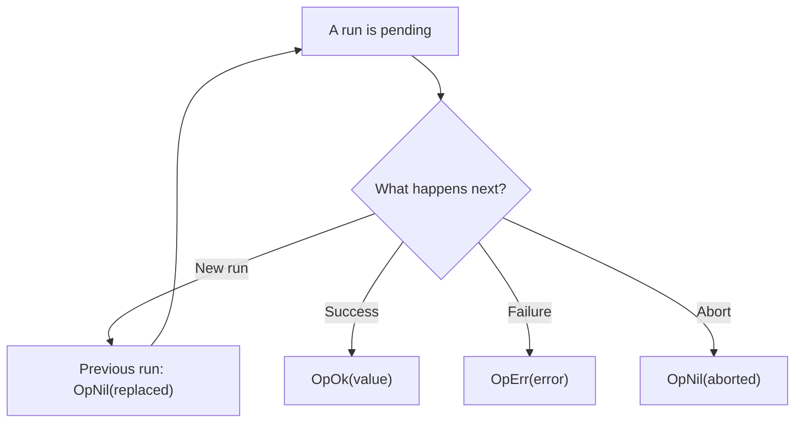

{/* BUNDLE_SIZE:START */}

> 6.05 kB minified + gzipped

{/* BUNDLE_SIZE:END */}

## Core Behavior

`Op<Args, E, A>` describes asynchronous work that takes arguments, can fail with an error `E`, and
returns a value `A`. `Op.interpret` creates a manager that runs the work and controls overlapping
calls.

- A manager exposes its current state, subscriptions, cancellation, and a `run` method.
- Each `run` returns an awaitable outcome: `OpOk`, `OpErr`, or `OpNil` with a reason.
- The chosen strategy decides whether overlapping calls replace, drop, queue, or run alongside one
  another. A manager can also apply a timeout and, for supported strategies, a retry policy.

## Example: Search Requests

When a user types a search query, an older response can arrive after a newer query. A `restartable`
manager replaces the earlier run, so its outcome cannot overwrite the latest state.

For a `restartable` manager, a new call settles the previous pending call as replaced and starts the
new one. The new call can then succeed, fail, or be aborted:



The previous run's signal is aborted when it is replaced. The underlying work stops only if it
responds to that signal; the manager ignores its eventual result either way.

### Managing Search Requests

This manager loads search results as text. It maps request errors to strings and uses
`restartable` so only the latest query can update the subscribed view:

```ts
import { Op, pipe } from "@pplnd/core";

const search = Op.make(
  (signal) => async (query: string) => {
    const response = await fetch(`/api/search?q=${encodeURIComponent(query)}`, { signal });
    if (!response.ok) throw new Error(`HTTP ${response.status}`);
    return response.text();
  },
  { onError: (error) => `Search request failed: ${String(error)}` },
);

const searches = Op.interpret(search, { strategy: "restartable" });

const unsubscribe = searches.subscribe((state) => {
  if (Op.is.pending(state)) console.log("Searching...");
  if (Op.Outcome.is.ok(state)) console.log(state.value);
  if (Op.Outcome.is.err(state)) console.error(state.error);
});

const previous = searches.run("pipe");
const current = searches.run("pipeline");

console.log(await previous); // OpNil with reason "replaced"
const message = pipe(
  await current,
  Op.Outcome.match({
    ok: (results) => results,
    err: (error) => error,
    nil: (reason) => `Search ${reason}`,
  }),
);
console.log(message);
unsubscribe();
```

`subscribe` reports manager state; awaiting each `run` reports that particular call's outcome.
These are different when a call is replaced: its caller receives `OpNil`, while the manager proceeds
with the newer call.

## Core Operations

### Creating and Running

| Signature                              | What it does                                                  | Return type or behavior                   |
| :------------------------------------- | :------------------------------------------------------------ | :---------------------------------------- |
| `Op.make(factory, { onError })`        | Defines work and maps thrown errors to a chosen type.         | `Op<Args, E, A>`                          |
| `Op.lift(factory)`                     | Defines work without mapping errors.                          | Error type is `unknown`.                  |
| `Op.interpret(op, options)`            | Creates a manager with a strategy and optional controls.      | An `Op` manager.                          |
| `manager.run(...args)`                 | Starts or schedules one invocation.                           | `Deferred` of that invocation's outcome. |
| `manager.state` / `subscribe(fn)`      | Reads state / observes changes.                               | `subscribe` returns an unsubscribe function. |
| `manager.abort()` / `reset()`          | Aborts active work / resets the manager.                      | Reset also aborts active work.            |
| `manager.poll({ interval })(...args)`  | Runs repeatedly on an interval.                               | Returns a function that stops polling.    |
| `Op.wire(manager, fn)`                 | Calls a function for successful manager states.               | Returns an unsubscribe function.          |

### Choosing a Strategy

| Strategy       | Behavior when calls overlap                                                    |
| :------------- | :----------------------------------------------------------------------------- |
| `restartable`  | Replaces the active call with the new call.                                    |
| `exclusive`    | Drops new calls while work is active.                                          |
| `once`         | Runs once until reset; later calls are dropped.                                 |
| `queue`        | Queues calls in order; supports capacity, concurrency, overflow, and deduplication options. |
| `buffered`     | Runs one call and keeps a bounded waiting buffer; older waiting calls can be evicted. |
| `debounced`    | Waits for a quiet period; newer waiting calls replace earlier ones.             |
| `throttled`    | Limits calls during a time window; optionally schedules a trailing call.     |
| `concurrent`   | Runs up to the configured limit; excess calls are queued or dropped.           |
| `keyed`        | Tracks independent runs per key, with `exclusive` or `restartable` per key.   |

`debounced` and `throttled` take a `duration`. `keyed` exposes a map of states and accepts an
optional key in `abort(key)`; calling `abort()` aborts all keys. Other strategies expose one manager
state. Check the strategy's options when configuring a retry, timeout, queue size, or rate limit.

### Reading and Transforming Outcomes

| Signature                                       | What it does                                                | Behavior                                  |
| :---------------------------------------------- | :---------------------------------------------------------- | :---------------------------------------- |
| `Op.is.idle/pending/queued/retrying/settled`    | Checks the manager state.                                   | Type guard.                               |
| `Op.Outcome.is.ok/err/nil`                      | Checks a settled outcome.                                   | Type guard.                               |
| `Op.Outcome.match(cases)`                       | Handles success, error, and nil.                            | Returns the selected handler result.      |
| `Op.Outcome.map(fn)` / `chain(fn)`              | Transforms or replaces a success value.                     | Error and nil pass through.               |
| `Op.Outcome.mapError(fn)` / `recover(fn)`      | Transforms or replaces an error.                            | Success and nil pass through.             |
| `Op.Outcome.tap(fn)` / `tapError(fn)`           | Observes success / error.                                   | Returns the original outcome.             |
| `Op.Outcome.getOrElse(fn)`                      | Reads a success value or uses a fallback.                   | Fallback handles both error and nil.      |
| `Op.Outcome.to.Result(onNil)` / `to.Maybe`      | Converts an outcome to `Result` or `Maybe`.                 | `to.Maybe` discards errors and nil reasons. |
| `Op.Outcome.from.Result(value)` / `from.Maybe(value)` | Creates an outcome from a container.                  | `None` becomes `OpNil`.                  |

## Failure Behavior and Edge Cases

`OpNil` is separate from an operation error. Its reason explains why that invocation did not
produce a result: `aborted`, `dropped`, `replaced`, or `evicted`. Handle it separately from
`OpErr`, especially if a dropped call should not be shown as a request failure.

`Op.make` maps errors thrown or rejected by its work using `onError`. A timeout returns an `OpErr`
from its configured `onTimeout`; aborting a run returns `OpNil`. Pass the supplied signal to work
that supports cancellation. Stopping a polling interval prevents future polling calls; use `abort`
separately if the active call should also stop.

If `onError`, a retry predicate, `onTimeout`, or a keyed strategy's key function throws, the
manager returns an `OpErr` containing `Op.Unexpected` and the original cause. An error mapper
exception does not enter the retry predicate.
