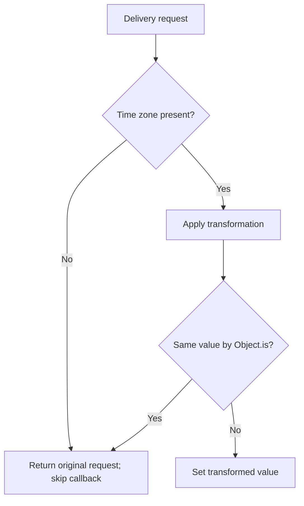

<!-- BUNDLE_SIZE:START -->

> 1.87 kB minified + gzipped

<!-- BUNDLE_SIZE:END -->

## Core Behavior

`Optional<S, A>` describes a path from a structure `S` to a value `A` that may be absent.

- `get` returns `Some(value)` when the path resolves and `None` when it does not.
- `modify` skips its callback and returns the original structure when the value is absent.
- `andThen` joins optional paths; `andThenLens` continues through a required path.

## Example: Delivery Schedule

A delivery request may have a schedule and the schedule may have a time zone. When the time zone is
present, the application can normalize it; otherwise it can display a default without changing the
request.

`modify` checks the focused value before calling the transformation:



### Reading and Normalizing the Time Zone

```ts
import { Optional, pipe } from "@pplnd/core";

type Schedule = { timeZone?: string };
type Delivery = { id: string; schedule?: Schedule };
const timeZone = pipe(
  Optional.from.property<Delivery>()("schedule"),
  Optional.andThen(Optional.from.property<Schedule>()("timeZone")),
);

const delivery: Delivery = { id: "delivery-7", schedule: { timeZone: " UTC " } };
const normalized = pipe(delivery, Optional.modify(timeZone)((zone) => zone.trim()));
const missing: Delivery = { id: "delivery-8" };

pipe(normalized, Optional.getOrElse(timeZone)(() => "Not scheduled")); // "UTC"
pipe(missing, Optional.getOrElse(timeZone)(() => "Not scheduled"));    // "Not scheduled"
```

## Core Operations

### Creating and Composing

| Signature                           | What it does                                | Result                            |
| :---------------------------------- | :------------------------------------------ | :-------------------------------- |
| `Optional.from.property<S>()(key)`  | Focuses on a nullable or optional property. | `Optional<S, NonNullable<S[K]>>`. |
| `Optional.from.index<A>(index)`     | Focuses on an array position.               | `Optional<readonly A[], A>`.      |
| `Optional.from.accessors(get, set)` | Creates a path from custom accessors.       | `Optional<S, A>`.                 |
| `Optional.andThen(inner)`           | Continues through another optional path.    | An optional path.                 |
| `Optional.andThenLens(inner)`       | Continues through a required lens.          | An optional path.                 |

### Reading and Updating

| Signature                            | What it does                         | Result                                                      |
| :----------------------------------- | :----------------------------------- | :---------------------------------------------------------- |
| `Optional.get(path)`                 | Reads the focus.                     | `Maybe<A>`.                                                 |
| `Optional.getOrElse(path)(fallback)` | Reads the focus or calls a fallback. | Focus or fallback value.                                    |
| `Optional.match(path)(cases)`        | Handles present and absent values.   | Selected handler's result.                                  |
| `Optional.set(path)(value)`          | Calls the path's setter.             | Updated or unchanged structure, depending on the path.      |
| `Optional.modify(path)(fn)`          | Transforms a present focus.          | Original structure when absent or unchanged by `Object.is`. |

## Failure Behavior and Edge Cases

`set` and `modify` differ for a missing property. A property setter can create that property, while
`modify` needs a present value before it calls its callback:

```ts
import { Optional, pipe } from "@pplnd/core";

type Schedule = { timeZone?: string };
const timeZone = Optional.from.property<Schedule>()("timeZone");
const schedule: Schedule = {};

pipe(schedule, Optional.set(timeZone)("UTC"));             // { timeZone: "UTC" }
pipe(schedule, Optional.modify(timeZone)((zone) => zone.trim())); // {}
```

A composed setter cannot proceed through an absent intermediate value. `Optional.from.index` accepts
only an integer between zero and the last index; an invalid index reads as `None` and its setter
returns the input array.
