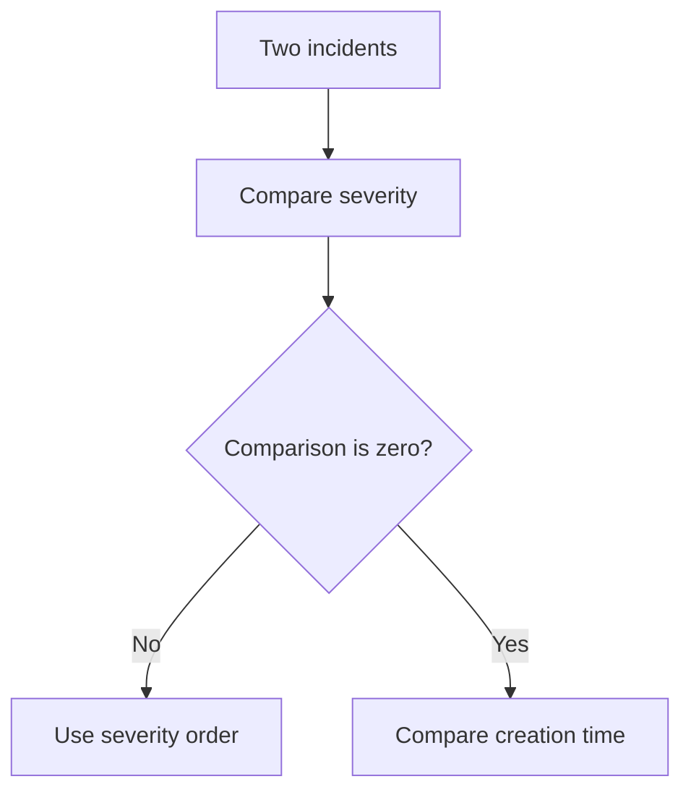

<!-- BUNDLE_SIZE:START -->

> 280 B minified + gzipped

<!-- BUNDLE_SIZE:END -->

## Core Behavior

`Ordering<A>` is a comparator: it returns a negative number when the first value comes before the
second, a positive number when it comes after, and zero when they compare equally.

- `by` adapts a comparator to a selected field.
- `thenBy` uses a second comparator only when the first returns zero.
- `reverse` swaps the comparison direction. Orderings can be passed to `Arr.sortWith` or native
  array sorting.

## Example: Incident Queue

An incident queue is sorted by severity, with earlier creation times breaking ties. Both decisions
belong in one comparator so the queue uses the same rules wherever it is displayed.

`thenBy` returns the first comparison when it is nonzero; otherwise it evaluates the tiebreaker:



### Sorting Incidents

```ts
import { Arr, Ordering, pipe } from "@pplnd/core";

type Incident = { id: string; severity: number; createdAt: number };
const bySeverity = pipe(Ordering.number, Ordering.reverse, Ordering.by((item: Incident) => item.severity));
const byCreatedAt = pipe(Ordering.number, Ordering.by((item: Incident) => item.createdAt));
const incidentOrder = pipe(bySeverity, Ordering.thenBy(byCreatedAt));

const incidents: readonly Incident[] = [
  { id: "INC-1", severity: 2, createdAt: 20 },
  { id: "INC-2", severity: 3, createdAt: 15 },
  { id: "INC-3", severity: 3, createdAt: 10 },
];
const ordered = pipe(incidents, Arr.sortWith(incidentOrder));
// Incident IDs: ["INC-3", "INC-2", "INC-1"]
```

## Core Operations

| Signature                             | What it does                                   | Result                                 |
| :------------------------------------ | :--------------------------------------------- | :------------------------------------- |
| `Ordering.string` / `number` / `date` | Compares strings, numbers, or date timestamps. | `Ordering<A>`.                         |
| `Ordering.by(select)`                 | Adapts a comparator to a selected value.       | A comparator for the original inputs.  |
| `Ordering.reverse(ordering)`          | Reverses a comparison.                         | A comparator.                          |
| `Ordering.thenBy(other)`              | Adds a tiebreaker.                             | Runs the next comparator only on zero. |
| `Ordering.byFields(orderings)`        | Combines comparators in array order.           | Uses the first nonzero result.         |
| `Ordering.tuple(...orderings)`        | Compares tuple positions in order.             | A tuple comparator.                    |

## Failure Behavior and Edge Cases

`Ordering.string` uses JavaScript's string comparisons, not locale-aware collation. Supply a custom
comparator when a locale's sorting rules matter. `Ordering.number` returns zero when comparisons
involving `NaN` are neither less than nor greater than each other; validate numeric sort keys if
that would make the ordering misleading.
