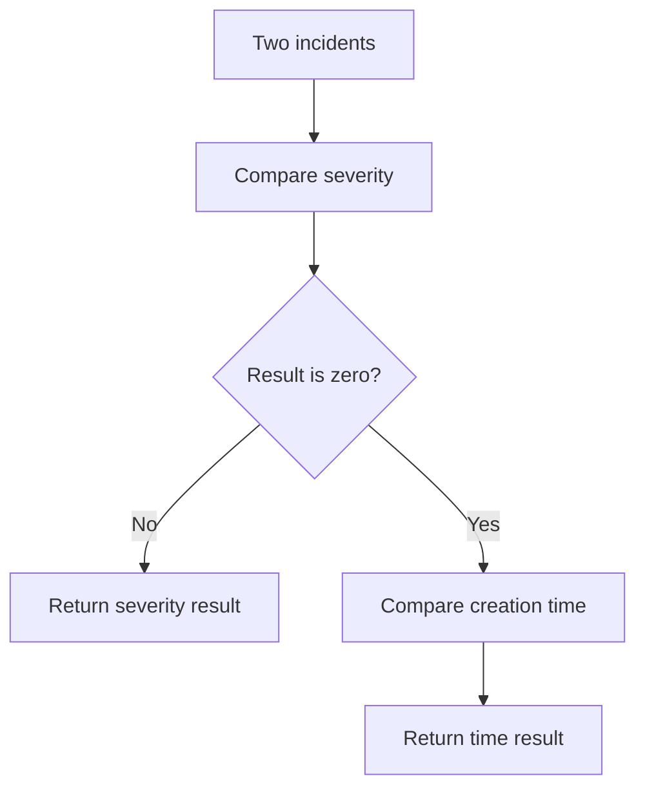

<!-- BUNDLE_SIZE:START -->

> 280 B minified + gzipped

<!-- BUNDLE_SIZE:END -->

An incident queue must show the most severe incidents first. Severity alone leaves ties in insertion
order, so two views of the same list can disagree after a retry or a page reload. Severity and
creation time have to participate in one comparison rule that every view reuses.

## Core Behavior

`Ordering<A>` is a comparator: it receives two values and returns a negative number when the first
should come before the second, a positive number when it should come after, and zero when the two
are equivalent.

- `by` lifts a comparator to a selected field; `reverse` flips the argument order.
- `thenBy` runs the second comparator only when the first returns zero; `byFields` checks an array
  of comparators in order and returns the first nonzero result.
- `tuple` compares positions with their comparators, then orders a shorter tuple before a longer
  one.
- `number` returns `-1`, `0`, or `1`; every `NaN` sorts after the valid numbers, and `date` applies
  the same rule to timestamps.

Reach for `Ordering` when values need an order. [`Equality`](/guides/equality/) answers only whether
two values match. The [choosing guide](/basics/choosing/) covers the comparison modules.

## Example: Incident Queue

An incident queue is sorted by severity, highest first, with earlier creation times breaking ties.
Both decisions live in one comparator so the queue is identical on every screen that renders it.

`thenBy` returns the severity result when it is nonzero; otherwise it evaluates the creation time:



### Sorting Incidents

```ts
import { Ordering, pipe } from "@pplnd/core";

type Incident = { id: string; severity: number; createdAt: number };

const bySeverity = pipe(
  Ordering.number,
  Ordering.reverse,
  Ordering.by((incident: Incident) => incident.severity),
);
const byCreatedAt = pipe(Ordering.number, Ordering.by((incident: Incident) => incident.createdAt));
const incidentOrder = pipe(bySeverity, Ordering.thenBy(byCreatedAt));

const incidents: readonly Incident[] = [
  { id: "INC-1", severity: 2, createdAt: 20 },
  { id: "INC-2", severity: 3, createdAt: 15 },
  { id: "INC-3", severity: 3, createdAt: 10 },
];

const ordered = [...incidents].sort(incidentOrder);
// Incident IDs: ["INC-3", "INC-2", "INC-1"]
```

Severity is reversed so larger numbers come first. Incidents with equal severity fall through to
`createdAt`, which orders the older incident first.

### Sorting the Queue with Array Helpers

`incidentOrder` is a plain `(first, second) => number` function, so the array helpers accept it
directly. `Arr.sortBy` returns a new array and leaves the source untouched:

```ts
import { Arr, pipe } from "@pplnd/core";

const ordered = pipe(incidents, Arr.sortBy(incidentOrder));
// ["INC-3", "INC-2", "INC-1"]
```

See [`Arr`](/guides/arr/) for sorting, grouping, and safe indexing.

## Core Operations

### Creating Comparators

| Signature         | What it does                                                      | Return type        |
| :---------------- | :---------------------------------------------------------------- | :----------------- |
| `Ordering.string` | Compares strings by UTF-16 code unit.                             | `Ordering<string>` |
| `Ordering.number` | Compares numbers and returns `-1`, `0`, or `1`; `NaN` sorts last. | `Ordering<number>` |
| `Ordering.date`   | Compares timestamps; invalid dates sort last.                     | `Ordering<Date>`   |

### Adapting and Combining

| Signature             | What it does                                                      | Return type                      |
| :-------------------- | :---------------------------------------------------------------- | :------------------------------- |
| `by(extract)`         | Lifts a comparator to a selected field; data-last.                | `Ordering<B>` from `Ordering<A>` |
| `reverse(ordering)`   | Swaps the argument order.                                         | Reversed comparator.             |
| `thenBy(other)`       | Runs `other` only when the first comparison returns zero.         | Composite comparator.            |
| `byFields(orderings)` | Returns the first nonzero result from an array of comparators.    | Composite comparator.            |
| `tuple(...orderings)` | Compares positions in order, then orders the shorter tuple first. | Tuple comparator.                |

## Failure Behavior and Edge Cases

`Ordering.string` compares UTF-16 code units with `<` and `>`, not locale collation. `"Z"` sorts
before `"a"`, and accented letters do not group with their base letters. Build a comparator on
`Intl.Collator` when locale rules matter.

`Ordering.number` sorts every `NaN` after the valid numbers and returns `0` for two `NaN` values;
[`Equality`](/guides/equality/) applies the same equivalence in its number rule. `Ordering.date`
treats an invalid date the same way. Because those pairs compare as `0`, their relative order
follows the sort's stability.

`thenBy` consults its tiebreaker only when the first result is `0`. `byFields([])` reports every
pair as equivalent. `tuple` compares positions up to the shorter of the comparator list and the
values, then orders the shorter tuple first.

`reverse` swaps the arguments instead of negating the result, so it reverses only a comparator that
orders its inputs consistently.
