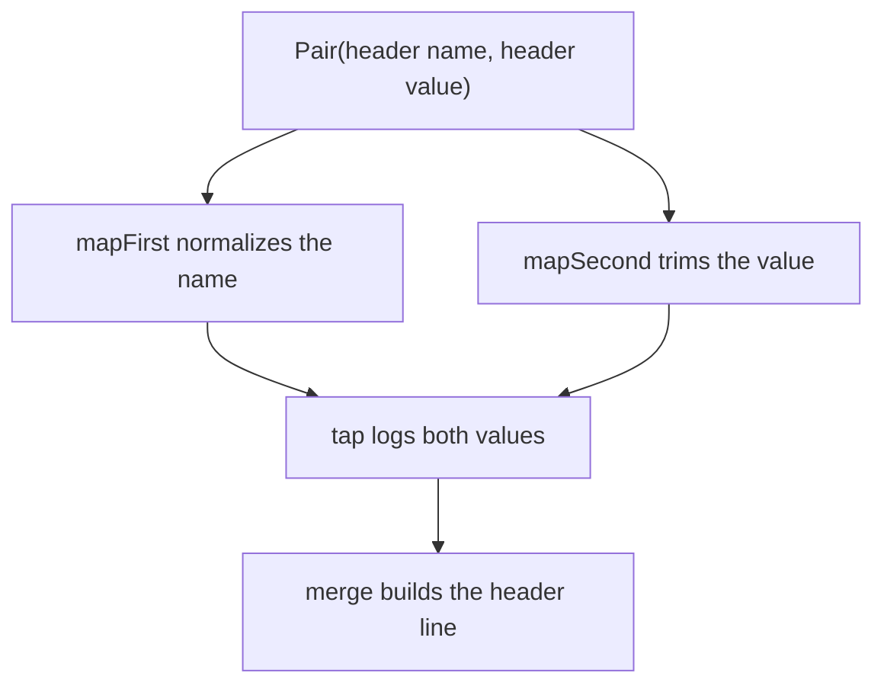

<!-- BUNDLE_SIZE:START -->

> 144 B minified + gzipped

<!-- BUNDLE_SIZE:END -->

A middleware normalizes an incoming header name, trims its value, and logs both before joining them
into one line. The two strings travel through every step together, and a function that returns them
as a bare array makes the positions easy to transpose without a type error.

## Core Behavior

`Pair<A, B>` is a readonly two-element tuple for two values that always travel together.

- Both positions are present; the first has type `A` and the second has type `B`.
- `mapFirst` and `mapSecond` replace one position and keep the other; `mapBoth` replaces both at
  once.
- `merge` folds both values into one result; `tap` observes both and returns the same tuple.
- `swap` reverses the positions and their types.

Reach for `Pair` when both values are always present and neither is a failure.
[`These`](/guides/these/) can hold one side alone and can attach a note to a value. The
[choosing guide](/basics/choosing/) compares the containers that add failure semantics.

## Example: Formatting a Rate-Limit Header

An HTTP middleware normalizes an incoming header before logging and forwarding it. The name and the
value pass through the same steps and are consumed together at the end.

Mapping changes one position at a time, and `merge` reads both:



### Normalizing the Header

```ts
import { Pair, pipe } from "@pplnd/core";

type Header = Pair<string, string | number>;

const normalizeHeader = (header: Header): Header =>
  pipe(
    header,
    Pair.mapFirst((name: string) => name.trim().toLowerCase()),
    Pair.mapSecond((value: string | number) => String(value).trim()),
  );

const formatHeader = (header: Header): string =>
  pipe(
    normalizeHeader(header),
    Pair.tap((name: string, value: string | number) => {
      console.debug("Normalized header", name, value);
    }),
    Pair.merge((name: string, value: string | number) => `${name}: ${value}`),
  );

formatHeader(Pair.make("  X-RateLimit-Remaining ", 42));
// "x-ratelimit-remaining: 42"
```

The pair type keeps the first position as the name and the second as the value while both are
transformed. `tap` logs the normalized values and returns the tuple it received, so `merge` reads
the same values that were logged.

### Handoff: A Header That Carries a Warning

Some headers are deprecated, and the formatted line needs a warning beside it. A `These` holds a
value, a note, or both, and converts back to a pair only when both sides are present:

```ts
import { These } from "@pplnd/core";

const deprecated = These.make.both("x-ratelimit-remaining: 42", "Header name is deprecated");
const missing = These.make.second("Header was not sent");

These.to.Pair(deprecated);
// Some(["x-ratelimit-remaining: 42", "Header name is deprecated"])
These.to.Pair(missing); // None
```

[`These`](/guides/these/) covers the operations that accumulate notes beside a value.

## Core Operations

### Creating Values

| Signature                  | What it does                        | Result       |
| :------------------------- | :---------------------------------- | :----------- |
| `Pair.make(first, second)` | Creates a tuple in the given order. | `Pair<A, B>` |

### Transforming Values

| Signature                         | What it does                         | Result                   |
| :-------------------------------- | :----------------------------------- | :----------------------- |
| `Pair.mapFirst(transform)`        | Transforms the first position.       | Keeps the second value   |
| `Pair.mapSecond(transform)`       | Transforms the second position.      | Keeps the first value    |
| `Pair.mapBoth(onFirst, onSecond)` | Transforms both positions.           | A new pair               |
| `Pair.swap(pair)`                 | Reverses the positions.              | `Pair<B, A>`             |
| `Pair.tap(sideEffect)`            | Calls the callback with both values. | The same tuple reference |

### Reading and Consuming

| Signature                                | What it does                         | Result                |
| :--------------------------------------- | :----------------------------------- | :-------------------- |
| `Pair.first(pair)` / `Pair.second(pair)` | Reads one position.                  | `A` / `B`             |
| `Pair.merge(transform)`                  | Calls the callback with both values. | The callback result   |
| `Pair.to.array(pair)`                    | Copies the tuple into an array.      | `readonly (A \| B)[]` |

## Failure Behavior and Edge Cases

`Pair` is a type for an existing tuple, not a runtime wrapper. `Pair.make` returns an array, and the
type is readonly; nothing freezes it, so a cast or an untyped alias can still mutate the two slots.

`mapFirst`, `mapSecond`, `mapBoth`, `swap`, and `Pair.make` return new tuples. `tap` returns the
tuple it received, which makes it suitable for logging in the middle of a pipeline and unsuitable
for changing the pair.

`Pair.to.array` copies the tuple into a new array and widens the element type to `A | B`, so
position information is lost after the conversion. `merge` has no failure path: it always calls the
callback with both values.

Any `readonly [A, B]` is accepted where `Pair<A, B>` is expected, including a tuple produced by
`Object.entries`. The type adds names and helpers, not a constructor check.
