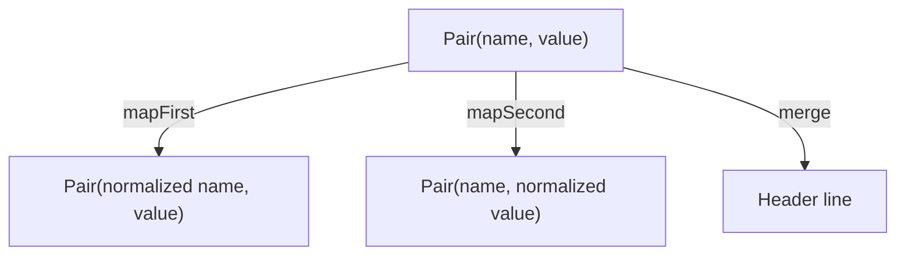

<!-- BUNDLE_SIZE:START -->

> 144 B minified + gzipped

<!-- BUNDLE_SIZE:END -->

## Core Behavior

`Pair<A, B>` is a readonly two-element tuple for values that travel together.

- Both positions are always present in the type; the first has type `A` and the second has type `B`.
- Mapping either position returns a new pair and leaves the other value in place.
- `merge` passes both values to a function and returns its result.

## Example: HTTP Header Formatting

For an HTTP header, manually rebuilding `[name, value]` at each step makes it easy to mix up the
positions or drop a transformation. `Pair.make(name, value)` gives those steps a common tuple type;
`Pair.mapFirst` and `Pair.mapSecond` address the positions separately.

Each operation receives the whole pair. Mapping changes only the selected position, while `merge`
uses both positions to produce a single result:



A pair is a `readonly [A, B]` tuple, so an existing two-element tuple can be passed directly to
these operations.

### Formatting a Header

This pipeline normalizes and logs the name and value, then formats them into a header line:

```ts
import { Pair, pipe } from "@pplnd/core";

const formatHeader = (header: Pair<string, string | number>): string =>
  pipe(
    header,
    Pair.mapFirst((name) => name.trim().toLowerCase()),
    Pair.mapSecond((value) => String(value).trim()),
    Pair.tap((name, value) => console.debug("Normalized header", name, value)),
    Pair.merge((name, value) => `${name}: ${value}`),
  );

const line = formatHeader(Pair.make("  X-RateLimit-Remaining ", 42));
// "x-ratelimit-remaining: 42"
```

## Core Operations

### Creating Values

| Signature                  | What it does                        | Return type  |
| :------------------------- | :---------------------------------- | :----------- |
| `Pair.make(first, second)` | Creates a tuple in the given order. | `Pair<A, B>` |

### Transforming Values

| Signature                         | What it does                    | Guarantee                  |
| :-------------------------------- | :------------------------------ | :------------------------- |
| `Pair.mapFirst(fn)`               | Transforms the first position.  | Keeps the second value.    |
| `Pair.mapSecond(fn)`              | Transforms the second position. | Keeps the first value.     |
| `Pair.mapBoth(onFirst, onSecond)` | Transforms both positions.      | Returns a new pair.        |
| `Pair.swap(pair)`                 | Reverses the positions.         | Returns `Pair<B, A>`.      |
| `Pair.tap(fn)`                    | Calls `fn(first, second)`.      | Returns the original pair. |

### Reading and Converting

| Signature                                | What it does                    | Return type           |
| :--------------------------------------- | :------------------------------ | :-------------------- |
| `Pair.first(pair)` / `Pair.second(pair)` | Reads one position.             | `A` / `B`             |
| `Pair.merge(fn)`                         | Calls `fn(first, second)`.      | The callback result.  |
| `Pair.to.array(pair)`                    | Copies the tuple into an array. | `readonly (A \| B)[]` |

## Failure Behavior and Edge Cases

Mapping and swapping return a new tuple; `tap` returns the original reference.
