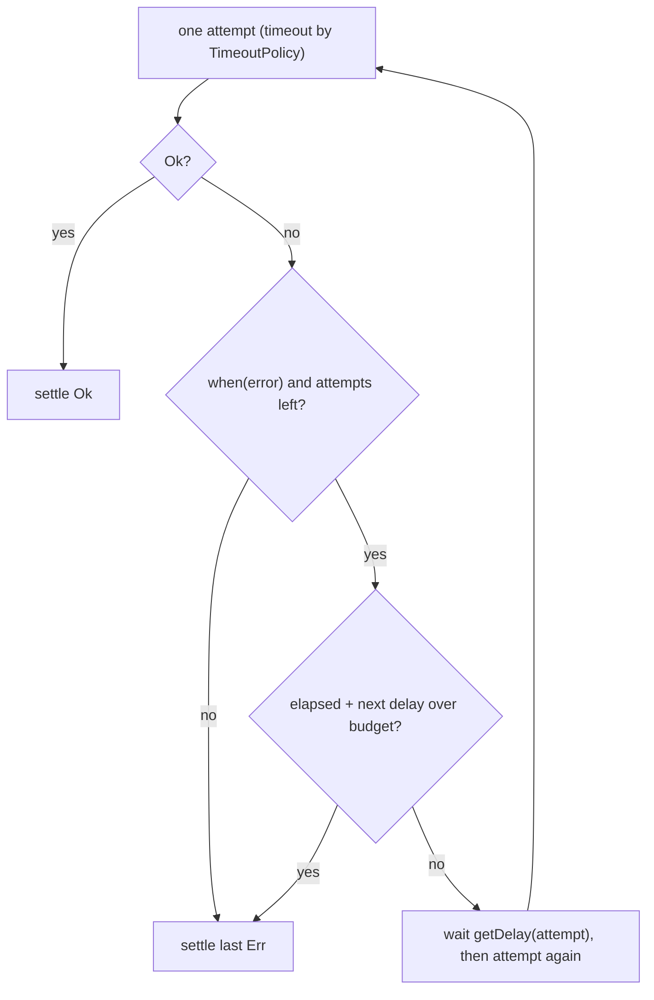

A pricing job syncs a third-party feed every few minutes. The first hand-written version tracks a
`Date.now()` timestamp to answer "one more retry?", wraps each attempt in an unguarded `setTimeout`,
and loops with `setInterval`. The deadline math drifts whenever an attempt runs long, the interval
fires while the previous sync is still running, and a failed run either stops the job silently or
retries forever. Every site that copies this pattern re-solves the same three questions with
slightly different answers.

## Core Behavior

The library models those three questions as immutable policy data, and the engines own the clock:

- **`TimeoutPolicy`** bounds one attempt. `TimeoutPolicy.after({ duration, onTimeout })` settles the
  attempt with the error `onTimeout` produces when the duration elapses.
- **`RetryPolicy`** governs a retry sequence. `constant` and `exponential` erase the backoff
  strategy into `getDelay`, `attempts` caps the sequence, `when` filters retriable errors, and
  `budget` caps the whole sequence in wall-clock time.
- **`RepeatPolicy`** governs a lifetime that continues past success. `spacing` waits `every` after
  each settled attempt; `cadence` aligns attempt starts to fixed multiples of `every` from the
  lifetime's start.

Policies are plain objects, so annotate them once and every consumer is checked against them. The
factories exist so behavior stays erasable: `RetryPolicy.exponential` computes `getDelay` from
`initial`, `factor`, `jitter`, and `maxDelay`, and the engine calls that function with the attempt
number. Engines never guess at intent — `Task.Result.timeout` arms one timer per attempt, `retry`
checks the budget before arming each backoff, and `Supervisor` schedules the next attempt only after
the current one settles. Consumers: [`Task.Result.retry`](/guides/task/),
[`Task.Result.timeout`](/guides/task/), every `Op` strategy's `timeout` option ([Op](/guides/op/)),
and [`Supervisor`](/guides/supervisor/) with `restart` and `repeat`.

The values are made of [`Duration`](/guides/duration/), which handles unit-safe spans. The
[choosing guide](/basics/choosing/) places the policies beside the engines that consume them.

## Example: Price Feed Sync

The sync fetches a price feed, retries transient failures with backoff, gives up within a fixed
budget so the cached price can serve, and repeats on a cadence. One attempt either succeeds, times
out, or fails; the retry sequence continues only while the error is retriable and the budget has
room:



### The Attempt and the Sequence

```ts
import { Duration, RetryPolicy, TimeoutPolicy, Task } from "@pplnd/core";

type FeedError = "feed_unavailable" | "deadline" | "aborted";

const fetchFeed = (): Task.Result<FeedError, PriceFeed> =>
  Task.Result.tryCatch((innerSignal) => fetchPrices(innerSignal), {
    onError: () => "feed_unavailable" as const,
  });

// one attempt: bounded runtime, always the first thing that runs
const fetchOne = Task.Result.timeout(
  TimeoutPolicy.after({ duration: Duration.seconds(10), onTimeout: () => "deadline" as const }),
)(fetchFeed);

// the sequence: backoff with jitter, retriable errors only, 2s wall-clock budget
const feedPolicy: RetryPolicy<FeedError> = RetryPolicy.exponential({
  attempts: 20,
  initial: Duration.milliseconds(200),
  jitter: true,
  when: (error) => error !== "deadline",
  budget: Duration.seconds(2),
});

const loadFeed = Task.Result.retry(feedPolicy)(fetchOne);
```

`budget` and the per-attempt `TimeoutPolicy` compose rather than compete: the timeout bounds one
fetch, the budget bounds the whole sequence. The first attempt always runs even when the budget is
already spent, and a budget-exhausted sequence settles with the last error without reporting a
phantom upcoming delay.

### Repeating on a Cadence

The sync runs forever, so the lifetime belongs to [`Supervisor`](/guides/supervisor/):

```ts
import { Duration, RepeatPolicy, Supervisor } from "@pplnd/core";

const sync = Supervisor.make(loadFeed, {
  restart: feedPolicy,
  repeat: RepeatPolicy.cadence({ every: Duration.minutes(5), jitter: true }),
});

const lifetime = sync.run();
process.on("SIGTERM", () => sync.abort());
```

`spacing` waits `every` after each settled attempt, so attempts can never overlap; `cadence` keeps
attempt starts on fixed multiples of `every`, and a tick missed during a long attempt fires once
immediately instead of catching up in a burst. A success resets the restart counter, so an
occasional failure does not exhaust `attempts` over a long lifetime.

## Core Operations

### Describing Deadlines

| Signature                                      | What it does                  | Behavior                                                   |
| :--------------------------------------------- | :---------------------------- | :--------------------------------------------------------- |
| `TimeoutPolicy.after({ duration, onTimeout })` | Bounds one attempt's runtime. | The engine arms the timer; `onTimeout` supplies the error. |

### Describing Retry

| Signature                                             | What it does                           | Behavior                                                 |
| :---------------------------------------------------- | :------------------------------------- | :------------------------------------------------------- |
| `RetryPolicy.constant({ attempts, delay, ... })`      | Fixed delay between attempts.          | Non-positive-integer `attempts` means one attempt.       |
| `RetryPolicy.exponential({ attempts, initial, ... })` | Backoff that grows by `factor`.        | `maxDelay` caps each delay; `jitter` randomizes it.      |
| `policy.getDelay(attempt)`                            | The delay before the next attempt.     | Called by the engine before arming each backoff.         |
| `policy.when`, `policy.onRetry`                       | Retry filter and telemetry.            | `onRetry` fires only when a retry is actually scheduled. |
| `policy.budget`                                       | Wall-clock cap for the whole sequence. | Exhausted sequences settle with the last error.          |

### Describing Repetition

| Signature                                  | What it does                                  | Behavior                                                         |
| :----------------------------------------- | :-------------------------------------------- | :--------------------------------------------------------------- |
| `RepeatPolicy.spacing({ every, jitter? })` | Waits `every` after each settled attempt.     | No overlap; jitter spreads delays across `[every × 0.5, every)`. |
| `RepeatPolicy.cadence({ every, jitter? })` | Aligns attempts to grid multiples of `every`. | A missed tick fires once immediately; jitter offsets the grid.   |

## Failure Behavior and Edge Cases

The three policies answer different questions and do not substitute for each other. A per-attempt
timeout does not bound a retry sequence, a budget does not bound one slow attempt, and neither makes
an engine repeat on success. Compose them: `timeout` per attempt, `budget` across attempts, `repeat`
across successes.

`budget` is a non-negative duration; a negative value clamps to zero, which allows the first attempt
and nothing else. `attempts` counts the first attempt, so `1` means no retry. `when` decides whether
an error is retryable — the budget decides whether there is time.

`RepeatPolicy.spacing` cannot overlap attempts because the delay starts only after the current one
settles, so the effective interval is at least `every`. `RepeatPolicy.cadence` anchors the grid to
the lifetime's start and applies `jitter` as a fixed random phase per policy instance. Aborting a
[`Supervisor`](/guides/supervisor/) lifetime clears the armed repeat timer immediately — see
[Aborted](/guides/aborted/) for cooperative cancellation inside the attempt itself.
